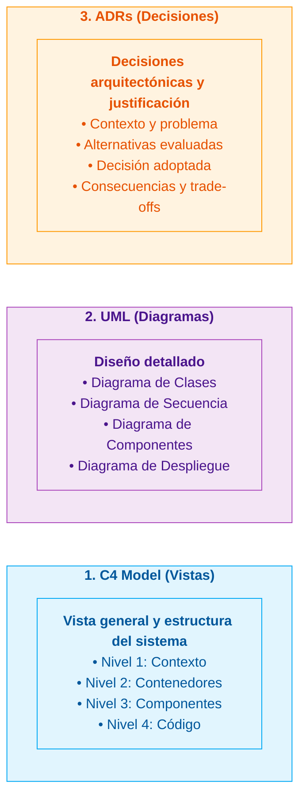

# Plataforma Integrada de Reservas y Gestión de Transporte Interprovincial

## 1. Descripción del Proyecto

Proyecto académico orientado al análisis, diseño y documentación formal de la arquitectura de una **Plataforma Integrada de Reservas y Gestión de Transporte Interprovincial** en la región de Ayacucho y sus rutas interregionales.

La plataforma centraliza la oferta de servicios de múltiples empresas y agencias de transporte, permitiendo a los pasajeros consultar rutas, horarios, tarifas y disponibilidad de cupos o asientos en tiempo real, adquiriendo pasajes de manera digital, segura y sin fricciones.

La arquitectura aborda escenarios críticos de alta demanda (Semana Santa, Fiestas Patrias, festividades regionales) garantizando la **consistencia absoluta de las reservas (cero sobreventa)**, el aislamiento seguro de información entre empresas competidoras y la alta mantenibilidad mediante un **Monolito Modular con Clean Architecture**.

* **Caso de estudio:** Plataforma integrada de reservas y gestión de transporte interprovincial en Ayacucho.
* **Curso:** Arquitectura de Software — IS-488.
* **Semestre:** 2026-II.

---

## 2. Estructura y Navegación de la Documentación

A continuación se detalla la organización de los artefactos técnicos y su correspondencia dentro del repositorio:

| Etapa del Proceso | Propósito | Documento en el Repositorio | Conceptos Clave Implementados |
|---|---|---|---|
| **Necesidad del Negocio** | Definición del problema y contexto | [`00-necesidad-del-negocio.md`](docs/01-analisis-de-sistema/00-necesidad-del-negocio.md) | Problemática del transporte en Ayacucho, centralización de oferta, reducción de sobreventas. |
| **Requisitos y Restricciones** | Alcance funcional y limitaciones | [`01-actores.md`](docs/01-analisis-de-sistema/01-actores.md) [`02-historias-de-usuario.md`](docs/01-analisis-de-sistema/02-historias-de-usuario.md) [`03-requisitos-funcionales.md`](docs/01-analisis-de-sistema/03-requisitos-funcionales.md) [`05-restricciones.md`](docs/01-analisis-de-sistema/05-restricciones.md) | 4 Actores humanos, 2 integraciones externas (Culqi y WhatsApp), HU01–HU44, RF01–RF48, Restricciones RC01–RC15. |
| **Atributos de Calidad** | Requerimientos no funcionales y escenarios | [`04-atributos-de-calidad.md`](docs/01-analisis-de-sistema/04-atributos-de-calidad.md) [`08-escenarios-atributos-calidad.md`](docs/01-analisis-de-sistema/08-escenarios-atributos-calidad.md) | AC01 a AC10 (Rendimiento, Escalabilidad, Concurrencia, Seguridad, etc.) con escenarios medibles EQ-01 a EQ-10. |
| **Drivers Arquitectónicos** | Factores de mayor impacto técnico | [`06-drivers-arquitectonicos.md`](docs/01-analisis-de-sistema/06-drivers-arquitectonicos.md) | DA01 a DA14 priorizados (concurrencia, prevención de sobreventa, aislamiento multiempresa, reserva temporal). |
| **Decisiones Arquitectónicas** | Registro y justificación técnica | [`07-decisiones-arquitectonicas.md`](docs/01-analisis-de-sistema/07-decisiones-arquitectonicas.md) | DA-01 a DA-15 formalizados (Monolito modular, Clean Architecture, PostgreSQL, Redis, RabbitMQ, Culqi, WhatsApp). |
| **Estilo Arquitectónico** | Estructuración global del backend | [`estilo-arquitectonico.md`](docs/02-arquitectura-software/estilo-arquitectonico.md) [`arquitectura-inicial.md`](docs/02-arquitectura-software/arquitectura-inicial.md) | Arquitectura en capas + Monolito modular. Organización lógica en capas con unidad de despliegue unificada. |
| **Enfoque Arquitectónico** | Organización interna del código | [`enfoque-arquitectonico.md`](docs/02-arquitectura-software/enfoque-arquitectonico.md) | Clean Architecture por módulo (Dominio, Aplicación, Infraestructura, Presentación) y regla de dependencias. |
| **Tácticas Arquitectónicas** | Técnicas concretas para atributos de calidad | [`tacticas-arquitectonicas.md`](docs/02-arquitectura-software/tacticas-arquitectonicas.md) | Caché (Redis), Colas (RabbitMQ), Bloqueo pesimista (`SELECT FOR UPDATE`), Rate Limiting, Adapter, Replicación. |
| **Diseño de Componentes** | Módulos del sistema y relaciones | [`componentes-arquitectonicos.md`](docs/02-arquitectura-software/componentes-arquitectonicos.md) [`Nivel3-Diagrama-de-Componentes.md`](docs/04-modelo-c4/Nivel3-Diagrama-de-Componentes.md) | 7 Módulos de negocio (MI01 a MI07) delimitados con contratos públicos de comunicación. |
| **Diseño Interno (Código)** | Principios SOLID y patrones de diseño | [`principios-de-diseño.md`](docs/03-diseño-de-software/diseño-interno/principios-de-diseño.md) [`patrones-de-diseño.md`](docs/03-diseño-de-software/diseño-interno/patrones-de-diseño.md) [`diseño-interno-de-modulos.md`](docs/03-diseño-de-software/diseño-interno/diseño-interno-de-modulos.md) [`Nivel4-DiagramadeCodigo.md`](docs/04-modelo-c4/Nivel4-DiagramadeCodigo.md) | SOLID, Patrones GoF (Repository, Strategy, Adapter, Factory), casos de uso y agregados en C# (.NET 8). |
| **Tecnologías y Despliegue** | Herramientas y modelo operativo | [`tecnologias-y-despliegue.md`](docs/02-arquitectura-software/tecnologias-y-despliegue.md) | React 18, TypeScript, ASP.NET Core 8, PostgreSQL 16, Redis, RabbitMQ, Nginx, Docker y CI/CD con GitHub Actions. |
| **Modelo C4** | Vistas jerárquicas de arquitectura | [`04-modelo-c4/`](docs/04-modelo-c4/) (Niveles 1 a 4) | Nivel 1 (Contexto), Nivel 2 (Contenedores), Nivel 3 (Componentes) y Nivel 4 (Código y Secuencia). |

---

## 3. Modelo de Representación y Documentación

El sistema utiliza tres instrumentos complementarios para comunicar y documentar la arquitectura:

