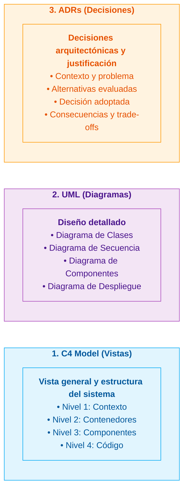

# Plataforma Integrada de Reservas y Gestión de Transporte Interprovincial

## 1. Descripción del Proyecto

Proyecto académico orientado al análisis, diseño y documentación formal de la arquitectura de una **Plataforma Integrada de Reservas y Gestión de Transporte Interprovincial** en la región de Ayacucho y sus rutas interregionales.

La plataforma centraliza la oferta de servicios de múltiples empresas y agencias de transporte, permitiendo a los pasajeros consultar rutas, horarios, tarifas y disponibilidad de cupos o asientos en tiempo real, adquiriendo pasajes y gestionando envíos de encomiendas de manera digital, segura y sin fricciones.

La arquitectura aborda escenarios críticos de alta demanda (Semana Santa, Fiestas Patrias, festividades regionales) garantizando la **consistencia absoluta de las reservas (cero sobreventa o overbooking)**, el aislamiento seguro de información entre empresas competidoras y la alta mantenibilidad mediante un **Monolito Modular con Clean Architecture**.

* **Caso de estudio:** Plataforma integrada de reservas y gestión de transporte interprovincial en Ayacucho.
* **Curso:** Arquitectura de Software — IS-488.
* **Semestre:** 2026-II.

---

## 2. Alineación con la Metodología Docente (13 Pasos de Arquitectura)

El repositorio implementa de forma rigurosa la metodología integral de 13 pasos para el diseño de arquitectura de software impartida por la docente de la cátedra:

```mermaid
flowchart TD
    P1["1. Necesidad del Negocio<br/><i>¿Qué problema resolvemos?</i>"] --> P2["2. Requisitos y Restricciones<br/><i>RF, RNF y Restricciones (R)</i>"]
    P2 --> P3["3. Atributos de Calidad<br/><i>Características importantes</i>"]
    P3 --> P4["4. Drivers Arquitectónicos<br/><i>RF + RNF + R con alto impacto</i>"]
    P4 --> P5["5. Decisiones Arquitectónicas<br/><i>Estrategia documentada en ADRs</i>"]
    P5 --> P6["6. Estilo Arquitectónico<br/><i>Monolito modular en capas</i>"]
    P6 --> P7["7. Enfoque Arquitectónico<br/><i>Clean Architecture por módulo</i>"]
    P7 --> P8["8. Tácticas Arquitectónicas<br/><i>Caché, Rate Limiting, Bloqueo, etc.</i>"]
    P8 --> P9["9. Diseño de Componentes<br/><i>8 Módulos de negocio delimitados</i>"]
    P9 --> P10["10. Diseño Interno (Código)<br/><i>SOLID, GoF, Casos de uso</i>"]
    P10 --> P11["11. Tecnologías<br/><i>React, ASP.NET Core, PostgreSQL</i>"]
    P11 --> P12["12. Implementación y Despliegue<br/><i>Docker, CI/CD GitHub Actions</i>"]
    P12 --> P13["13. Documentación y Representación<br/><i>C4 Model, UML y ADRs</i>"]

    classDef f1 fill:#FFCDD2,stroke:#E53935,color:#B71C1C
    classDef f2 fill:#FFF9C4,stroke:#FBC02D,color:#F57F17
    classDef f3 fill:#C8E6C9,stroke:#43A047,color:#1B5E20
    classDef f4 fill:#BBDEFB,stroke:#1E88E5,color:#0D47A1
    class P1,P2,P3 f1
    class P4,P5,P6 f2
    class P7,P8,P9 f3
    class P10,P11,P12,P13 f4
```

---

## 3. Matriz de Navegación y Trazabilidad de Documentos

A continuación se detalla la correspondencia exacta entre cada paso de la guía de la docente y los artefactos técnicos del repositorio:

| Paso Metodológico | Pregunta Clave / Propósito | Documento en el Repositorio | Conceptos Clave Implementados |
|---|---|---|---|
| **Paso 1: Necesidad del Negocio** | ¿Qué problema queremos resolver? | [`00-necesidad-del-negocio.md`](file:///c:/Users/USER/Documents/transporte-interprovincial-arquitectura/docs/01-analisis-de-sistema/00-necesidad-del-negocio.md) | Problemática del transporte en Ayacucho, objetivos de negocio (OBJ01–OBJ05), reducción de sobreventas, venta 24/7. |
| **Paso 2: Requisitos y Restricciones** | ¿Qué debe hacer el sistema y qué limitaciones existen? | [`01-actores.md`](file:///c:/Users/USER/Documents/transporte-interprovincial-arquitectura/docs/01-analisis-de-sistema/01-actores.md) [`02-historias-de-usuario.md`](file:///c:/Users/USER/Documents/transporte-interprovincial-arquitectura/docs/01-analisis-de-sistema/02-historias-de-usuario.md) [`03-requisitos-funcionales.md`](file:///c:/Users/USER/Documents/transporte-interprovincial-arquitectura/docs/01-analisis-de-sistema/03-requisitos-funcionales.md) [`05-restricciones.md`](file:///c:/Users/USER/Documents/transporte-interprovincial-arquitectura/docs/01-analisis-de-sistema/05-restricciones.md) | 4 Actores humanos, 2 sistemas externos, HU01–HU24, RF01–RF48, RN01–RN16, Restricciones R01–R10 (PostgreSQL, Docker, Ley 29733). |
| **Paso 3: Atributos de Calidad** | ¿Qué características de calidad debe tener? | [`04-atributos-de-calidad.md`](file:///c:/Users/USER/Documents/transporte-interprovincial-arquitectura/docs/01-analisis-de-sistema/04-atributos-de-calidad.md) [`08-escenarios-atributos-calidad.md`](file:///c:/Users/USER/Documents/transporte-interprovincial-arquitectura/docs/01-analisis-de-sistema/08-escenarios-atributos-calidad.md) | AC01 a AC09 (Consistencia, Seguridad, Rendimiento, Disponibilidad, etc.) con escenarios medibles EC01 a EC08 (estímulo, respuesta, métrica). |
| **Paso 4: Drivers Arquitectónicos** | ¿Qué condiciona las decisiones de arquitectura? | [`06-drivers-arquitectonicos.md`](file:///c:/Users/USER/Documents/transporte-interprovincial-arquitectura/docs/01-analisis-de-sistema/06-drivers-arquitectonicos.md) | $\textbf{Driver} = \textbf{RF} + \textbf{RNF} + \textbf{R}$. DA01 a DA08 priorizados (Consistencia de reservas, aislamiento multiempresa, picos de carga). |
| **Paso 5: Decisiones Arquitectónicas** | ¿Cómo responderemos a los drivers? | [`07-decisiones-arquitectonicas.md`](file:///c:/Users/USER/Documents/transporte-interprovincial-arquitectura/docs/01-analisis-de-sistema/07-decisiones-arquitectonicas.md) | Estructura formal de ADR (Contexto, Alternativas, Decisión y Consecuencias) para ADR01 a ADR08. |
| **Paso 6: Estilo Arquitectónico** | ¿Cómo estructuramos globalmente el sistema? | [`estilo-arquitectonico.md`](file:///c:/Users/USER/Documents/transporte-interprovincial-arquitectura/docs/02-arquitectura-software/estilo-arquitectonico.md) [`arquitectura-inicial.md`](file:///c:/Users/USER/Documents/transporte-interprovincial-arquitectura/docs/02-arquitectura-software/arquitectura-inicial.md) | Arquitectura en capas + Monolito modular. Capas = organización lógica; Monolito = unidad de despliegue. No son microservicios. |
| **Paso 7: Patrones / Enfoques Arquitectónicos** | ¿Qué estructuras reutilizables usamos? | [`enfoque-arquitectonico.md`](file:///c:/Users/USER/Documents/transporte-interprovincial-arquitectura/docs/02-arquitectura-software/enfoque-arquitectonico.md) | Clean Architecture (Dominio, Aplicación, Adaptadores, Infraestructura). Regla de dependencias hacia el núcleo. |
| **Paso 8: Tácticas Arquitectónicas** | ¿Cómo cumplimos los atributos de calidad? | [`tacticas-arquitectonicas.md`](file:///c:/Users/USER/Documents/transporte-interprovincial-arquitectura/docs/02-arquitectura-software/tacticas-arquitectonicas.md) | Caché, Rate Limiting, Retry/Circuit Breaker, Replicación, Bloqueo pesimista (`SELECT FOR UPDATE`), Procesamiento asíncrono. |
| **Paso 9: Diseño de Componentes** | ¿Qué componentes existen y cómo se relacionan? | [`componentes-arquitectonicos.md`](file:///c:/Users/USER/Documents/transporte-interprovincial-arquitectura/docs/02-arquitectura-software/componentes-arquitectonicos.md) [`Nivel3-Diagrama-de-Componentes.md`](file:///c:/Users/USER/Documents/transporte-interprovincial-arquitectura/docs/04-modelo-c4/Nivel3-Diagrama-de-Componentes.md) | 8 Módulos de negocio (MI01 a MI08) delimitados dentro del monolito con contratos públicos de comunicación. |
| **Paso 10: Diseño Interno (Código)** | Uso de SOLID y patrones para código mantenible | [`principios-de-diseño.md`](file:///c:/Users/USER/Documents/transporte-interprovincial-arquitectura/docs/03-diseño-de-software/diseño-interno/principios-de-diseño.md) [`patrones-de-diseño.md`](file:///c:/Users/USER/Documents/transporte-interprovincial-arquitectura/docs/03-diseño-de-software/diseño-interno/patrones-de-diseño.md) [`diseño-interno-de-modulos.md`](file:///c:/Users/USER/Documents/transporte-interprovincial-arquitectura/docs/03-diseño-de-software/diseño-interno/diseño-interno-de-modulos.md) [`Nivel4-DiagramadeCodigo.md`](file:///c:/Users/USER/Documents/transporte-interprovincial-arquitectura/docs/04-modelo-c4/Nivel4-DiagramadeCodigo.md) | Principios SOLID (S, O, L, I, D), Patrones GoF (Repository, Strategy, Adapter, Factory), casos de uso y agregados en C# (.NET 8). |
| **Paso 11: Tecnologías** | ¿Qué herramientas y tecnologías usaremos? | [`tecnologias-y-despliegue.md`](file:///c:/Users/USER/Documents/transporte-interprovincial-arquitectura/docs/02-arquitectura-software/tecnologias-y-despliegue.md) | React 18+, TypeScript, ASP.NET Core 8+, PostgreSQL 16+, Docker, Nginx. *"La tecnología implementa decisiones: no define por sí sola la arquitectura."* |
| **Paso 12: Implementación y Despliegue** | Desarrollo, despliegue y operación | [`tecnologias-y-despliegue.md`](file:///c:/Users/USER/Documents/transporte-interprovincial-arquitectura/docs/02-arquitectura-software/tecnologias-y-despliegue.md) | Monolito modular contenedorizado en Docker, Pipeline CI/CD con GitHub Actions y monitoreo con Serilog. |
| **Paso 13: Documentación y Representación** | ¿Cómo comunicamos y documentamos la arquitectura? | [`04-modelo-c4/`](file:///c:/Users/USER/Documents/transporte-interprovincial-arquitectura/docs/04-modelo-c4/) (Niveles 1 a 4) `07-decisiones-arquitectonicas.md` Diagramas UML | **C4 Model** (estructura general de macro a micro), **UML** (diseño detallado de interacción y clases) y **ADRs** (justificación de decisiones). |

---

## 4. Los Tres Pilares de Representación y Documentación (Paso 13)

La metodología enseña que un sistema de software no se documenta con un único tipo de diagrama, sino mediante tres instrumentos complementarios con propósitos diferenciados:

