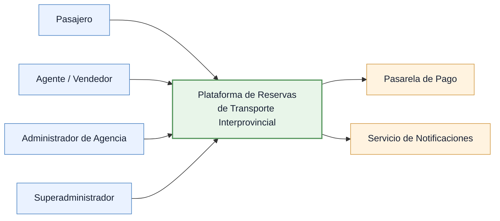

# Identificación de Actores del Sistema

## 1. Descripción

La Plataforma Integrada de Reservas y Gestión de Transporte Interprovincial tiene como propósito centralizar la consulta de servicios y la gestión de reservas de pasajes ofrecidos por diferentes empresas de transporte y sus agencias.

La plataforma contempla actores humanos con responsabilidades diferenciadas y sistemas externos que intervienen en determinados procesos.

La identificación de actores constituye la base para elaborar las historias de usuario, los requisitos funcionales y las reglas de acceso.

---

## 2. Actores principales

| ID | Actor | Descripción | Ámbito de actuación |
|---|---|---|---|
| ACT01 | Pasajero | Usuario que consulta servicios de transporte y realiza o gestiona reservas. | Personal |
| ACT02 | Agente / Vendedor | Personal autorizado para registrar ventas y gestionar reservas. | Agencia asignada |
| ACT03 | Administrador de Agencia | Responsable de administrar las operaciones y el personal de una agencia. | Agencia(s) autorizada(s) |
| ACT04 | Superadministrador | Responsable de la administración general de la plataforma. | Plataforma |

### ACT01 — Pasajero

**Descripción:** Persona que utiliza la plataforma para buscar servicios de transporte interprovincial y reservar pasajes.

**Responsabilidades:**
- Consultar rutas, horarios y tarifas.
- Consultar disponibilidad de asientos.
- Registrar y consultar sus reservas.
- Realizar pagos mediante los medios habilitados.
- Solicitar cancelaciones o reprogramaciones según las condiciones aplicables.
- Consultar el estado de sus operaciones.

**Restricción de acceso:** Solo puede gestionar sus propias reservas e información personal.

### ACT02 — Agente / Vendedor

**Descripción:** Personal autorizado de una agencia de transporte encargado de atender operaciones de venta y reserva de pasajes.

**Responsabilidades:**
- Consultar servicios y disponibilidad.
- Registrar reservas y ventas para pasajeros.
- Consultar el estado de las reservas.
- Gestionar operaciones permitidas por sus permisos.
- Consultar información operativa correspondiente a su agencia.

**Restricción de acceso:** Sus operaciones se limitan a las agencias y funciones autorizadas.

### ACT03 — Administrador de Agencia

**Descripción:** Usuario responsable de la administración operativa de una empresa de transporte y sus agencias autorizadas.

**Responsabilidades:**
- Gestionar la información operativa de la empresa.
- Administrar las agencias asignadas.
- Gestionar rutas y destinos.
- Registrar y administrar unidades de transporte.
- Configurar horarios, tarifas y servicios programados.
- Gestionar agentes y vendedores.
- Supervisar ventas, reservas, cancelaciones y reprogramaciones.
- Consultar reportes operativos y comerciales.
- Administrar los permisos correspondientes a su ámbito.

**Restricción de acceso:** Solo puede administrar la información de la empresa y las agencias que tenga autorizadas. No puede acceder a datos de otras empresas.

**Nota:** Este rol concentra la administración empresarial y de agencias. No se contempla un rol adicional denominado Administrador de Empresa.

### ACT04 — Superadministrador

**Descripción:** Usuario responsable de la configuración y administración general de la plataforma.

**Responsabilidades:**
- Registrar y administrar empresas de transporte.
- Administrar agencias vinculadas a las empresas.
- Gestionar usuarios y permisos administrativos.
- Supervisar el funcionamiento general de la plataforma.
- Consultar reportes y registros de auditoría.
- Gestionar parámetros generales del sistema.

**Restricción de acceso:** Dispone de privilegios administrativos de plataforma, sujetos a autenticación, autorización y auditoría.

---

## 3. Sistemas externos

| ID | Sistema externo | Descripción | Interacción |
|---|---|---|---|
| EXT01 | Pasarela de pago | Servicio encargado de procesar transacciones electrónicas. | Solicitudes de pago y recepción de resultados |
| EXT02 | Servicio de notificaciones | Servicio encargado de entregar comunicaciones a los usuarios. | Envío de correos, SMS u otros canales habilitados |

### EXT01 — Pasarela de pago

Permite procesar pagos electrónicos asociados a las reservas.

La plataforma debe interpretar las respuestas del proveedor y registrar los resultados correspondientes, sin asumir que una solicitud de pago enviada equivale a un pago confirmado.

### EXT02 — Servicio de notificaciones

Permite comunicar información relacionada con las operaciones del sistema, como confirmaciones, cancelaciones o cambios de estado.

La entrega de notificaciones debe mantenerse desacoplada de las operaciones transaccionales críticas.

---

## 4. Matriz general de participación

| Funcionalidad | Pasajero | Agente | Administrador de Agencia | Superadministrador |
|---|:---:|:---:|:---:|:---:|
| Consultar servicios | ✓ | ✓ | ✓ | ✓ |
| Consultar disponibilidad | ✓ | ✓ | ✓ | ✓ |
| Registrar reservas | ✓ | ✓ | Según permisos | Según permisos |
| Consultar reservas | Propias | Agencia autorizada | Agencia autorizada | Supervisión autorizada |
| Gestionar ventas | — | ✓ | Según permisos | Según permisos |
| Administrar agencia | — | — | ✓ | ✓ |
| Administrar empresas | — | — | — | ✓ |
| Gestionar usuarios | Cuenta propia | Cuenta propia | Ámbito autorizado | Plataforma |
| Consultar reportes | — | Según permisos | Agencia autorizada | Plataforma |

**Nota:** Esta matriz representa responsabilidades generales. Los permisos definitivos se especificarán en los requisitos funcionales y el diseño de autorización.

---

## 5. Reglas generales de acceso

- RG01: Cada usuario debe operar bajo una identidad autenticada cuando la funcionalidad requiera acceso privado.
- RG02: Los permisos deben evaluarse según el rol y el ámbito organizacional autorizado.
- RG03: Un agente no puede gestionar operaciones de agencias no autorizadas.
- RG04: Un administrador de agencia no puede acceder a información de otras empresas sin autorización.
- RG05: Un pasajero no puede consultar ni modificar reservas privadas de terceros.
- RG06: Las operaciones administrativas y críticas deben permitir trazabilidad.

---

## 6. Consideraciones arquitectónicas iniciales

La existencia de múltiples empresas y agencias implica la necesidad de controlar el acceso a la información según su ámbito organizacional.

Las operaciones de reserva y pago requieren mecanismos que protejan la integridad de los datos ante solicitudes simultáneas y respuestas de servicios externos.

Estas necesidades serán detalladas en los requisitos funcionales y atributos de calidad antes de establecer los drivers y decisiones arquitectónicas definitivas.

---

## 7. Alcance de la identificación

Los actores identificados corresponden a la propuesta funcional inicial del sistema.

No se consideran actores independientes los componentes internos como el módulo de reservas, la base de datos, la caché o la cola de eventos.

La incorporación de nuevos roles deberá justificarse mediante una necesidad funcional y actualizarse de forma coherente en los documentos relacionados.

## 8. Diagrama de actores

