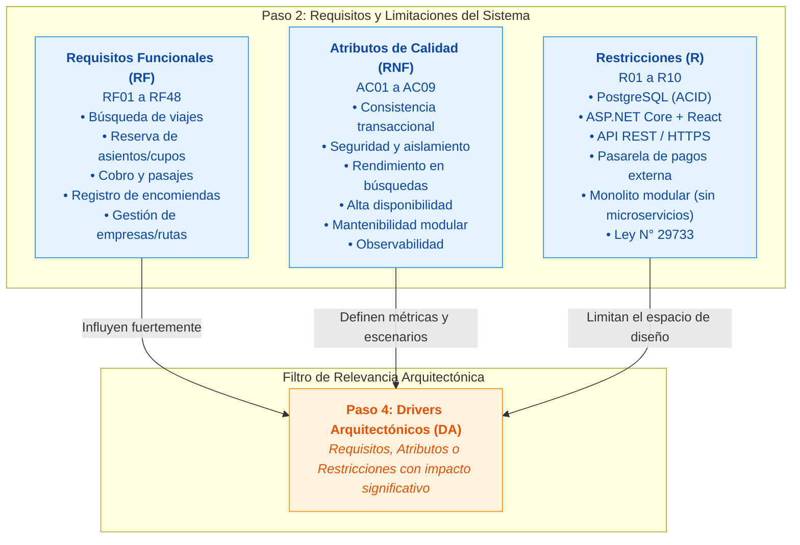

# 05. Restricciones del Sistema

## 1. Descripción

Las **restricciones (R)** son decisiones de diseño impuestas de manera previa, limitaciones técnicas, normativas, organizacionales o de infraestructura que acotan el espacio de soluciones disponibles para el arquitecto de software.

A diferencia de los requisitos funcionales (lo que el sistema debe hacer) y de los atributos de calidad (cómo debe comportarse), las restricciones representan **condiciones no negociables** que la solución técnica debe satisfacer obligatoriamente.

> [!NOTE]
> **Principio de la docente (Paso 2 de Arquitectura):**
> *No todo requisito se convierte automáticamente en un driver arquitectónico. Las restricciones actúan como fronteras y directrices fijas que canalizan las decisiones arquitectónicas.*

---

## 2. Clasificación de Restricciones del Sistema

| ID | Restricción | Tipo | Justificación / Origen |
|---|---|---|---|
| **R01** | Uso de Base de Datos Relacional **PostgreSQL 16+** | Tecnológica / Persistencia | Obligatorio para garantizar consistencia transaccional estricta (propiedades ACID) y control de concurrencia pesimista en reservas de pasajes. |
| **R02** | Backend desarrollado en **ASP.NET Core 8+ (C#)** | Tecnológica / Plataforma | Lenguaje tipado de alto rendimiento con soporte nativo de inyección de dependencias y concurrencia asíncrona robusta. |
| **R03** | Frontend Web SPA desarrollado en **React 18+, TypeScript y Vite** | Tecnológica / Cliente | Garantiza renderizado responsivo y dinámico para mapas interactivos de asientos y paneles de ventanilla. |
| **R04** | Protocolo de comunicación **API REST sobre HTTPS (TLS 1.3)** | Técnica / Protocolo | Estándar de interoperabilidad seguro para el intercambio de datos entre la SPA, clientes móviles y el backend unificado. |
| **R05** | Integración obligatoria con **Pasarela de Pagos Externa** | Integración / Servicio externo | El sistema no almacena ni procesa tarjetas bancarias directamente (evita certificación PCI-DSS compleja); delega en pasarelas certificadas (Stripe, Culqi, Niubiz). |
| **R06** | Integración con **Proveedor Externo de Notificaciones** | Integración / Servicio externo | Las comunicaciones de confirmación de boletos y estados de encomienda deben despacharse mediante servicios especializados de Email/SMS. |
| **R07** | Control de versiones en **Git** y repositorio en **GitHub** | Organizacional / Herramientas | Todo el código, documentación arquitectónica y flujos de integración deben estar versionados en GitHub. |
| **R08** | Empaquetamiento y despliegue en **Contenedores Docker** | Infraestructura / Despliegue | Los entornos de ejecución deben ser reproducibles, portables y preparados para ejecución sobre servidores Linux. |
| **R09** | Restricción de modelo de despliegue inicial: **Monolito Modular** | Arquitectónica / Proyecto | Por restricciones presupuestarias y tamaño del equipo de desarrollo, no se admiten arquitecturas de microservicios en la primera fase. |
| **R10** | Cumplimiento de la **Ley de Protección de Datos Personales (Ley N° 29733 de Perú)** | Legal / Regulatoria | Proteger estrictamente los datos privados de pasajeros, remitentes y destinatarios de encomiendas; anonimizar consultas públicas de tracking. |

---

## 3. Matriz de Clasificación de Requisitos y Restricciones (Visión Docente)

Siguiendo el esquema metodológico enseñado, el análisis de requisitos del sistema se estructura en tres dimensiones claras:

---

## 4. Diferencia entre Reglas de Negocio y Restricciones Arquitectónicas

Es fundamental no confundir las **Reglas de Negocio (RN)** con las **Restricciones Técnicas (R)**:

* **Regla de Negocio (ej. RN06):** *"Un asiento no puede confirmarse en dos reservas del mismo viaje"* $\rightarrow$ Es una regla funcional del dominio que describe una política comercial.
* **Restricción Arquitectónica (ej. R01):** *"Usar PostgreSQL con transacciones ACID y soporte para SELECT FOR UPDATE"* $\rightarrow$ Es la restricción tecnológica que condiciona cómo se implementa dicha regla en el motor de persistencia.

---

## 5. Trazabilidad con Drivers Arquitectónicos

Las restricciones R01 a R10 condicionan directamente los siguientes drivers arquitectónicos del sistema:

* **R01 (PostgreSQL) + R05 (Pasarela externa) $\rightarrow$ DA01 (Consistencia de Reservas y Pagos):** Obliga a utilizar transacciones ACID, índices únicos y mecanismos de verificación idempotente.
* **R02 (ASP.NET Core) + R09 (Monolito Modular) $\rightarrow$ DA06 (Mantenibilidad y Evolución Modular):** Obliga a implementar Clean Architecture dentro de un único proceso de despliegue.
* **R04 (API REST) + R10 (Ley de Protección de Datos) $\rightarrow$ DA02 (Seguridad y Aislamiento Multiempresa):** Condiciona el diseño de autorización basada en tokens y la anonimización de endpoints públicos.
