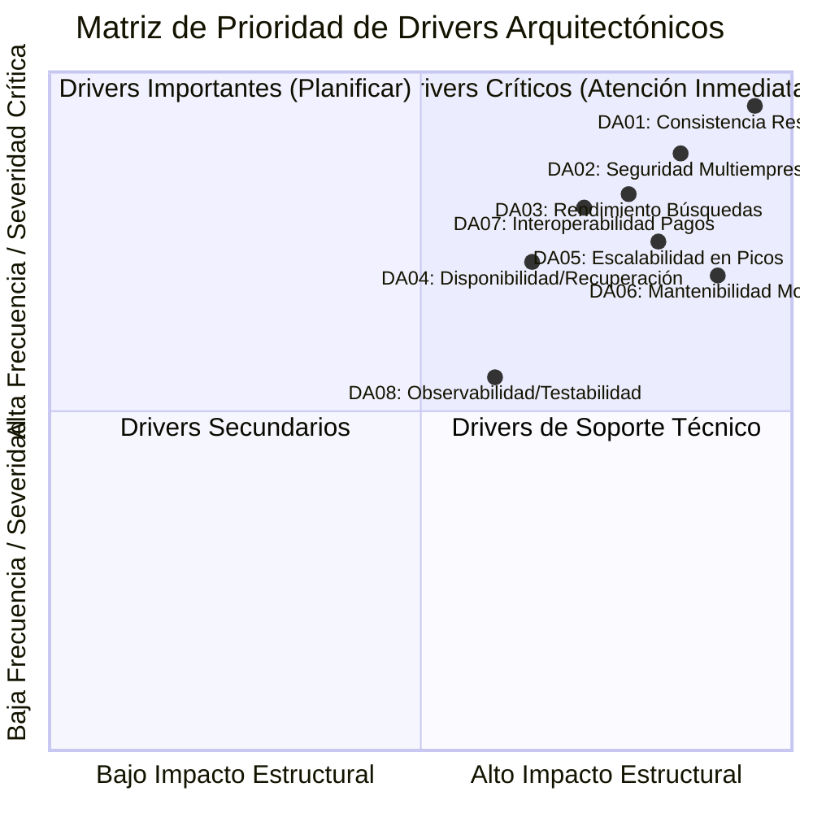

# 06. Drivers Arquitectónicos

## 1. Definición y Fundamentación Teórica

Según la metodología de arquitectura de software impartida por la docente (Paso 4):

> [!IMPORTANT]
> **Fórmula del Driver Arquitectónico:**
> $$\textbf{Driver Arquitectónico} = \text{Requisito (RF)} + \text{Atributo de Calidad (RNF)} + \text{Restricción (R)}$$
> *Un driver es cualquier requerimiento, atributo de calidad o restricción técnica/organizacional que influye de manera determinante y significativa en las decisiones de arquitectura de software.*

No todos los requisitos son drivers arquitectónicos. Por ejemplo, un CRUD administrativo estándar no condiciona la arquitectura global; en cambio, la necesidad de retener asientos concurrentemente sin sobreventa condiciona la elección de base de datos, el mecanismo de bloqueo y el diseño modular del backend.

---

## 2. Drivers Arquitectónicos Identificados

| ID | Driver Arquitectónico | Dimensión Docente | Prioridad | Atributo / RNF | Restricciones Vinculadas |
|---|---|---|:---:|---|---|
| **DA01** | **Consistencia estricta de reservas y pagos (Cero sobreventa)** | Consistencia / Concurrencia | **Crítica** | AC01 (Consistencia e integridad) | R01 (PostgreSQL ACID), R05 (Pasarela externa) |
| **DA02** | **Seguridad y aislamiento multiempresa** | Seguridad | **Alta** | AC02 (Seguridad), AC07 (Auditabilidad) | R04 (API REST / HTTPS), R10 (Ley N° 29733) |
| **DA03** | **Rendimiento en búsquedas de viajes y catálogos** | Rendimiento | **Alta** | AC03 (Rendimiento) | R03 (React/Vite SPA), R01 (Índices PostgreSQL) |
| **DA04** | **Alta disponibilidad y recuperación ante fallos** | Disponibilidad / Resiliencia | **Alta** | AC04 (Disponibilidad), AC08 (Recuperabilidad) | R08 (Docker), R01 (Respaldos PostgreSQL) |
| **DA05** | **Escalabilidad en picos de demanda regional** | Escalabilidad | **Alta** | AC05 (Escalabilidad) | R08 (Contenedores), R09 (Monolito modular) |
| **DA06** | **Mantenibilidad y evolución desacoplada** | Mantenibilidad | **Alta** | AC06 (Mantenibilidad) | R02 (ASP.NET Core), R09 (Monolito modular) |
| **DA07** | **Interoperabilidad e integraciones externas seguras** | Integraciones | **Alta** | AC09 (Interoperabilidad) | R04 (REST/HTTPS), R05 (Pasarela), R06 (Notificaciones) |
| **DA08** | **Observabilidad, trazabilidad y testabilidad** | Testabilidad / Observabilidad | **Media-Alta** | AC07 (Auditabilidad), Mantenibilidad | R07 (GitHub CI/CD), R10 (Auditoría legal) |

---

## 3. Detalle de los Drivers Arquitectónicos

### DA01 — Consistencia estricta de reservas y pagos (Cero sobreventa)
* **¿Qué problema atiende?** El riesgo de sobreventa de asientos o cupos cuando varios pasajeros y agentes intentan reservar simultáneamente en temporadas altas (Semana Santa, Fiestas Patrias), y el procesamiento de pagos duplicados.
* **Composición:** RF05–RF12, RF14, RF19 + AC01 (Integridad y consistencia) + R01 (PostgreSQL ACID) + R05 (Pasarela de pagos).
* **Impacto arquitectónico:** Obliga a utilizar transacciones ACID con bloqueo pesimista (`SELECT ... FOR UPDATE`), índices únicos parciales en base de datos (`idx_unique_active_seat`) y verificación con idempotencia en webhooks de pago.

### DA02 — Seguridad y aislamiento multiempresa
* **¿Qué problema atiende?** La plataforma integra a múltiples empresas y agencias competidoras; una empresa jamás debe visualizar ni alterar itinerarios, tarifas, reservas o clientes de otra.
* **Composición:** RF20–RF23, RF40–RF44 + AC02 (Seguridad) + R10 (Ley N° 29733 de Protección de Datos).
* **Impacto arquitectónico:** Determina la implementación de autenticación JWT, autorización basada en Claims (rol, empresa, agencia) y filtros de aislamiento a nivel de consulta (Row-Level Security o Global Query Filters en EF Core).

### DA03 — Rendimiento en búsquedas de viajes y catálogos
* **¿Qué problema atiende?** Las consultas de itinerarios y precios representan el 85 % del tráfico total del sistema; deben responder con inmediatez para evitar el abandono de compra.
* **Composición:** RF01–RF04, RF30–RF31 + AC03 (Rendimiento) + R03 (React SPA).
* **Impacto arquitectónico:** Conduce a la optimización de índices en base de datos, proyección de DTOs livianos, paginación en el API REST y previsión de caché en memoria o Redis para rutas frecuentes.

### DA04 — Alta disponibilidad y recuperación ante fallos
* **¿Qué problema atiende?** La indisponibilidad del sistema detiene la venta de pasajes y el despacho de buses en terminales terrestres.
* **Composición:** RF01–RF19 + AC04 (Disponibilidad), AC08 (Recuperabilidad) + R08 (Docker).
* **Impacto arquitectónico:** Requiere manejo controlado de excepciones, health checks en ASP.NET Core, políticas de reintento ante fallos de proveedores y políticas de respaldo periódico (RTO < 4 h, RPO < 1 h).

### DA05 — Escalabilidad en picos de demanda regional
* **¿Qué problema atiende?** El incremento súbito de tráfico durante festividades regionales sin degradar las operaciones en counter presencial.
* **Composición:** RF01–RF04, RF20–RF39 + AC05 (Escalabilidad) + R08 (Docker).
* **Impacto arquitectónico:** Diseña el backend como un monolito modular **sin estado (stateless)**, permitiendo ejecutar múltiples réplicas detrás de un proxy inverso (Nginx) y delegando la sesión a tokens JWT.

### DA06 — Mantenibilidad y evolución desacoplada
* **¿Qué problema atiende?** Permitir modificar módulos (ej. añadir una nueva política de encomiendas o un cálculo de tarifas) sin que colapse el módulo de reservas o ventas.
* **Composición:** RF05–RF48 + AC06 (Mantenibilidad) + R02 (ASP.NET Core), R09 (Monolito modular).
* **Impacto arquitectónico:** Impone el uso de **Clean Architecture** en cada uno de los 8 módulos, encapsulando el dominio e interactuando únicamente a través de contratos de aplicación (interfaces públicas).

### DA07 — Interoperabilidad e integraciones externas seguras
* **¿Qué problema atiende?** Dependencia de proveedores externos (Stripe/Culqi/Niubiz para cobros y servicios de SMS/Email para boletos digitales).
* **Composición:** RF13–RF14, RF47–RF48 + AC09 (Interoperabilidad) + R05, R06.
* **Impacto arquitectónico:** Obliga a emplear el patrón **Adapter (Puertos y Adaptadores)** para no acoplar el código de negocio a librerías de terceros, además de implementar verificación criptográfica de firmas HMAC.

### DA08 — Observabilidad, trazabilidad y testabilidad
* **¿Qué problema atiende?** Necesidad de auditar todas las operaciones comerciales y validar el software mediante pruebas automatizadas sin depender de la base de datos física.
* **Composición:** RF17, RF29, RF39, RF44 + AC07 (Auditabilidad) + R07 (GitHub Actions).
* **Impacto arquitectónico:** Registro estructurado de logs (Serilog), tablas inmutables de auditoría en PostgreSQL, y diseño desacoplado que permite pruebas unitarias con mocks de repositorios.

---

## 4. Matriz de Síntesis y Priorización

El driver determinante de la arquitectura es **DA01 — Consistencia estricta de reservas y pagos**, seguido directamente por **DA02 — Seguridad multiempresa** y **DA06 — Mantenibilidad modular**. Estos tres pilares fundamentan la adopción de un **Monolito Modular con Clean Architecture y PostgreSQL**.
