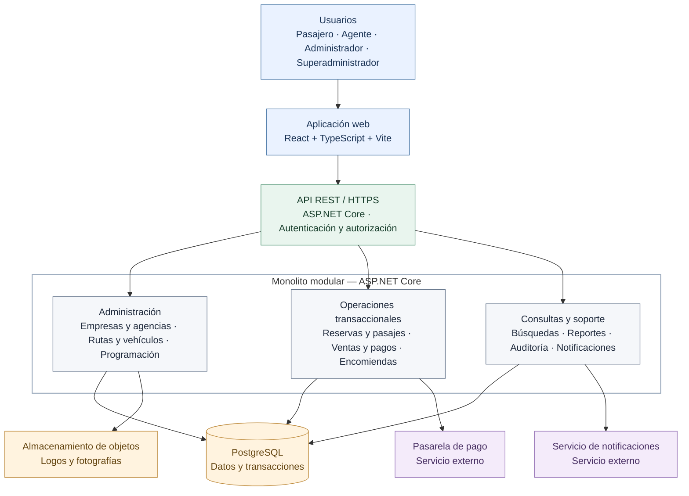

# Arquitectura inicial del sistema

## 1. Propósito

Definir la estructura general de la **Plataforma Integrada de Reservas y Gestión de Transporte Interprovincial**, considerando múltiples empresas y agencias, reservas de pasajes, ventas, pagos y encomiendas.

Esta propuesta se fundamenta en los requisitos RF01–RF48, los drivers DA01–DA06 y las decisiones ADR01–ADR12.

## 2. Arquitectura seleccionada

- **Estilo:** arquitectura en capas.
- **Estructura:** monolito modular.
- **Enfoque de diseño:** Clean Architecture.
- **Interfaz:** aplicación web responsive con React, TypeScript y Vite.
- **Backend:** API REST con ASP.NET Core y C#.
- **Persistencia:** PostgreSQL mediante Entity Framework Core.
- **Seguridad:** ASP.NET Core Identity y autorización por rol, empresa y agencia.

Los módulos se ejecutan dentro de una misma aplicación backend; **no son microservicios**.

## 3. Diagrama de arquitectura inicial

**Nota:** Las conexiones representan dependencias funcionales principales, no llamadas de red independientes entre módulos. Las operaciones críticas de reserva y pago se coordinan desde el backend.

## 4. Capas de la solución

| Capa | Responsabilidad | Componentes principales |
|---|---|---|
| Presentación | Interacción con los cuatro actores. | React, TypeScript, Vite. |
| API | Exponer endpoints, validar solicitudes y aplicar seguridad. | ASP.NET Core REST, Identity y autorización. |
| Aplicación | Coordinar casos de uso y transacciones. | Servicios de aplicación por módulo. |
| Dominio | Implementar reglas de negocio. | Reservas, viajes, pagos, encomiendas y políticas. |
| Infraestructura | Persistencia y comunicación con proveedores externos. | EF Core, PostgreSQL, almacenamiento e integraciones. |

**Regla de dependencias:** el dominio no debe depender de la interfaz web, la base de datos ni de proveedores externos.

## 5. Organización funcional

| Grupo | Módulos | Funciones principales |
|---|---|---|
| Administración | Identidad y acceso; empresas y agencias; rutas, vehículos y programación. | Configuración de operadores, servicios, usuarios y permisos. |
| Transaccional | Reservas y pasajes; ventas y pagos; encomiendas. | Control de disponibilidad, ventas, confirmación de pagos y seguimiento de envíos. |
| Consultas y soporte | Búsquedas; reportes y auditoría; notificaciones e integraciones. | Consulta de servicios, trazabilidad e información operativa. |

Los grupos son **clasificaciones funcionales**, no límites de despliegue. Los módulos comparten la misma aplicación y una base de datos PostgreSQL, con responsabilidades y acceso a datos delimitados.

## 6. Reglas arquitectónicas esenciales

1. **Consistencia:** PostgreSQL es la fuente de verdad para asientos, cupos, reservas y pagos. Se utilizan transacciones y restricciones de integridad para impedir sobreventas.
2. **Aislamiento multiempresa:** el backend valida rol, empresa y agencia en cada operación protegida.
3. **Pagos:** una reserva solo se considera pagada tras verificar la confirmación del proveedor; los eventos repetidos se procesan de forma idempotente.
4. **Encomiendas:** cada empresa define rutas, tarifas y políticas; sus estados se registran sin modificar la disponibilidad de pasajeros.
5. **Mantenibilidad:** los módulos exponen interfaces claras y evitan dependencias directas innecesarias.
6. **Evolución:** Redis, mensajería duradera y múltiples instancias de aplicación se incorporarán cuando la demanda y las pruebas lo justifiquen.

## 7. Alcance de la implementación inicial

La primera versión contempla aplicación web responsive, API REST, módulos funcionales, PostgreSQL, autenticación/autorización, integración de pagos, almacenamiento de imágenes, registros de auditoría y respaldos.

No se requieren inicialmente microservicios, Kubernetes, Redis ni un almacén analítico independiente. Los reportes pueden obtenerse mediante consultas controladas a PostgreSQL.

## 8. Relación con los drivers

| Driver | Respuesta arquitectónica |
|---|---|
| DA01 — Consistencia | Transacciones y restricciones de PostgreSQL; pagos idempotentes. |
| DA02 — Seguridad | Identity y autorización por rol, empresa y agencia. |
| DA03 — Rendimiento | Consultas optimizadas e índices; caché solo si se justifica. |
| DA04 — Disponibilidad y recuperación | Manejo de fallos, monitoreo y respaldos. |
| DA05 — Escalabilidad | Backend preparado para despliegue de varias instancias. |
| DA06 — Mantenibilidad | Monolito modular y Clean Architecture. |

## 9. Conclusión

La arquitectura inicial integra las operaciones de múltiples empresas de transporte en una plataforma web, priorizando la consistencia de reservas, la seguridad multiempresa y la separación de responsabilidades. Su estructura modular permite evolucionar sin asumir la complejidad de microservicios desde el inicio.
