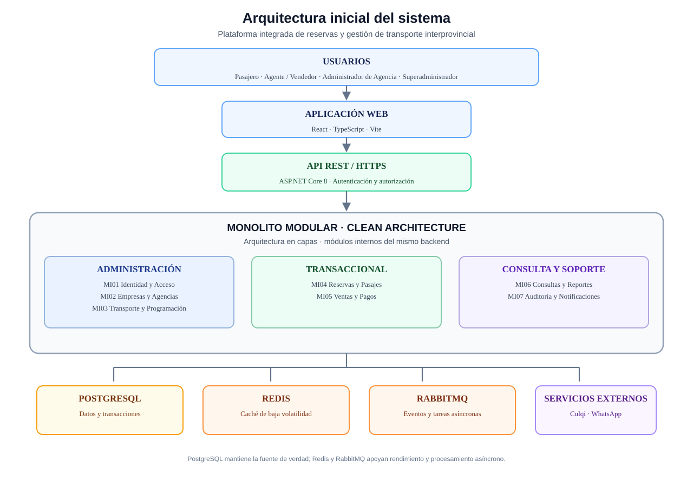

# Arquitectura Inicial del Sistema

## 1. Arquitectura propuesta

La Plataforma Integrada de Reservas y Gestión de Transporte Interprovincial se plantea bajo un **estilo de arquitectura en capas**, organizado como un **monolito modular** y aplicando principios de **Clean Architecture** para separar las responsabilidades de presentación, aplicación, dominio e infraestructura.

La solución permitirá atender a los cuatro actores del sistema — pasajero, agente/vendedor, administrador de agencia y superadministrador — mediante una aplicación web responsive para navegador de escritorio o móvil. La arquitectura contempla desde la primera versión la concurrencia de reservas y ventas, el aislamiento de información entre empresas y agencias, los pagos electrónicos mediante Culqi, las notificaciones mediante WhatsApp Business Cloud API, el procesamiento asíncrono con Transactional Outbox y RabbitMQ, y el rendimiento de búsquedas y catálogos mediante Redis.

### Figura 1. Arquitectura inicial de la solución



**Figura 1.** Arquitectura inicial de la Plataforma Integrada de Reservas y Gestión de Transporte Interprovincial.

---

## 2. Niveles de la arquitectura

### Actores del sistema

| Actor | Canal principal |
|---|---|
| Pasajero | Aplicación web (reservas y pagos en línea) |
| Agente / Vendedor | Aplicación web (venta presencial desde agencia) |
| Administrador de Agencia | Aplicación web (gestión de su agencia o agencias asignadas) |
| Superadministrador | Aplicación web (administración general de la plataforma) |

### Capa de presentación

- Aplicación web responsive con **React 18, TypeScript y Vite**.
- Interfaz adaptada al rol del usuario autenticado.

### Capa de acceso

- **API REST** sobre HTTPS con terminación TLS 1.3 en Nginx.
- **Autenticación** mediante JWT con claims `sub`, `role`, `company_id` y `agency_ids[]`.
- **Autorización** basada en rol y ámbito organizacional; el cliente envía la agencia activa en `X-Agency-Id` y el caso de uso valida que esté autorizada para la empresa.

### Monolito modular

Los siguientes módulos comparten el mismo proceso backend en ASP.NET Core 8:

| Módulo | Responsabilidad principal |
|---|---|
| Identidad y Acceso | Autenticación, roles y contexto organizacional |
| Empresas y Agencias | Gestión de empresas, agencias y asignaciones |
| Transporte y Programación | Rutas, horarios, servicios, modelos de vehículos, vehículos, planos y asientos por viaje |
| Reservas y Pasajes | Mapa de asientos numerados, reservas de varios asientos, estados, expiración y pasajes |
| Ventas y Pagos | Ventas presenciales, pagos con Culqi y confirmaciones |
| Consultas y Reportes | Búsqueda de viajes, reportes y analítica |
| Auditoría y Notificaciones | Trazabilidad, alertas y comunicaciones |

### Infraestructura

| Componente | Rol |
|---|---|
| **PostgreSQL 16** | Fuente de verdad transaccional para reservas, disponibilidad, ventas y pagos. |
| **Redis** | Caché de búsquedas de viajes y catálogos con TTL de 60 segundos. Mapa de asientos y reservas consultan PostgreSQL. |
| **RabbitMQ** | Cola durable que despacha asíncronamente eventos persistidos mediante Transactional Outbox. |

### Servicios externos

| Servicio | Integración | Rol |
|---|---|---|
| **Culqi** | `IPaymentGateway` → `CulqiPaymentAdapter` | Culqi Checkout emite el token; el backend crea el cargo y reconcilia respuesta de servidor y webhook HMAC idempotentemente por `charge_id`. |
| **WhatsApp Business Cloud API** | `INotificationGateway` → `WhatsAppNotificationAdapter` | Notificaciones asíncronas; las alertas de demanda requieren opt-in y más del 70 % de ocupación. |

---

## 3. Flujo principal de reserva digital

```text
Pasajero (web responsive)
   ↓
Aplicación Web (React)
   ↓
API REST / HTTPS (Nginx)
   ↓
Autenticación y autorización (JWT + Claims)
   ↓
Módulo de Consultas y Reportes → Redis (búsquedas y catálogos, TTL 60 s)
   ↓
Seleccionar uno o varios TripSeat y pasajeros
   ↓
Módulo de Reservas bloquea los asientos en PostgreSQL
   └── HELD solo en canal digital (10 minutos)
          ↓
Culqi Checkout token → backend crea cargo → respuesta de servidor/webhook HMAC
   ├── Primer resultado válido por charge_id: APPROVED → CONFIRMED → pasajes ISSUED
   └── EXPIRED: aprobación tardía confirma si todos los asientos siguen libres;
               en otro caso, pago REFUNDED
          ↓
Outbox guarda el evento con la transacción
   ↓
RabbitMQ → consumidor → WhatsApp Business Cloud API
```

---

## 4. Flujo de operación presencial

Para las operaciones presenciales, el agente/vendedor utiliza **el mismo backend**, el **mismo mapa de asientos numerados** y la **misma disponibilidad transaccional** que la venta digital. Ambos canales operan sobre PostgreSQL. El agente registra pago en efectivo, Yape/Plin o POS y confirma directamente, sin retención digital ni cierre de caja.

```text
Agente / Vendedor
   ↓
Aplicación Web (React — interfaz de agencia)
   ↓
API REST / HTTPS → Autenticación + verificación de agencia asignada
   ↓
Seleccionar asientos disponibles y asociar pasajeros
   ↓
Módulo de Ventas registra efectivo / Yape-Plin / POS
   ↓
Módulo de Reservas bloquea TripSeat y confirma en PostgreSQL
   ↓
Reserva CONFIRMED → pasajes ISSUED
   ↓
Outbox → RabbitMQ → WhatsApp Business Cloud API
```

---

## 5. Principios arquitectónicos

| Principio | Descripción | Decisión relacionada |
|---|---|---|
| **Separación de responsabilidades** | Cada capa y módulo tiene una responsabilidad definida. | ADR-02, ADR-14 |
| **Aislamiento organizacional** | Una empresa no puede acceder a información privada de otra. Cada agencia opera dentro de su ámbito autorizado. | ADR-05, ADR-06 |
| **Fuente única de verdad** | PostgreSQL mantiene las reservas, disponibilidad, ventas y pagos. | ADR-04, ADR-07 |
| **Control de concurrencia** | Las operaciones críticas bloquean TripSeat y usan restricciones únicas/transacciones. | ADR-07 |
| **Procesamiento asíncrono** | Transactional Outbox y RabbitMQ despachan notificaciones sin bloquear operaciones críticas. | ADR-10, ADR-12 |
| **Caché** | Redis con TTL de 60 segundos reduce consultas de búsquedas y catálogos. | ADR-09 |
| **Integración desacoplada** | Culqi y WhatsApp se integran mediante contratos y adaptadores. | ADR-11, ADR-12 |
| **Escalabilidad horizontal** | El backend es stateless y puede ejecutarse en múltiples instancias detrás de Nginx. | ADR-01, ADR-14 |
| **Trazabilidad** | Las operaciones críticas se registran con usuario, empresa, agencia, operación y resultado. | ADR-13 |

---

## 6. Justificación de las decisiones principales

| Decisión | Justificación |
|---|---|
| **Monolito modular** | Permite desarrollar y mantener el sistema con una complejidad adecuada para el alcance inicial. Los límites modulares claros facilitan una futura evolución sin la complejidad operativa de los microservicios. |
| **Clean Architecture** | Protege las reglas del dominio frente a cambios de frameworks, bases de datos o proveedores externos. Facilita las pruebas unitarias de los casos de uso. |
| **PostgreSQL** | Proporciona las garantías transaccionales y de integridad que exigen las operaciones de reserva y pago. El control de concurrencia se apoya en sus capacidades nativas. |
| **Redis desde la primera versión** | Permite atender búsquedas de viajes y catálogos durante periodos de alta demanda; los asientos exactos y reservas se consultan en PostgreSQL (RC12). |
| **Transactional Outbox + RabbitMQ desde la primera versión** | Evita perder eventos de notificación y garantiza que una falla temporal de WhatsApp no afecte operaciones ya confirmadas (RC13). |
| **Culqi mediante Adapter** | Permite cambiar de pasarela de pago en el futuro sin modificar las reglas de negocio del dominio. |
| **WhatsApp Business Cloud API** | Canal de comunicación de alto alcance en el contexto peruano, integrado de forma asíncrona para no bloquear operaciones principales. |
