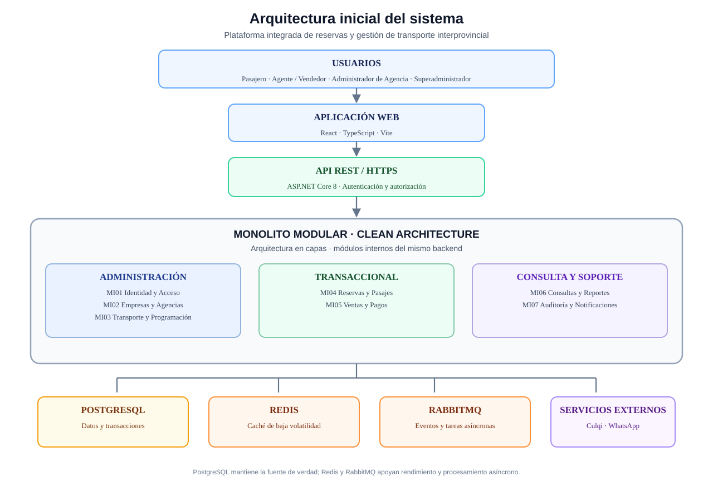

# Arquitectura Inicial del Sistema

## 1. Arquitectura propuesta

La Plataforma Integrada de Reservas y Gestión de Transporte Interprovincial se plantea bajo un **estilo de arquitectura en capas**, organizado como un **monolito modular** y aplicando principios de **Clean Architecture** para separar las responsabilidades de presentación, aplicación, dominio e infraestructura.

La solución permitirá atender a los cuatro actores del sistema — pasajero, agente/vendedor, administrador de agencia y superadministrador — mediante una plataforma centralizada. La arquitectura contempla desde la primera versión la concurrencia de reservas y ventas, el aislamiento de información entre empresas y agencias, los pagos electrónicos mediante Culqi, las notificaciones mediante WhatsApp Business Cloud API, el procesamiento asíncrono con RabbitMQ y el rendimiento mediante Redis.

### Figura 1. Arquitectura inicial de la solución



**Figura 1.** Arquitectura inicial de la Plataforma Integrada de Reservas y Gestión de Transporte Interprovincial.

---

## 2. Niveles de la arquitectura

### Actores del sistema

| Actor | Canal principal |
|---|---|
| Pasajero | Aplicación web (reservas y pagos en línea) |
| Agente / Vendedor | Aplicación web (venta presencial desde agencia) |
| Administrador de Agencia | Aplicación web (gestión de su agencia o agencias asignadas) |
| Superadministrador | Aplicación web (administración general de la plataforma) |

### Capa de presentación

- Aplicación web responsive con **React 18, TypeScript y Vite**.
- Interfaz adaptada al rol del usuario autenticado.

### Capa de acceso

- **API REST** sobre HTTPS con terminación TLS 1.3 en Nginx.
- **Autenticación** mediante JWT con claims de usuario, rol, empresa y agencia.
- **Autorización** basada en rol y ámbito organizacional (empresa y agencia), aplicada en la capa de aplicación antes de ejecutar cualquier caso de uso.

### Monolito modular

Los siguientes módulos comparten el mismo proceso backend en ASP.NET Core 8:

| Módulo | Responsabilidad principal |
|---|---|
| Identidad y Acceso | Autenticación, roles y contexto organizacional |
| Empresas y Agencias | Gestión de empresas, agencias y asignaciones |
| Transporte y Programación | Rutas, horarios, servicios, unidades y tarifas |
| Reservas y Pasajes | Disponibilidad, reservas, estados, expiración y pasajes |
| Ventas y Pagos | Ventas presenciales, pagos con Culqi y confirmaciones |
| Consultas y Reportes | Búsqueda de viajes, reportes y analítica |
| Auditoría y Notificaciones | Trazabilidad, alertas y comunicaciones |

### Infraestructura

| Componente | Rol |
|---|---|
| **PostgreSQL 16** | Fuente de verdad transaccional para reservas, disponibilidad, ventas y pagos. |
| **Redis** | Caché de información de consulta frecuente (rutas, horarios, servicios). No aplica a operaciones críticas de reserva. |
| **RabbitMQ** | Cola durable para procesamiento asíncrono de notificaciones y eventos secundarios. |

### Servicios externos

| Servicio | Integración | Rol |
|---|---|---|
| **Culqi** | `IPaymentGateway` → `CulqiPaymentAdapter` | Procesamiento de pagos electrónicos. |
| **WhatsApp Business Cloud API** | `INotificationGateway` → `WhatsAppAdapter` | Notificaciones a pasajeros (confirmaciones, recordatorios, alertas). |

---

## 3. Flujo principal de reserva digital

```text
Pasajero
   ↓
Aplicación Web (React)
   ↓
API REST / HTTPS (Nginx)
   ↓
Autenticación y autorización (JWT + Claims)
   ↓
Módulo de Consultas y Reportes → Redis (caché de horarios/servicios)
   ↓
Módulo de Reservas y Pasajes → PostgreSQL
   ├── SELECT FOR UPDATE (bloqueo pesimista)
   └── Estado: HELD (reserva temporal — 10 minutos)
          ↓
Módulo de Ventas y Pagos → Culqi (mediante CulqiPaymentAdapter)
   ├── Pago aprobado → Estado: CONFIRMED → Pasaje emitido
   └── Sin pago en 10 min → Estado: EXPIRED → Asiento liberado
          ↓
Módulo de Auditoría y Notificaciones → RabbitMQ
   ↓
Consumidor de eventos → WhatsApp Business Cloud API
```

---

## 4. Flujo de operación presencial

Para las operaciones presenciales, el agente/vendedor utiliza **el mismo backend** y la **misma disponibilidad transaccional** que la venta digital. Ambos canales operan sobre una única fuente de verdad (PostgreSQL), eliminando el riesgo de sobreventa entre canales.

```text
Agente / Vendedor
   ↓
Aplicación Web (React — interfaz de agencia)
   ↓
API REST / HTTPS → Autenticación + verificación de agencia asignada
   ↓
Módulo de Ventas y Pagos → Módulo de Reservas y Pasajes → PostgreSQL
   └── Misma disponibilidad transaccional que el canal web
          ↓
Estado: CONFIRMED → Pasaje emitido
   ↓
Módulo de Auditoría y Notificaciones → RabbitMQ → WhatsApp Business Cloud API
```

---

## 5. Principios arquitectónicos

| Principio | Descripción | Decisión relacionada |
|---|---|---|
| **Separación de responsabilidades** | Cada capa y módulo tiene una responsabilidad definida. | DA-02, DA-14 |
| **Aislamiento organizacional** | Una empresa no puede acceder a información privada de otra. Cada agencia opera dentro de su ámbito autorizado. | DA-05, DA-06 |
| **Fuente única de verdad** | PostgreSQL mantiene las reservas, disponibilidad, ventas y pagos. | DA-04, DA-07 |
| **Control de concurrencia** | Las operaciones críticas se ejecutan con bloqueo pesimista y transacciones ACID. | DA-07 |
| **Procesamiento asíncrono** | RabbitMQ ejecuta notificaciones y tareas secundarias sin bloquear operaciones críticas. | DA-10 |
| **Caché** | Redis reduce consultas repetitivas sobre información de baja volatilidad. | DA-09 |
| **Integración desacoplada** | Culqi y WhatsApp se integran mediante adaptadores reemplazables. | DA-11, DA-12 |
| **Escalabilidad horizontal** | El backend es stateless y puede ejecutarse en múltiples instancias detrás de Nginx. | DA-01, DA-14 |
| **Trazabilidad** | Las operaciones críticas se registran con usuario, empresa, agencia, operación y resultado. | DA-13 |

---

## 6. Justificación de las decisiones principales

| Decisión | Justificación |
|---|---|
| **Monolito modular** | Permite desarrollar y mantener el sistema con una complejidad adecuada para el alcance inicial. Los límites modulares claros facilitan una futura evolución sin la complejidad operativa de los microservicios. |
| **Clean Architecture** | Protege las reglas del dominio frente a cambios de frameworks, bases de datos o proveedores externos. Facilita las pruebas unitarias de los casos de uso. |
| **PostgreSQL** | Proporciona las garantías transaccionales y de integridad que exigen las operaciones de reserva y pago. El control de concurrencia se apoya en sus capacidades nativas. |
| **Redis desde la primera versión** | Permite atender los requerimientos de rendimiento desde el inicio, especialmente durante periodos de alta demanda como festividades o feriados (RC12). |
| **RabbitMQ desde la primera versión** | Garantiza que una falla temporal en WhatsApp Business Cloud API no afecte las operaciones de reserva o pago ya confirmadas (RC13). |
| **Culqi mediante Adapter** | Permite cambiar de pasarela de pago en el futuro sin modificar las reglas de negocio del dominio. |
| **WhatsApp Business Cloud API** | Canal de comunicación de alto alcance en el contexto peruano, integrado de forma asíncrona para no bloquear operaciones principales. |
