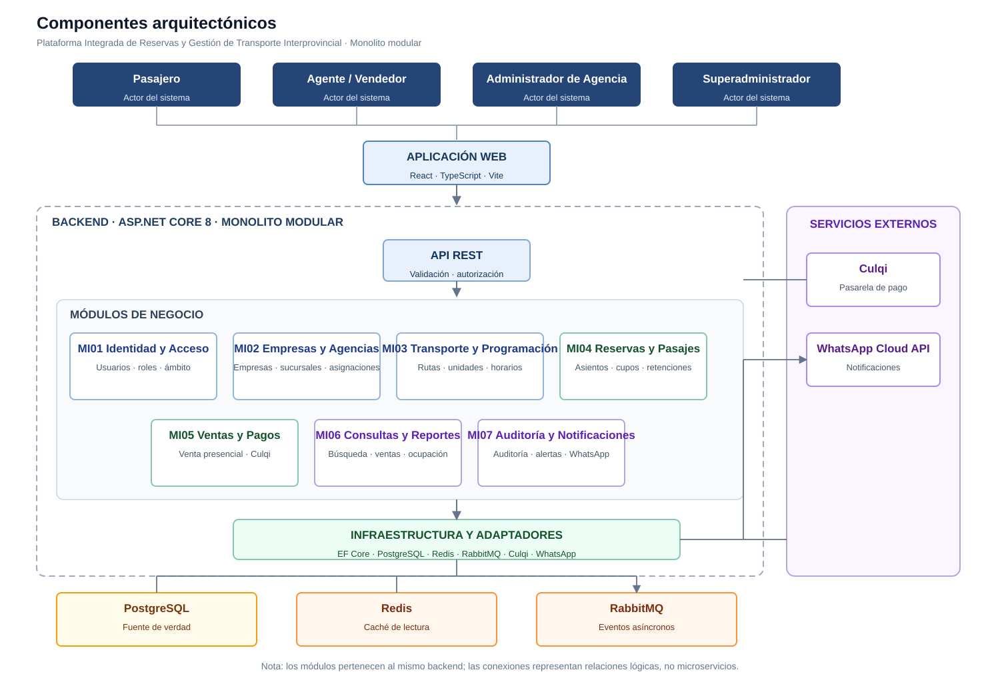

# Componentes Arquitectónicos

## 1. Descripción (Paso 9)

La plataforma se organiza como un **monolito modular**. Los módulos funcionales permanecen dentro del mismo backend y se relacionan mediante casos de uso y contratos internos. No constituyen microservicios independientes.

Cada componente tiene responsabilidades definidas y se comunica con los demás a través de interfaces explícitas, respetando la dirección de dependencias establecida por Clean Architecture.

---

## 2. Componentes principales

| ID | Componente | Responsabilidad |
|---|---|---|
| CA01 | Aplicación Web Responsive | Interfaces React + TypeScript para pasajero, agente/vendedor, administrador de agencia y superadministrador, en navegador de escritorio o móvil. |
| CA02 | API REST | Recibir solicitudes HTTPS, validar entradas, autorizar la agencia activa y delegar en casos de uso. |
| CA03 | Identidad y Acceso | Autenticación JWT con claims `sub`, `role`, `company_id`, `agency_ids[]`; valida empresa y agencia activa (`X-Agency-Id`). |
| CA04 | Empresas y Agencias | Gestión de empresas, agencias y asignaciones de administradores y agentes. Superadministrador como actor principal. |
| CA05 | Transporte y Programación | Rutas, destinos, `VehicleModel` (capacidad y `SeatLayout`), vehículos por placa, horarios, tarifas y viajes programados con `TripSeat`. |
| CA06 | Reservas y Pasajes | Mapa de asientos numerados, reservas de varios asientos/pasajeros, `HELD` digital, concurrencia, estados y emisión de pasajes. |
| CA07 | Ventas y Pagos | Venta presencial con pago en efectivo, Yape/Plin o POS y confirmación directa; pagos electrónicos Culqi y reconciliación idempotente. |
| CA08 | Consultas y Reportes | Búsqueda pública de viajes, consulta de disponibilidad, reportes de ventas, ocupación y demanda para administradores y superadministrador. |
| CA09 | Auditoría y Notificaciones | Registro de operaciones críticas, Outbox transaccional y alertas; despacho asíncrono por WhatsApp. |
| CA10 | Persistencia | Una base PostgreSQL con esquema y `DbContext` por módulo, EF Core 8 y Npgsql; `company_id`/`agency_id`, Global Query Filters y validación en casos de uso. |
| CA11 | Caché | Redis solo para búsquedas de viajes y catálogos con TTL de 60 s; nunca para mapa exacto de asientos o reservas. |
| CA12 | Cola de Eventos | RabbitMQ consume eventos persistidos en Outbox y procesa notificaciones de forma asíncrona. |
| CA13 | Adaptador de Pagos | Interfaz `IPaymentGateway` en Aplicación implementada por `CulqiPaymentAdapter` en Infraestructura. |
| CA14 | Adaptador de Notificaciones | Interfaz `INotificationGateway` en Aplicación implementada por `WhatsAppNotificationAdapter` en Infraestructura. |

---

## 3. Diagrama de componentes arquitectónicos



**Figura 2.** Componentes y relaciones principales del monolito modular.

---

## 4. Relaciones principales

| Origen | Destino | Relación |
|---|---|---|
| Aplicación Web (CA01) | API REST (CA02) | Solicitudes HTTPS. |
| API REST (CA02) | Identidad y Acceso (CA03) | Autenticación y verificación del contexto de empresa y agencia. |
| API REST (CA02) | Módulos de aplicación (CA04–CA09) | Delegación de casos de uso. |
| Reservas y Pasajes (CA06) | Transporte y Programación (CA05) | Consulta de viaje, modelo de asientos y `TripSeat` disponibles mediante contrato público. |
| Ventas y Pagos (CA07) | Reservas y Pasajes (CA06) | La venta presencial solicita confirmación de asientos mediante contrato público. |
| Ventas y Pagos (CA07) | Adaptador de Pagos (CA13) | El caso de uso usa `IPaymentGateway`; el adaptador crea cargos y reconcilia respuestas/webhooks. |
| Consultas y Reportes (CA08) | Caché (CA11) | Búsquedas y catálogos cacheables por 60 s; no se cachean asientos. |
| Consultas y Reportes (CA08) | Persistencia (CA10) | Consultas autorizadas a PostgreSQL (sin réplica de lectura en v1). |
| Auditoría y Notificaciones (CA09) | Cola de Eventos (CA12) | Transactional Outbox persiste eventos con la transacción para despacho. |
| Cola de Eventos (CA12) | Adaptador de Notificaciones (CA14) | Consumidor usa `INotificationGateway` y envía mediante WhatsApp Business Cloud API. |
| Módulos de aplicación (CA04–CA09) | Persistencia (CA10) | Operaciones transaccionales mediante contratos de repositorio. |
| Reservas y Pasajes (CA06) | Mecanismo de expiración | `BackgroundService` cada 10 s usa `FOR UPDATE SKIP LOCKED` para expirar retenciones digitales y liberar `TripSeat`. |

---

## 5. Flujo de reserva digital

```text
Pasajero (web responsive, CA01)
       ↓
API REST (CA02) → validar autenticación (CA03)
       ↓
Buscar viajes y catálogos → Redis (CA11, TTL 60 s)
       ↓
Seleccionar varios TripSeat + datos de pasajeros
       ↓
Reserva digital HELD 10 min; bloqueo transaccional en PostgreSQL (CA10)
       ↓
Culqi Checkout token → IPaymentGateway (CA13) → cargo / webhook HMAC
       ├── Primer resultado válido por charge_id: APPROVED → CONFIRMED → ISSUED
       └── EXPPIRED tardío: confirmar si todos los asientos siguen libres; si no, REFUNDED
       ↓
Outbox (CA09) → RabbitMQ (CA12) → WhatsAppNotificationAdapter (CA14)
```

---

## 6. Flujo de operación presencial

```text
Agente / Vendedor (CA01)
       ↓
API REST (CA02) → validar `X-Agency-Id` y claims (CA03)
       ↓
Ventas y Pagos registra efectivo / Yape/Plin / POS
       ↓
Reservas y Pasajes bloquea TripSeat y confirma directamente en PostgreSQL
       ↓
Reserva CONFIRMED → pasajes ISSUED
       ↓
Outbox (CA09) → RabbitMQ (CA12) → WhatsAppNotificationAdapter (CA14)
```

---

## 7. Reglas arquitectónicas

- Los componentes funcionales (CA04–CA09) pertenecen al mismo backend y se despliegan en el mismo proceso.
- PostgreSQL (CA10) es la fuente de verdad para reservas, disponibilidad, ventas y pagos; cada módulo es propietario de un esquema y `DbContext`.
- Redis (CA11) no reemplaza las transacciones ni controla la disponibilidad crítica.
- RabbitMQ (CA12) no confirma ni libera asientos; su función es despachar eventos persistidos en Outbox.
- Culqi y WhatsApp se consumen únicamente mediante sus adaptadores reemplazables (CA13 y CA14).
- Todas las operaciones privadas validan empresa, agencia y rol antes de ejecutarse.
- El mecanismo de expiración de reservas opera de forma independiente como proceso en segundo plano, sin bloquear operaciones concurrentes.
