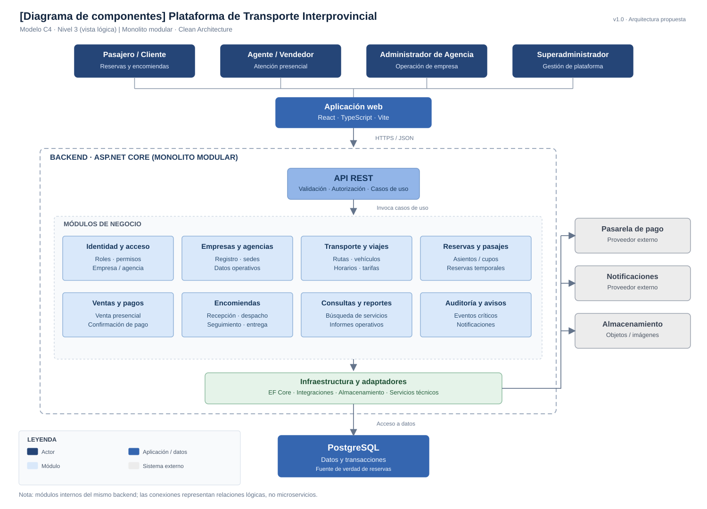

# Componentes Arquitectónicos

## 1. Descripción

La Plataforma Integrada de Reservas y Gestión de Transporte Interprovincial se organiza mediante un monolito modular con arquitectura en capas y enfoque Clean Architecture.

Los componentes se agrupan por responsabilidades y colaboran mediante interfaces definidas. Su implementación inicial corresponde a una única aplicación backend, no a microservicios independientes.

## 2. Componentes principales

| ID | Componente | Responsabilidad |
|---|---|---|
| CA01 | Aplicación web | Presentar las interfaces de pasajeros, agentes, administradores y superadministrador. |
| CA02 | API REST | Recibir solicitudes HTTPS, validar entradas y coordinar los casos de uso. |
| CA03 | Identidad y acceso | Autenticar usuarios y autorizar operaciones por rol, empresa y agencia. |
| CA04 | Empresas y agencias | Gestionar empresas, agencias, información comercial y estados operativos. |
| CA05 | Transporte y programación | Gestionar rutas, destinos, vehículos, horarios, tarifas y viajes programados. |
| CA06 | Reservas y pasajes | Administrar disponibilidad, reservas temporales, asientos, cupos y pasajes. |
| CA07 | Ventas y pagos | Registrar ventas, gestionar cobros y verificar confirmaciones de pago. |
| CA08 | Encomiendas | Gestionar solicitudes, políticas, recepción, despacho, seguimiento y entrega. |
| CA09 | Consultas y reportes | Realizar búsquedas de servicios y generar reportes operativos. |
| CA10 | Auditoría y notificaciones | Registrar eventos críticos y coordinar el envío de avisos. |
| CA11 | Persistencia | Gestionar el acceso transaccional a PostgreSQL y las referencias de archivos. |
| CA12 | Integraciones externas | Adaptar la comunicación con la pasarela de pago, notificaciones y almacenamiento de objetos. |

## 3. Organización por capas

### 3.1. Presentación

Incluye la aplicación web y los controladores de la API REST.

Responsabilidades:
- Presentar información.
- Recibir solicitudes.
- Validar formatos de entrada.
- Aplicar controles de acceso en los puntos de entrada.
- Entregar respuestas HTTP.

### 3.2. Aplicación

Coordina los casos de uso de los módulos de negocio.

Responsabilidades:
- Ejecutar operaciones de consulta y registro.
- Coordinar transacciones.
- Aplicar autorización según el contexto de la operación.
- Invocar interfaces de persistencia e integración.

### 3.3. Dominio

Contiene entidades, reglas de negocio y contratos independientes de tecnologías externas.

Responsabilidades:
- Validar disponibilidad y capacidad.
- Aplicar reglas de reservas.
- Gestionar estados de pagos y encomiendas.
- Aplicar políticas operativas de cada empresa.

### 3.4. Infraestructura

Implementa los mecanismos técnicos requeridos por la aplicación.

Responsabilidades:
- Acceso a PostgreSQL mediante Entity Framework Core.
- Autenticación mediante ASP.NET Core Identity.
- Integración con proveedores de pago y notificaciones.
- Almacenamiento de archivos.
- Registro técnico y mecanismos de recuperación.
## 3. Diagrama de componentes arquitectónicos

**Figura 2.** Componentes de la Plataforma Integrada de Reservas y Gestión de Transporte Interprovincial.

## 4. Relaciones principales

| Origen | Destino | Relación |
|---|---|---|
| Aplicación web | API REST | Solicitudes y respuestas HTTPS. |
| API REST | Identidad y acceso | Autenticación y autorización. |
| API REST | Módulos de aplicación | Ejecución de casos de uso. |
| Reservas y pasajes | Transporte y programación | Consulta de viajes y capacidad disponible. |
| Ventas y pagos | Reservas y pasajes | Confirmación de ventas y estado de reservas. |
| Encomiendas | Empresas y agencias | Consulta de políticas, rutas y servicios habilitados. |
| Módulos de aplicación | Persistencia | Acceso mediante interfaces y operaciones transaccionales. |
| Ventas y pagos | Integraciones externas | Verificación de pagos electrónicos. |
| Auditoría y notificaciones | Integraciones externas | Envío de avisos y comunicación con proveedores. |

Las dependencias internas deben respetar los límites de los módulos y las reglas de Clean Architecture.

## 5. Reglas arquitectónicas

- Los componentes funcionales pertenecen al mismo backend.
- Las reglas del dominio no dependen directamente de React, ASP.NET Core, Entity Framework Core ni proveedores externos.
- PostgreSQL es la fuente de verdad de reservas y disponibilidad.
- El acceso a información debe respetar el ámbito de empresa y agencia.
- Los pagos externos requieren verificación e idempotencia.
- Las encomiendas mantienen su propio proceso y no consumen asientos de pasajeros.
- Las tareas secundarias no deben comprometer la integridad de las operaciones críticas.

## 6. Conclusión

La separación de componentes permite organizar las funcionalidades del sistema, controlar las dependencias y facilitar su mantenimiento.

Esta estructura responde principalmente a DA01, DA02 y DA06, y permite evolucionar la plataforma sin adoptar microservicios de manera prematura.
