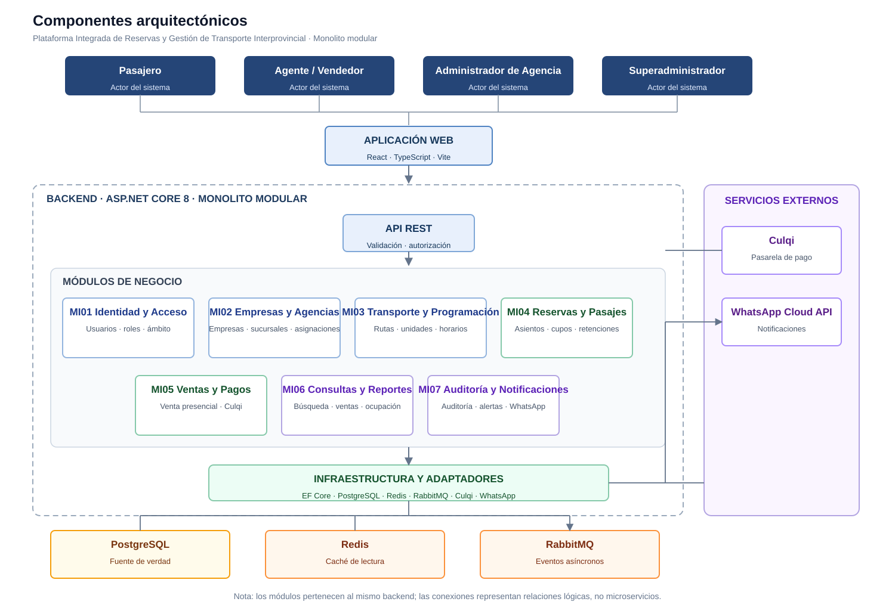

# Componentes Arquitectónicos

## 1. Descripción (Paso 9)

La plataforma se organiza como un **monolito modular**. Los módulos funcionales permanecen dentro del mismo backend y se relacionan mediante casos de uso y contratos internos. No constituyen microservicios independientes.

Cada componente tiene responsabilidades definidas y se comunica con los demás a través de interfaces explícitas, respetando la dirección de dependencias establecida por Clean Architecture.

---

## 2. Componentes principales

| ID | Componente | Responsabilidad |
|---|---|---|
| CA01 | Aplicación Web | Interfaces para pasajero, agente/vendedor, administrador de agencia y superadministrador. React + TypeScript. |
| CA02 | API REST | Recibir solicitudes HTTPS, validar entradas, aplicar autenticación y autorización, y delegar en los casos de uso correspondientes. |
| CA03 | Identidad y Acceso | Autenticación mediante JWT, gestión de roles y validación del contexto organizacional (empresa y agencia). |
| CA04 | Empresas y Agencias | Gestión de empresas, agencias y asignaciones de administradores y agentes. Superadministrador como actor principal. |
| CA05 | Transporte y Programación | Rutas, destinos, tipos de transporte, unidades, horarios, tarifas y servicios programados. |
| CA06 | Reservas y Pasajes | Disponibilidad, reservas temporales (estado `HELD`), control de concurrencia, confirmación, cancelación, expiración automática y emisión de pasajes. |
| CA07 | Ventas y Pagos | Ventas presenciales, integración con la pasarela de pagos Culqi, confirmación de operaciones y registro de estados. |
| CA08 | Consultas y Reportes | Búsqueda pública de viajes, consulta de disponibilidad, reportes de ventas, ocupación y demanda para administradores y superadministrador. |
| CA09 | Auditoría y Notificaciones | Registro de operaciones críticas, alertas preventivas de alta demanda y envío de notificaciones mediante WhatsApp Business Cloud API. |
| CA10 | Persistencia | Acceso transaccional a PostgreSQL mediante Entity Framework Core 8 y Npgsql. |
| CA11 | Caché | Redis para lecturas frecuentes y de baja volatilidad (rutas, horarios, servicios). No aplica a operaciones críticas de reserva. |
| CA12 | Cola de Eventos | RabbitMQ para procesamiento asíncrono de notificaciones, alertas y eventos secundarios. |
| CA13 | Adaptador de Pagos | Contrato `IPaymentGateway` implementado por `CulqiPaymentAdapter`. Permite cambio de pasarela sin modificar el dominio. |
| CA14 | Adaptador de Notificaciones | Contrato `INotificationGateway` implementado por el adaptador de WhatsApp Business Cloud API. |

---

## 3. Diagrama de componentes arquitectónicos



**Figura 2.** Componentes y relaciones principales del monolito modular.

---

## 4. Relaciones principales

| Origen | Destino | Relación |
|---|---|---|
| Aplicación Web (CA01) | API REST (CA02) | Solicitudes HTTPS. |
| API REST (CA02) | Identidad y Acceso (CA03) | Autenticación y verificación del contexto de empresa y agencia. |
| API REST (CA02) | Módulos de aplicación (CA04–CA09) | Delegación de casos de uso. |
| Reservas y Pasajes (CA06) | Transporte y Programación (CA05) | Consulta de servicio, horario y capacidad disponible. |
| Ventas y Pagos (CA07) | Reservas y Pasajes (CA06) | Confirmación de ventas y actualización del estado de la reserva. |
| Ventas y Pagos (CA07) | Adaptador de Pagos (CA13) | Solicitud y verificación del resultado de pago ante Culqi. |
| Consultas y Reportes (CA08) | Caché (CA11) | Lecturas cacheables de rutas, horarios y servicios. |
| Consultas y Reportes (CA08) | Persistencia (CA10) | Consultas de reportes hacia la réplica de lectura PostgreSQL. |
| Auditoría y Notificaciones (CA09) | Cola de Eventos (CA12) | Publicación de eventos de notificación y alertas. |
| Cola de Eventos (CA12) | Adaptador de Notificaciones (CA14) | Consumo de eventos y envío mediante WhatsApp Business Cloud API. |
| Módulos de aplicación (CA04–CA09) | Persistencia (CA10) | Operaciones transaccionales mediante contratos de repositorio. |
| Reservas y Pasajes (CA06) | Mecanismo de expiración | Proceso en segundo plano que detecta reservas en estado `HELD` que superaron los 10 minutos, las marca como `EXPIRED` y libera el asiento o cupo. |

---

## 5. Flujo de reserva digital

```text
Pasajero (CA01)
       ↓
API REST (CA02) → validar autenticación (CA03)
       ↓
Consultas y Reportes (CA08) → Redis (CA11)
       ↓
Reservas y Pasajes (CA06) → Persistencia (CA10) → PostgreSQL
       ├── SELECT FOR UPDATE (bloqueo pesimista)
       └── Estado: HELD (10 minutos)
              ↓
Ventas y Pagos (CA07) → Adaptador de Pagos (CA13) → Culqi
       ↓
Resultado del pago validado
       ↓
Reservas y Pasajes (CA06) → Estado: CONFIRMED → Pasaje emitido
       ↓
Auditoría y Notificaciones (CA09) → Cola de Eventos (CA12)
       ↓
Adaptador de Notificaciones (CA14) → WhatsApp Business Cloud API
```

---

## 6. Flujo de operación presencial

```text
Agente / Vendedor (CA01)
       ↓
API REST (CA02) → validar agencia asignada (CA03)
       ↓
Ventas y Pagos (CA07) → Reservas y Pasajes (CA06) → Persistencia (CA10)
       ├── Misma disponibilidad transaccional que el canal digital
       └── Estado: CONFIRMED → Pasaje emitido
              ↓
Auditoría y Notificaciones (CA09) → Cola de Eventos (CA12)
       ↓
Adaptador de Notificaciones (CA14) → WhatsApp Business Cloud API
```

---

## 7. Reglas arquitectónicas

- Los componentes funcionales (CA04–CA09) pertenecen al mismo backend y se despliegan en el mismo proceso.
- PostgreSQL (CA10) es la fuente de verdad para reservas, disponibilidad, ventas y pagos.
- Redis (CA11) no reemplaza las transacciones ni controla la disponibilidad crítica.
- RabbitMQ (CA12) no confirma ni libera asientos o cupos; su función es publicar y consumir eventos secundarios.
- Culqi y WhatsApp se consumen únicamente mediante sus adaptadores reemplazables (CA13 y CA14).
- Todas las operaciones privadas validan empresa, agencia y rol antes de ejecutarse.
- El mecanismo de expiración de reservas opera de forma independiente como proceso en segundo plano, sin bloquear operaciones concurrentes.
