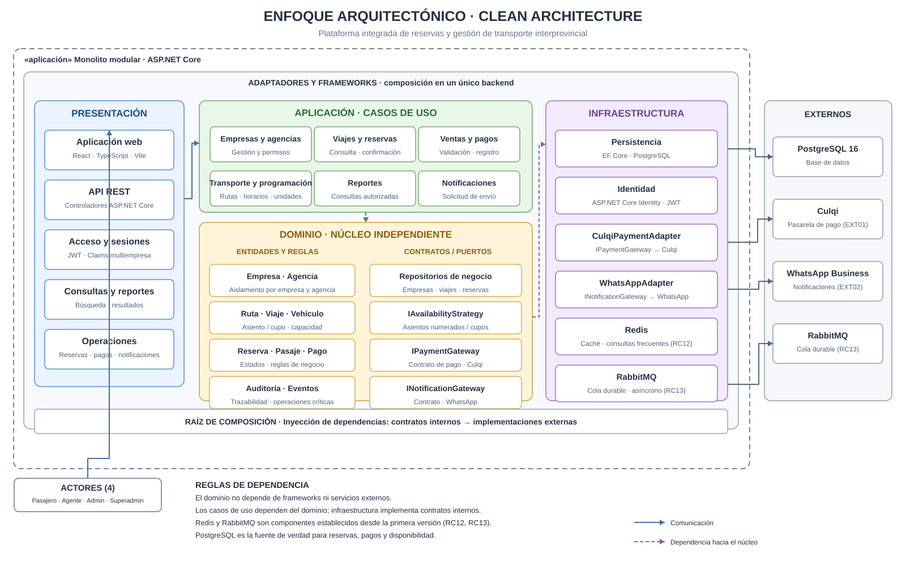

# Enfoque Arquitectónico

## 1. Clean Architecture

La solución utiliza **Clean Architecture** dentro del monolito modular. Su objetivo es mantener las reglas del negocio independientes de frameworks, base de datos y proveedores externos. Esta decisión responde al driver **DA14** y a la restricción **RC15** del análisis de sistema.

## 2. Capas

| Capa | Responsabilidad | Drivers relacionados |
|---|---|---|
| Presentación | Aplicación web responsive y controladores REST; recibe solicitudes y entrega respuestas. | DA03 |
| Aplicación | Casos de uso, autorización contextual (rol, empresa, agencia) y contratos de integración/persistencia. | DA04, DA06 |
| Dominio | Entidades, reglas de reservas por TripSeat, disponibilidad, concurrencia, estados y transporte. | DA02, DA03, DA08 |
| Infraestructura | EF Core, PostgreSQL, Redis, RabbitMQ, Identity y adaptadores de Culqi y WhatsApp. | DA09, DA10, DA11 |

## 3. Diagrama del enfoque

**Figura 3.** Organización interna de Clean Architecture y dirección de dependencias.

## 4. Aplicación al proyecto

- **Reservas:** el dominio define las reglas de disponibilidad por `TripSeat`, estados (`HELD`, `CONFIRMED`, `CANCELLED`, `EXPIRED`, `RESCHEDULED`) y concurrencia; la aplicación coordina los casos de uso y `IReservationRepository` accede a PostgreSQL. *(DA02, DA03, DA07, DA08)*
- **Seguridad:** la aplicación valida rol, `company_id` y agencia activa elegida mediante `X-Agency-Id`, contrastándola con `agency_ids[]`. *(DA04, DA06)*
- **Pagos:** `IPaymentGateway` (Aplicación) es implementada por `CulqiPaymentAdapter` (Infraestructura). *(DA09, DA11)*
- **Notificaciones:** `INotificationGateway` (Aplicación) es implementada por `WhatsAppNotificationAdapter` (Infraestructura); Outbox y RabbitMQ evitan bloquear la operación principal. *(DA10, DA12)*
- **Alta demanda:** Redis atiende consultas frecuentes de rutas, horarios y servicios, reduciendo la carga sobre PostgreSQL. RabbitMQ procesa alertas preventivas y tareas secundarias de forma asíncrona. *(DA06, DA10, DA11)*

## 5. Regla de dependencias

1. El dominio no depende de frameworks, bases de datos ni servicios externos.
2. Los casos de uso dependen únicamente del dominio y de contratos internos (interfaces).
3. Los controladores delegan en casos de uso y no contienen reglas de negocio.
4. La infraestructura implementa los contratos definidos en Aplicación y Dominio mediante inyección de dependencias.
5. Redis y RabbitMQ no contienen ni aplican reglas críticas del negocio.
6. Los módulos permanecen dentro del mismo backend y no se consideran microservicios independientes.
7. El aislamiento entre empresas y agencias se aplica mediante validación del caso de uso y filtros globales de persistencia.
8. Toda integración externa y persistencia se accede mediante interfaz en Aplicación e implementación en Infraestructura.
