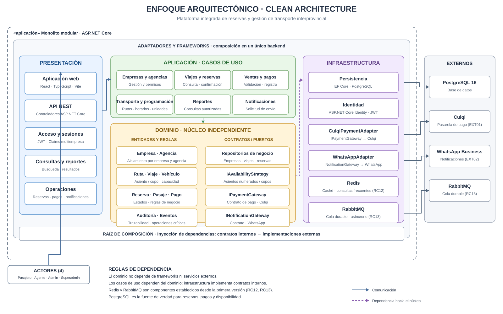

# Enfoque Arquitectónico

## 1. Clean Architecture

La solución utiliza **Clean Architecture** dentro del monolito modular. Su objetivo es mantener las reglas del negocio independientes de frameworks, base de datos y proveedores externos. Esta decisión responde al driver **DA14** y a la restricción **RC15** del análisis de sistema.

## 2. Capas

| Capa | Responsabilidad | Drivers relacionados |
|---|---|---|
| Presentación | Aplicación web y controladores REST; recibe solicitudes y entrega respuestas. | DA-03 |
| Aplicación | Casos de uso, autorización contextual (rol, empresa, agencia) y coordinación de operaciones. | DA-04, DA-06 |
| Dominio | Entidades, reglas de reservas, disponibilidad, control de concurrencia, estados y transporte. | DA-02, DA-03, DA-08 |
| Adaptadores e infraestructura | EF Core, PostgreSQL, Redis, RabbitMQ, Identity y adaptadores de Culqi y WhatsApp. | DA-09, DA-10, DA-11 |

## 3. Diagrama del enfoque

**Figura 3.** Organización interna de Clean Architecture y dirección de dependencias.

## 4. Aplicación al proyecto

- **Reservas:** el dominio define las reglas de disponibilidad, estados (`HELD`, `CONFIRMED`, `EXPIRED`, `CANCELLED`) y control de concurrencia; la capa de aplicación coordina el caso de uso y PostgreSQL garantiza la integridad transaccional. *(DA-02, DA-03, DA-07, DA-08)*
- **Seguridad:** la capa de aplicación valida el contexto del usuario (rol, empresa y agencia) antes de ejecutar cualquier operación privada. Los controladores no ejecutan lógica de autorización directamente. *(DA-04, DA-06)*
- **Pagos:** el contrato `IPaymentGateway` permite integrar Culqi sin acoplar el dominio al proveedor. Un futuro cambio de pasarela solo afectaría al adaptador correspondiente. *(DA-09, DA-11)*
- **Notificaciones:** `INotificationGateway` permite enviar mensajes por WhatsApp Business Cloud API mediante RabbitMQ, sin bloquear la operación principal de reserva o venta. *(DA-10, DA-12)*
- **Alta demanda:** Redis atiende consultas frecuentes de rutas, horarios y servicios, reduciendo la carga sobre PostgreSQL. RabbitMQ procesa alertas preventivas y tareas secundarias de forma asíncrona. *(DA-06, DA-10, DA-11)*

## 5. Regla de dependencias

1. El dominio no depende de frameworks, bases de datos ni servicios externos.
2. Los casos de uso dependen únicamente del dominio y de contratos internos (interfaces).
3. Los controladores delegan en casos de uso y no contienen reglas de negocio.
4. La infraestructura implementa los contratos definidos en el dominio y la aplicación mediante inyección de dependencias.
5. Redis y RabbitMQ no contienen ni aplican reglas críticas del negocio.
6. Los módulos permanecen dentro del mismo backend y no se consideran microservicios independientes.
7. El aislamiento entre empresas y agencias se aplica en la capa de aplicación antes de acceder a cualquier recurso del dominio o la infraestructura.
