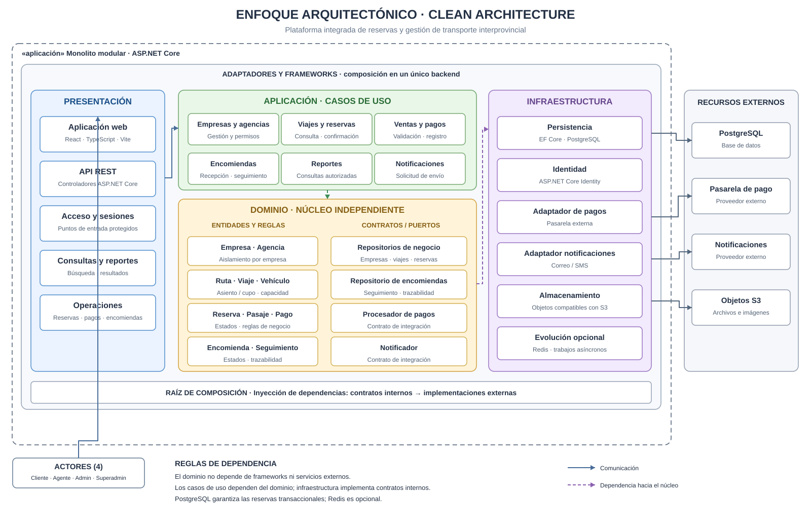

# Enfoque arquitectónico

## 1. Descripción

La Plataforma Integrada de Reservas y Gestión de Transporte Interprovincial adopta **Clean Architecture** para organizar las dependencias internas de un **monolito modular con arquitectura en capas**. Las reglas de negocio permanecen independientes de frameworks, bases de datos e integraciones externas.

**Regla fundamental:** las dependencias de código se orientan hacia las capas internas; el dominio no depende de la infraestructura.

## 2. Organización del enfoque

| Capa | Responsabilidad | Elementos del proyecto |
|---|---|---|
| **Dominio** | Modelar entidades y reglas de negocio. | Empresa, agencia, ruta, vehículo, viaje programado, asiento/cupo, reserva, pago y encomienda. |
| **Aplicación** | Coordinar casos de uso y definir contratos para servicios externos y persistencia. | Buscar viajes, gestionar reservas, verificar pagos, gestionar encomiendas y generar reportes. |
| **Adaptadores de interfaz** | Traducir solicitudes y respuestas entre la aplicación y el exterior. | Controladores REST, DTO, validadores y adaptadores de entrada/salida. |
| **Infraestructura y frameworks** | Implementar mecanismos tecnológicos concretos. | ASP.NET Core, EF Core, PostgreSQL, ASP.NET Core Identity, almacenamiento de objetos y proveedores externos. |

La **aplicación web React + TypeScript + Vite** es un cliente externo al backend que consume la API REST mediante HTTPS.

## 3. Diagrama del enfoque

**Figura 3.** Capas y dirección de dependencias de Clean Architecture en el monolito modular.

## 4. Aplicación al proyecto

- **Reservas:** el dominio define reglas de capacidad y disponibilidad; la aplicación coordina el caso de uso y la infraestructura garantiza la atomicidad mediante transacciones y restricciones de PostgreSQL.
- **Seguridad multiempresa:** la identidad se gestiona con ASP.NET Core Identity; la autorización valida rol, empresa y agencia en las operaciones correspondientes.
- **Pagos:** la aplicación define el contrato de integración; el adaptador verifica las respuestas de la pasarela y aplica idempotencia.
- **Encomiendas:** el dominio aplica políticas y estados de envío por empresa; la infraestructura persiste los movimientos y la evidencia de entrega.

## 5. Reglas de dependencia

1. El dominio no referencia frameworks ni servicios externos.
2. Los casos de uso dependen del dominio y de contratos definidos hacia el interior.
3. Los controladores invocan casos de uso; no implementan reglas de negocio.
4. La infraestructura implementa los contratos requeridos por la aplicación y se conecta mediante inyección de dependencias.
5. Los módulos se mantienen dentro del mismo backend, con límites funcionales claros; no constituyen microservicios.

## 6. Relación con las decisiones arquitectónicas

| Elemento | Decisión vigente |
|---|---|
| Estilo | Arquitectura en capas |
| Organización | Monolito modular |
| Enfoque | Clean Architecture |
| Cliente web | React + TypeScript + Vite |
| API | ASP.NET Core + C#, REST/HTTPS |
| Persistencia principal | PostgreSQL + EF Core |
| Identidad | ASP.NET Core Identity |
| Evolución opcional | Redis, mensajería duradera y escalamiento horizontal según necesidad |

**Driver principal relacionado:** **DA06 — Mantenibilidad y evolución modular**. El enfoque también contribuye a DA01 (consistencia de reservas y pagos) y DA02 (seguridad y aislamiento multiempresa).
