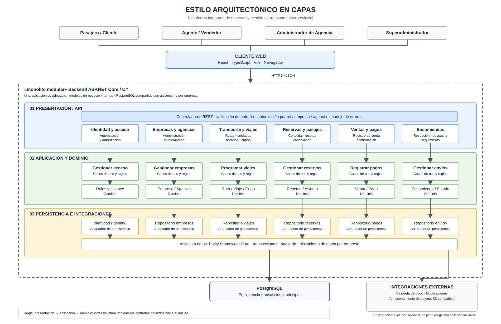

# Estilo Arquitectónico

## 1. Descripción

La **Plataforma Integrada de Reservas y Gestión de Transporte Interprovincial** adopta la **arquitectura en capas** como estilo arquitectónico. Su implementación se organiza como un **monolito modular**, aplicando **Clean Architecture** para controlar las dependencias internas.

Esta combinación permite desarrollar y desplegar un único backend, separar las responsabilidades del negocio y evolucionar los módulos sin introducir microservicios prematuramente.

## 2. Estilo seleccionado: arquitectura en capas

La solución distingue cuatro capas:

| Capa | Responsabilidad principal |
|---|---|
| **Presentación** | Aplicación web React y controladores REST de ASP.NET Core; reciben solicitudes y devuelven respuestas. |
| **Aplicación** | Ejecuta casos de uso y coordina operaciones de empresas, viajes, reservas, pagos y encomiendas. |
| **Dominio** | Define entidades, reglas de negocio y políticas de disponibilidad, capacidad, reservas y seguimiento. |
| **Infraestructura** | Implementa persistencia PostgreSQL con EF Core, identidad, almacenamiento e integraciones externas. |

Las dependencias del código se dirigen hacia el núcleo: **dominio y aplicación no dependen de implementaciones de infraestructura**.

## 3. Diagrama del estilo arquitectónico

## 4. Organización como monolito modular

Los módulos de **identidad y acceso, empresas y agencias, transporte y programación, reservas y pasajes, ventas y pagos, encomiendas, consultas y reportes, auditoría y notificaciones** se integran en un mismo backend ASP.NET Core, con responsabilidades y límites definidos.

Los módulos se comunican mediante contratos internos y casos de uso, evitando el acceso directo a las implementaciones o datos privados de otros módulos. El backend puede desplegarse en varias instancias sin convertirse en una arquitectura de microservicios.

## 5. Reglas arquitectónicas

1. **Separación de responsabilidades:** cada capa cumple una función específica.
2. **Dependencias hacia el núcleo:** dominio y casos de uso permanecen independientes de frameworks y proveedores externos.
3. **Modularidad:** cada módulo conserva sus reglas y contratos; las operaciones entre módulos se coordinan explícitamente.
4. **Integridad transaccional:** PostgreSQL es la fuente de verdad para reservas, asientos o cupos y confirmaciones de pago; deben evitarse las sobreventas.
5. **Seguridad multiempresa:** las operaciones respetan el alcance de empresa, agencia y rol del usuario.
6. **Integraciones desacopladas:** pagos, notificaciones y almacenamiento se acceden mediante interfaces y adaptadores.
7. **Evolución gradual:** Redis y el procesamiento asíncrono mediante colas se consideran únicamente si la demanda lo justifica.

## 6. Justificación

La arquitectura en capas favorece la **mantenibilidad (DA06)** y la separación de responsabilidades. El monolito modular simplifica el despliegue y permite coordinar operaciones transaccionales críticas (**DA01**), mientras que los límites de acceso apoyan la seguridad multiempresa (**DA02**). La separación entre lógica de negocio e infraestructura facilita futuras mejoras de rendimiento, disponibilidad y escalabilidad (**DA03–DA05**).

**Conclusión:** el estilo arquitectónico es **en capas**; el **monolito modular** define la organización del backend y **Clean Architecture** establece las reglas de dependencia. Son decisiones complementarias, no estilos distintos ni una arquitectura de microservicios.
