# Tácticas Arquitectónicas

## 1. Concepto y diferenciación (Paso 8)

Las **tácticas arquitectónicas** son decisiones de diseño concretas orientadas a satisfacer uno o más **atributos de calidad** del sistema. Se diferencian del enfoque arquitectónico (Clean Architecture) y de los patrones de diseño (Strategy, Factory, Adapter), que operan en niveles distintos.

> **Distinción clave:**
> - **Enfoque arquitectónico** (Clean Architecture, Hexagonal, Onion): define la filosofía de organización del código y la dirección de dependencias hacia el núcleo del dominio. *No es una táctica.*
> - **Táctica arquitectónica** (Caché, Rate Limiting, Circuit Breaker, Bloqueo pesimista): es la técnica concreta de ingeniería aplicada para satisfacer un atributo de calidad medible.
> - **Patrón de diseño** (Strategy, Factory, Adapter): resuelve un problema de diseño a nivel de clases y objetos en el código interno.

---

## 2. Mapa de tácticas del sistema

```mermaid
flowchart TD
    subgraph ATRIBUTOS["Atributos de Calidad (del análisis)"]
        AC01["AC01: Rendimiento<br/>(Búsquedas rápidas)"]
        AC02["AC02: Escalabilidad<br/>(Picos de demanda)"]
        AC03["AC03: Disponibilidad<br/>(Tolerancia a fallos)"]
        AC04["AC04: Seguridad<br/>(Aislamiento y protección)"]
        AC05["AC05: Concurrencia<br/>(Cero sobreventa)"]
        AC06["AC06: Integridad y consistencia<br/>(Estados coherentes)"]
        AC07["AC07: Mantenibilidad<br/>(Evolución sin acoplamientos)"]
        AC08["AC08: Interoperabilidad<br/>(Integración con externos)"]
        AC09["AC09: Trazabilidad y auditoría<br/>(Rastreo de operaciones)"]
    end

    subgraph TACTICAS["Tácticas Arquitectónicas Implementadas (Paso 8)"]
        T_CACHE["1. Caché<br/>Redis para consultas frecuentes"]
        T_ASYN["2. Colas y eventos<br/>RabbitMQ para procesamiento asíncrono"]
        T_BAL["3. Balanceo de carga<br/>Nginx reverse proxy + instancias stateless"]
        T_REPL["4. Replicación de datos<br/>Read-Replicas PostgreSQL"]
        T_RETRY["5. Retry y Circuit Breaker<br/>Polly ante servicios externos"]
        T_AUTH["6. Autenticación y autorización<br/>JWT + Claims multiempresa/agencia"]
        T_RATE["7. Rate Limiting<br/>Límite por IP y usuario"]
        T_LOCK["8. Bloqueo pesimista e índice único parcial<br/>SELECT FOR UPDATE + Unique Index"]
        T_MOD["9. Aislamiento modular por contratos<br/>Interfaces públicas entre módulos"]
        T_ADAP["10. Patrón Adapter<br/>Adaptadores para Culqi y WhatsApp"]
        T_AUDIT["11. Auditoría y logs estructurados<br/>Registro de operaciones críticas"]
    end

    AC01 --> T_CACHE
    AC01 --> T_ASYN
    AC02 --> T_BAL
    AC02 --> T_CACHE
    AC03 --> T_RETRY
    AC03 --> T_BAL
    AC03 --> T_REPL
    AC04 --> T_AUTH
    AC04 --> T_RATE
    AC05 --> T_LOCK
    AC06 --> T_LOCK
    AC07 --> T_MOD
    AC08 --> T_ADAP
    AC09 --> T_AUDIT

    classDef atrib fill:#E8EAF6,stroke:#3F51B5,color:#1A237E
    classDef tac fill:#E8F5E9,stroke:#4CAF50,color:#1B5E20
    class AC01,AC02,AC03,AC04,AC05,AC06,AC07,AC08,AC09 atrib
    class T_CACHE,T_ASYN,T_BAL,T_REPL,T_RETRY,T_AUTH,T_RATE,T_LOCK,T_MOD,T_ADAP,T_AUDIT tac
```



---

## 3. Catálogo de tácticas implementadas

### Táctica 1: Caché — Para Rendimiento (AC01)

**Objetivo:** Reducir los tiempos de respuesta en las operaciones de lectura más frecuentes, aliviando la carga sobre PostgreSQL durante periodos de alta demanda.

**Aplicación:** Las consultas de rutas, destinos, empresas, agencias, horarios y servicios disponibles se sirven desde **Redis**. Redis es un componente obligatorio desde la primera versión (RC12).

**Regla de integridad:** La disponibilidad de asientos en tiempo real **nunca se cachea como fuente definitiva**. Las operaciones críticas de reserva siempre consultan PostgreSQL como fuente de verdad.

```text
Cliente
   ↓
API
   ↓
Redis (consulta frecuente)
  ├── Existe → responder
  └── No existe
        ↓
    PostgreSQL
        ↓
     Redis (almacenar)
```

**Driver relacionado:** DA-06, DA-11

---

### Táctica 2: Colas y procesamiento asíncrono — Para Rendimiento y Desacoplamiento (AC01, AC03)

**Objetivo:** Evitar que operaciones secundarias como el envío de notificaciones demoren o bloqueen la confirmación de reservas y ventas.

**Aplicación:** Se utiliza **RabbitMQ** como cola durable para publicar eventos después de completar las operaciones principales. Un consumidor independiente procesa los mensajes y envía notificaciones mediante WhatsApp Business Cloud API.

```text
Reserva confirmada
       ↓
Publicar evento en RabbitMQ
       ↓
Consumidor de eventos
       ↓
Adaptador de notificaciones
       ↓
WhatsApp Business Cloud API
```

Si WhatsApp presenta una falla temporal, la operación principal queda correctamente persistida. Los eventos pendientes en la cola se reintentan según la política configurada.

**Driver relacionado:** DA-10, DA-13

---

### Táctica 3: Balanceo de carga — Para Escalabilidad y Disponibilidad (AC02, AC03)

**Objetivo:** Distribuir el tráfico entre múltiples instancias del backend durante periodos de alta demanda como festividades, feriados o temporadas de mayor movilidad.

**Aplicación:** Proxy inverso **Nginx** configurado con algoritmo *Least Connections* hacia las instancias Docker de la API REST. El backend es completamente *stateless* (sin estado en sesión de memoria), por lo que cualquier instancia puede atender cualquier solicitud.

```text
                   Nginx (Balanceador)
                        │
         ┌──────────────┼──────────────┐
         ▼              ▼              ▼
      API (inst. 1)  API (inst. 2)  API (inst. N)
         │              │              │
         └──────────────┼──────────────┘
                        ▼
                    PostgreSQL
```

**Driver relacionado:** DA-01, DA-05, DA-14

---

### Táctica 4: Replicación de datos — Para Disponibilidad y Rendimiento de lectura (AC03, AC01)

**Objetivo:** Proteger la base de datos ante fallos y descargar el tráfico de reportes y analítica del nodo principal.

**Aplicación:** Replicación física en streaming de PostgreSQL:

- **Nodo Primario:** exclusivo para operaciones de escritura transaccional (reservas, pagos, ventas).
- **Réplica de Lectura:** atiende consultas del módulo de Reportes y Auditoría, evitando que la generación de reportes bloquee las operaciones críticas de reserva.

**Driver relacionado:** DA-05, DA-06

---

### Táctica 5: Retry y Circuit Breaker — Para Resiliencia y Disponibilidad (AC03, AC08)

**Objetivo:** Evitar que una caída transitoria de Culqi o WhatsApp Business Cloud API bloquee o degrade el backend principal.

**Aplicación:** Implementación con **Polly** en ASP.NET Core:

- **Retry con Backoff Exponencial:** ante error 503 o timeout de la pasarela de pagos Culqi, se reintenta 3 veces con espera incremental (2 s, 4 s, 8 s) más jitter.
- **Circuit Breaker:** si el servicio externo falla 5 veces consecutivas, el circuito se abre durante 30 segundos, rechazando nuevas solicitudes de inmediato y retornando un mensaje controlado al usuario.

**Driver relacionado:** DA-09, DA-10

---

### Táctica 6: Autenticación y autorización basada en Claims — Para Seguridad (AC04)

**Objetivo:** Impedir el acceso no autorizado y garantizar el aislamiento de información entre empresas y agencias en la misma base de datos compartida.

**Aplicación:** Emisión de tokens **JWT** firmados con claves asimétricas. El token contiene los siguientes claims obligatorios:

| Claim | Contenido |
|---|---|
| `sub` | Identificador del usuario |
| `role` | Pasajero, Agente, Administrador de Agencia, Superadministrador |
| `company_id` | Identificador de la empresa autorizada |
| `agency_id` | Identificador de la agencia asignada (cuando corresponde) |

Los middlewares de autorización en ASP.NET Core rechazan cualquier solicitud fuera del ámbito organizacional antes de que llegue a la lógica de negocio.

**Driver relacionado:** DA-04, DA-06

---

### Táctica 7: Rate Limiting — Para Seguridad y Disponibilidad (AC04, AC03)

**Objetivo:** Proteger la plataforma contra ataques de fuerza bruta en el inicio de sesión y abuso de scraping en el motor de búsqueda de viajes.

**Aplicación:** Middleware nativo de Rate Limiting en ASP.NET Core 8:

- Endpoints de búsqueda (`/api/v1/trips/search`): máximo 60 peticiones por minuto por IP.
- Endpoints de autenticación (`/api/v1/auth/login`): máximo 5 intentos fallidos cada 5 minutos por usuario antes del bloqueo temporal.

**Driver relacionado:** DA-04

---

### Táctica 8: Bloqueo pesimista e índice único parcial — Para Concurrencia e Integridad (AC05, AC06)

**Objetivo:** Garantizar cero sobreventa de asientos o cupos en escenarios de alta concurrencia, donde pasajeros y agentes intentan reservar simultáneamente el mismo recurso.

**Aplicación:**

- **En la capa de infraestructura:** consulta con bloqueo pesimista `SELECT ... FOR UPDATE` sobre la fila del servicio o del asiento durante la transacción de creación de reserva. Solo una transacción puede avanzar; las demás esperan o son rechazadas.
- **En la base de datos física:** índice único condicional como segunda línea de defensa:

```sql
CREATE UNIQUE INDEX idx_unique_active_seat
  ON reservations (trip_id, seat_number)
  WHERE status IN ('Held', 'Confirmed');
```

Si dos transacciones concurrentes intentan confirmar el mismo asiento, la primera consolida y la segunda es abortada por el motor relacional con error de clave duplicada.

```text
Pasajero A ──┐
             ├──> PostgreSQL
Pasajero B ──┘        │
Agente ───────────────┘
                 ↓
         SELECT FOR UPDATE
                 ↓
      Una sola confirmación válida
```

**Driver relacionado:** DA-02, DA-03, DA-07

---

### Táctica 9: Aislamiento modular por contratos — Para Mantenibilidad (AC07)

**Objetivo:** Permitir que los módulos del monolito evolucionen de forma independiente sin generar acoplamiento entre sus implementaciones internas.

**Aplicación:** Cada módulo expone únicamente sus casos de uso e interfaces públicas. Los demás módulos interactúan a través de estos contratos, sin acceder directamente a las entidades o repositorios internos de otro módulo.

**Driver relacionado:** DA-05, DA-14

---

### Táctica 10: Patrón Adapter — Para Interoperabilidad (AC08)

**Objetivo:** Mantener la lógica de negocio independiente de los proveedores externos de pagos y notificaciones, facilitando una futura sustitución sin modificar el dominio.

**Aplicación:**

```text
Dominio / Aplicación
        │
        ▼
  IPaymentGateway ──────► CulqiPaymentAdapter ──► Culqi
  INotificationGateway ─► WhatsAppAdapter ────────► WhatsApp Business Cloud API
```

Un cambio de pasarela de pagos o de canal de notificaciones afecta únicamente al adaptador correspondiente, sin modificar las reglas de reservas ni los casos de uso.

**Driver relacionado:** DA-09, DA-10, DA-13

---

### Táctica 11: Auditoría y logs estructurados — Para Trazabilidad (AC09)

**Objetivo:** Mantener un registro completo de las operaciones críticas para permitir investigar errores, operaciones no autorizadas y problemas de negocio.

**Aplicación:** Registro estructurado de las operaciones críticas utilizando **Serilog**. Cada registro conserva:

| Campo | Descripción |
|---|---|
| `usuario` | Identificador del actor que realizó la operación |
| `rol` | Rol del usuario |
| `empresa` | Empresa sobre la que se operó |
| `agencia` | Agencia sobre la que se operó |
| `operación` | Tipo de operación realizada |
| `fecha_hora` | Marca temporal de la operación |
| `recurso_afectado` | Entidad modificada (reserva, servicio, pago, etc.) |
| `resultado` | Resultado de la operación |

**Driver relacionado:** DA-04, DA-12, DA-15

---

## 4. Matriz de trazabilidad: Atributos de Calidad vs. Tácticas

| Atributo de Calidad | Driver Vinculado | Táctica Arquitectónica Aplicada | Mecanismo Técnico |
|---|---|---|---|
| **AC01 — Rendimiento** | DA-06, DA-11 | Caché de lectura | Redis para rutas, horarios y servicios |
| **AC01 — Rendimiento** | DA-10 | Procesamiento asíncrono | RabbitMQ para notificaciones y eventos secundarios |
| **AC02 — Escalabilidad** | DA-01, DA-05 | Balanceo de carga | Nginx + múltiples instancias stateless de la API |
| **AC03 — Disponibilidad** | DA-05, DA-06 | Replicación de datos | Streaming replication Primario-Standby PostgreSQL |
| **AC03 — Disponibilidad** | DA-09, DA-10 | Circuit Breaker y reintentos | Polly con backoff exponencial ante Culqi y WhatsApp |
| **AC04 — Seguridad** | DA-04, DA-06 | Autenticación y autorización RBAC | Tokens JWT con Claims de Rol, Empresa y Agencia |
| **AC04 — Seguridad** | DA-04 | Rate Limiting | RateLimiter Middleware contra fuerza bruta y scraping |
| **AC05 — Concurrencia** | DA-02, DA-03 | Bloqueo pesimista e índice único parcial | `SELECT FOR UPDATE` + índice único condicional en PostgreSQL |
| **AC06 — Integridad y consistencia** | DA-03, DA-07, DA-08 | Bloqueo pesimista + transacciones ACID | Transacciones PostgreSQL sobre reservas y disponibilidad |
| **AC07 — Mantenibilidad** | DA-05, DA-14 | Aislamiento modular por contratos | Interfaces públicas de aplicación entre módulos del monolito |
| **AC08 — Interoperabilidad** | DA-09, DA-10, DA-13 | Patrón Adapter | Adaptadores de Culqi y WhatsApp Business Cloud API |
| **AC09 — Trazabilidad** | DA-04, DA-12, DA-15 | Auditoría y logs estructurados | Serilog con campos de auditoría en todas las operaciones críticas |

---

## 5. Conclusión

Las 11 tácticas arquitectónicas seleccionadas responden directamente a los atributos de calidad prioritarios identificados en el análisis del sistema.

La distinción entre **enfoque arquitectónico** (Clean Architecture como organización del código), **tácticas de calidad** (Caché, Rate Limiting, Circuit Breaker, Bloqueo pesimista) y **patrones de diseño** (Adapter, Strategy) garantiza la coherencia conceptual del diseño y la alineación con los drivers arquitectónicos del proyecto.
