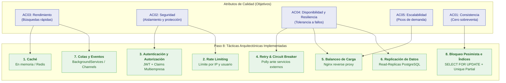

# Tácticas Arquitectónicas

## 1. Fundamentación y Concepto (Paso 8 de la Docente)

Las **Tácticas Arquitectónicas** son decisiones de diseño de software concebidas para influir directamente en el cumplimiento de uno o más **Atributos de Calidad** (Rendimiento, Seguridad, Disponibilidad, Escalabilidad, Resiliencia).

> [!IMPORTANT]
> **Diferenciación conceptual clave enseñada por la docente:**
> * **Enfoque Arquitectónico (ej. Clean Architecture, Hexagonal, Onion):** Define la filosofía y las reglas estructurales de dependencias hacia el núcleo del dominio. *Clean Architecture NO es una táctica.*
> * **Táctica Arquitectónica (ej. Caché, Rate Limiting, Circuit Breaker):** Es la técnica concreta de ingeniería aplicada para satisfacer un escenario o atributo de calidad medible.
> * **Patrón de Diseño (ej. Strategy, Factory, Adapter):** Resuelve un problema de diseño a nivel de clases y objetos en el código interno.

---

## 2. Mapa de Tácticas Arquitectónicas del Sistema



---

## 3. Catálogo de Tácticas Implementadas en la Plataforma

### Táctica 1: Caché (Para Rendimiento — AC03)
* **Objetivo:** Reducir drásticamente los tiempos de respuesta en las operaciones de lectura más frecuentes.
* **Aplicación:** Las consultas de terminales, ciudades origen-destino, empresas y rutas fijas se cachean en memoria (`IMemoryCache` de ASP.NET Core). En una fase de alto volumen, se incorpora Redis para compartir caché entre múltiples instancias de la API.
* **Regla de integridad:** **La disponibilidad de asientos en tiempo real NUNCA se cachea** sin invalidación inmediata, para evitar que dos usuarios vean como disponible un asiento que acaba de ser reservado.

### Táctica 2: Autenticación y Autorización Basada en Claims (Para Seguridad — AC02)
* **Objetivo:** Impedir el acceso no autorizado y garantizar el aislamiento absoluto entre empresas de transporte competidoras.
* **Aplicación:** Emisión de tokens criptográficos JWT firmados con claves asimétricas. El token contiene Claims obligatorios: `sub` (Id del usuario), `role` (Pasajero, Agente, Admin, Superadmin), `company_id` (identificador de la empresa autorizada) y `agency_id`.
* **Mecanismo:** Middlewares de autorización en ASP.NET Core rechazan cualquier solicitud fuera del ámbito organizacional antes de que llegue a la lógica de negocio.

### Táctica 3: Rate Limiting (Para Seguridad y Disponibilidad — AC02, AC04)
* **Objetivo:** Proteger la plataforma contra ataques de fuerza bruta en el inicio de sesión y abuso de scraping en el motor de búsqueda de pasajes.
* **Aplicación:** Middleware nativo de Rate Limiting en ASP.NET Core 8:
  * Endpoints de búsqueda (`/api/v1/trips/search`): Máximo 60 peticiones por minuto por IP.
  * Endpoints de autenticación (`/api/v1/auth/login`): Máximo 5 intentos fallidos cada 5 minutos por usuario antes de bloqueo temporal.

### Táctica 4: Retry y Circuit Breaker (Para Resiliencia — AC04, AC09)
* **Objetivo:** Evitar que una caída transitoria de la pasarela de pagos (Stripe/Culqi) o del servicio de SMS/Email bloquee o tumbe el backend.
* **Aplicación:** Implementación con **Polly** en ASP.NET Core:
  * **Retry con Backoff Exponencial:** Si la pasarela responde con error 503 o timeout de red, se reintenta 3 veces espaciando la espera (2s, 4s, 8s) con jitter.
  * **Circuit Breaker:** Si el servicio externo falla 5 veces consecutivas, el circuito se abre por 30 segundos, rechazando de inmediato nuevas solicitudes para no agotar los hilos del servidor y retornando un mensaje claro al usuario ("Pasarela en mantenimiento temporal").

### Táctica 5: Balanceo de Carga (Para Escalabilidad y Disponibilidad — AC04, AC05)
* **Objetivo:** Distribuir el tráfico de peticiones entrantes entre múltiples réplicas del contenedor de la API en temporadas de alta demanda (Semana Santa, Fiestas Patrias).
* **Aplicación:** Proxy inverso **Nginx** configurado como balanceador de carga HTTP con algoritmo *Least Connections* hacia las instancias Docker de la API REST. Dado que el backend es completamente *stateless* (sin estado en memoria de sesión), cualquier réplica puede atender cualquier petición.

### Táctica 6: Replicación de Datos (Para Disponibilidad y Rendimiento de Lectura — AC03, AC04)
* **Objetivo:** Proteger la base de datos contra fallos del servidor físico y descargar el tráfico de consultas de reportes y analítica.
* **Aplicación:** Configuración de replicación física en streaming de PostgreSQL:
  * **Nodo Primario (Primary):** Exclusivo para operaciones de escritura transaccional (crear reservas, confirmar pagos, registrar encomiendas).
  * **Réplica de Lectura (Standby Read-Replica):** Atiende las consultas pesadas del módulo de Reportes y Auditoría (MI07, MI08), evitando que la generación de reportes lentos bloquee las reservas en ventanilla.

### Táctica 7: Colas y Procesamiento Asíncrono en Segundo Plano (Para Desacoplamiento — AC06, AC09)
* **Objetivo:** Evitar que tareas secundarias y pesadas demoren la confirmación de la reserva o la compra del pasaje.
* **Aplicación:** Canales asíncronos en memoria (`System.Threading.Channels`) y servicios en segundo plano (`IHostedService` / `BackgroundService` en ASP.NET Core):
  * La confirmación del pago en base de datos toma menos de 100 ms.
  * La generación del PDF del boleto digital y el envío del correo electrónico o SMS se despachan a la cola interna asíncrona, ejecutándose en segundo plano sin hacer esperar al pasajero en la pantalla.

### Táctica 8: Bloqueo Pesimista e Índice Único Parcial (Para Consistencia Transaccional — AC01)
* **Objetivo:** Garantizar de forma infalible la regla de CERO SOBREVENTA en escenarios de alta concurrencia.
* **Aplicación:**
  * **En el código de infraestructura:** Consulta con bloqueo pesimista `SELECT ... FOR UPDATE` sobre la fila del viaje o del asiento durante la transacción de creación de reserva.
  * **En el motor físico de base de datos:** Índice único condicional:
    ```sql
    CREATE UNIQUE INDEX idx_unique_active_seat ON reservations (trip_id, seat_number)
    WHERE status IN ('Held', 'Confirmed');
    ```
  * Si dos transacciones intentan ocupar el mismo asiento simultáneamente, la primera se consolida y la segunda es abortada por el motor relacional con error de clave duplicada, evitando el overbooking a nivel físico.

---

## 4. Matriz de Trazabilidad: Atributos de Calidad vs. Tácticas

| Atributo de Calidad | Driver Vinculado | Táctica Arquitectónica Aplicada | Mecanismo Técnico |
|---|---|---|---|
| **AC01 — Consistencia** | DA01 | Bloqueo pesimista e índices parciales | `SELECT FOR UPDATE` + Índice único condicional en PostgreSQL |
| **AC02 — Seguridad** | DA02 | Autenticación y Autorización RBAC | Tokens JWT + Claims de Rol, Empresa y Agencia |
| **AC02 — Seguridad** | DA02 | Rate Limiting | RateLimiter Middleware (control de fuerza bruta en logins) |
| **AC03 — Rendimiento** | DA03 | Caché de lectura | `IMemoryCache` para catálogos y rutas fijas |
| **AC03 — Rendimiento** | DA03 | Procesamiento asíncrono en segundo plano | `System.Threading.Channels` para generación de PDFs y notificaciones |
| **AC04 — Disponibilidad**| DA04 | Circuit Breaker y Reintentos | Librería Polly con backoff exponencial ante pasarelas |
| **AC04 — Disponibilidad**| DA04 | Replicación de base de datos | Streaming replication Primario-Standby en PostgreSQL |
| **AC05 — Escalabilidad** | DA05 | Balanceo de carga y arquitectura sin estado | Nginx Reverse Proxy + múltiples instancias Docker de API |
| **AC06 — Mantenibilidad**| DA06 | Aislamiento modular por contratos | Interfaces públicas de aplicación entre módulos del monolito |
| **AC09 — Interoperabilidad**| DA07 | Patrón Adapter con verificación criptográfica | Adaptadores de pago con validación de webhooks idempotentes (HMAC) |

---

## 5. Conclusión

Las 8 tácticas arquitectónicas seleccionadas responden punto por punto a los atributos de calidad prioritarios del sistema. 

Al separar claramente los **enfoques arquitectónicos** (Clean Architecture en capas) de las **tácticas de calidad** (Caché, Rate Limiting, Circuit Breaker, Bloqueo Pesimista), el diseño del sistema alcanza la rigurosidad técnica y conceptual exigida por la cátedra de Arquitectura de Software.
