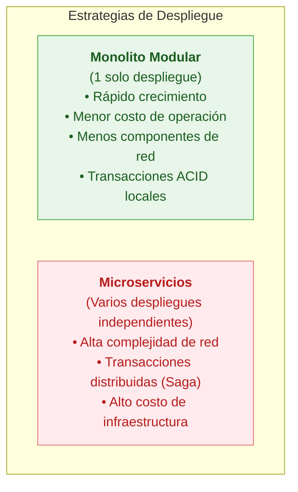
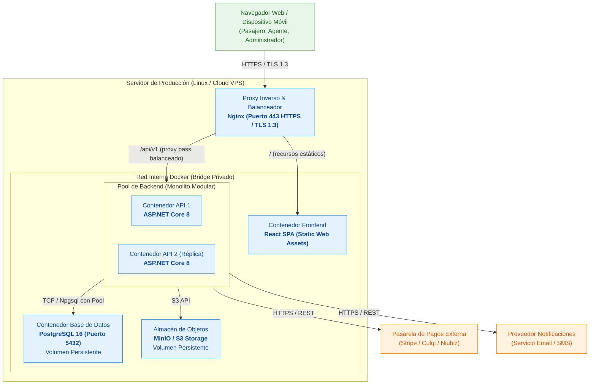
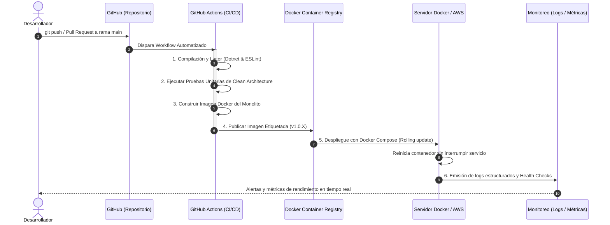

# Tecnologías, Implementación y Despliegue

## 1. Principio Rector (Paso 11 de la Docente)

> [!IMPORTANT]
> **Máxima de la docente:**
> *"La tecnología implementa decisiones: no define por sí sola la arquitectura."*
> 
> Las tecnologías seleccionadas son el medio para concretar los estilos, enfoques y tácticas arquitectónicas decididas en fases previas para satisfacer los drivers del sistema. No se elige una arquitectura porque se usa una tecnología, sino que se selecciona la tecnología adecuada para materializar las decisiones de diseño.

---

## 2. Stack Tecnológico del Sistema y su Justificación

| Capa / Función | Tecnología Seleccionada | Justificación Arquitectónica | Decisión / ADR Relacionado |
|---|---|---|:---:|
| **Frontend Web** | **React 18+ con TypeScript y Vite** | Interfaz reactiva tipo SPA (Single Page Application). Vite provee compilación ultrarrápida; TypeScript aporta tipado estricto que previene errores en la selección de asientos de 1 o 2 pisos. | ADR02, ADR03 |
| **Estilos & UI** | **Tailwind CSS y componentes accesibles** | Diseño adaptable y responsive para dispositivos móviles de pasajeros y pantallas optimizadas de ventanilla con atajos para agentes. | ADR02 |
| **Backend API** | **ASP.NET Core 8+ (C#)** | Plataforma de código abierto multiplataforma de altísimo rendimiento I/O. Soporte nativo de Inyección de Dependencias, concurrencia asíncrona sin sobrecarga y middlewares seguros. | ADR01, ADR03 |
| **Acceso a Datos** | **Entity Framework Core 8 + Npgsql** | Mapeo relacional objeto (ORM) con soporte para Global Query Filters (aislamiento multiempresa), migraciones automáticas y consultas SQL nativas con bloqueo pesimista. | ADR02, ADR04, ADR05 |
| **Base de Datos** | **PostgreSQL 16+** | Motor relacional robusto con soporte ACID estricto, índices únicos condicionales para evitar sobreventa de asientos (`idx_unique_active_seat`) y transacciones serializables. | ADR04 (DA01) |
| **Almacén de Objetos** | **Cloud Object Storage (compatible S3 / MinIO)** | Almacenamiento desacoplado para fotografías de buses, comprobantes digitalizados y guías de encomiendas, evitando engrosar la base de datos relacional. | ADR07 |
| **Caché** | **IMemoryCache (inicial) / Redis (evolución)** | Reducción de latencia en consultas repetitivas de catálogos y rutas fijas. | ADR08 (Táctica 1) |
| **Proxy & Balanceador** | **Nginx** | Servidor web perimetral de alto rendimiento: terminación TLS 1.3 (HTTPS), compresión Gzip/Brotli, rate limiting y balanceo de carga entre contenedores. | ADR11 (Táctica 5) |
| **Contenedores** | **Docker & Docker Compose** | Empaquetamiento estándar, reproducible y portable de los entornos de desarrollo, pruebas y producción sobre Linux. | ADR11 |
| **Control de Versiones** | **Git & GitHub** | Repositorio centralizado de código y documentación arquitectónica con control estricto de ramas y revisiones. | R07 |
| **Pipeline CI/CD** | **GitHub Actions** | Automatización de compilación, ejecución de pruebas unitarias de casos de uso y empaquetamiento de imágenes Docker en cada integración. | DA08 |
| **Observabilidad** | **Serilog + Health Checks** | Logs estructurados en formato JSON para trazabilidad y auditoría de eventos de negocio y endpoints de estado (`/health`). | DA08 |

---

## 3. Modelo de Implementación y Despliegue (Paso 12 de la Docente)

### 3.1. Justificación del Despliegue Monolítico Modular

La docente resalta una distinción clave entre las estrategias de despliegue:

Para la **Plataforma Integrada de Transporte Interprovincial**, se elige el **Monolito Modular**:
* **Despliegue unificado:** Todos los 8 módulos de negocio (MI01 a MI08) se compilan en un único binario ejecutable alojado en un contenedor Docker.
* **Crecimiento rápido con menor operación:** Evita la sobrecarga de gestionar un clúster Kubernetes o múltiples tuberías de despliegue independientes.
* **Garantía de consistencia:** Permite que las operaciones críticas de reserva y pago se coordinen dentro de la misma transacción en PostgreSQL, eliminando la necesidad de lidiar con consistencia eventual entre microservicios.

---

### 3.2. Diagrama de Despliegue Físico en Servidor

---

## 4. Pipeline de CI/CD y Flujo Operativo

El ciclo de desarrollo y puesta en producción sigue el flujo formal ilustrado por la docente:

1. **Código en GitHub:** Todo cambio de código fuente y diagramas seVersiona en el repositorio Git.
2. **Integración Continua (CI):** GitHub Actions compila el backend y frontend y corre pruebas unitarias de casos de uso (ej. `CrearReserva`, `ConfirmarReserva`). Si una prueba falla, el pipeline aborta.
3. **Construcción y Registro de Contenedores:** Se construye la imagen optimizada con Docker multi-stage build.
4. **Despliegue Continuo (CD):** Se actualiza el contenedor en el servidor de destino mediante Docker Compose sin tiempo de inactividad visible.
5. **Monitoreo y Operación:** Se recolectan métricas de uso y logs de auditoría para supervisar la salud del sistema.
