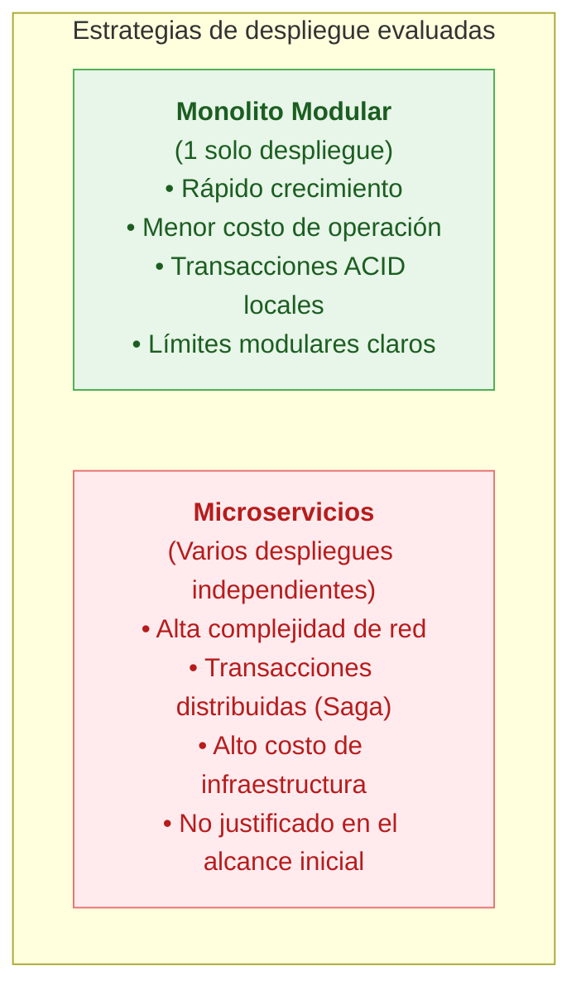
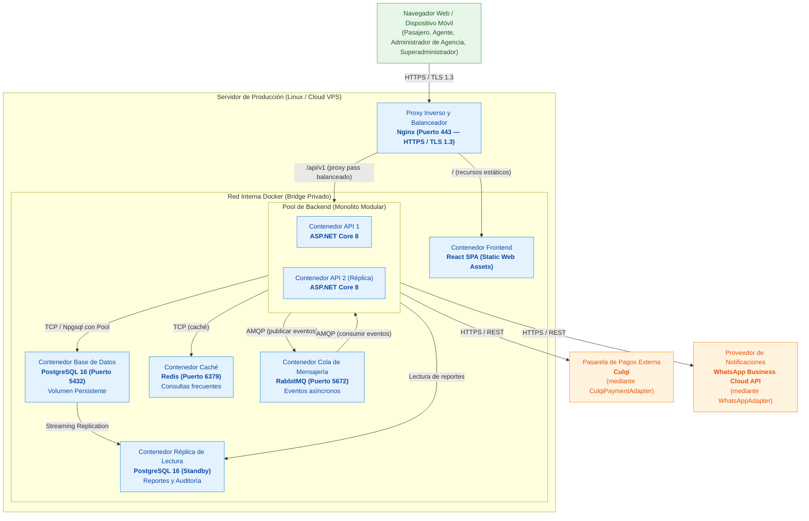
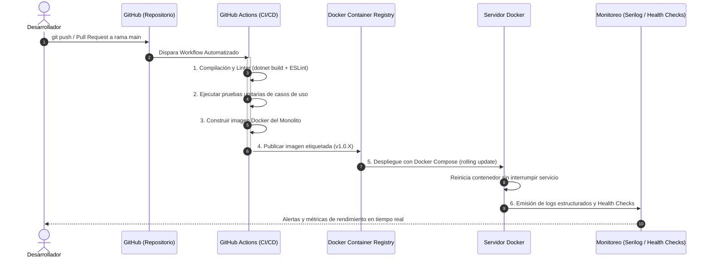

# Tecnologías, Implementación y Despliegue

## 1. Principio rector (Paso 11)

> **La tecnología implementa decisiones: no define por sí sola la arquitectura.**
>
> Las tecnologías seleccionadas son el medio para concretar los estilos, enfoques y tácticas arquitectónicas decididas en fases previas para satisfacer los drivers del sistema. No se elige una arquitectura porque se usa una tecnología; se selecciona la tecnología adecuada para materializar las decisiones de diseño.

---

## 2. Stack tecnológico del sistema

| Capa / Función | Tecnología seleccionada | Justificación arquitectónica | Decisión relacionada |
|---|---|---|:---:|
| **Frontend Web** | React 18 + TypeScript + Vite | Interfaz SPA reactiva con tipado estricto. Vite provee compilación rápida. TypeScript previene errores en la selección de asientos y operaciones multiagencia. | DA-03 |
| **Estilos e interfaz** | Tailwind CSS | Diseño adaptable y responsive para pasajeros (web) y agentes (ventanilla). | DA-03 |
| **Backend API** | ASP.NET Core 8 (C#) | Plataforma de alto rendimiento con soporte nativo de Inyección de Dependencias, concurrencia asíncrona y middlewares seguros. | DA-01, DA-02, DA-14 |
| **Acceso a datos** | Entity Framework Core 8 + Npgsql | ORM con soporte para Global Query Filters (aislamiento multiempresa), migraciones y consultas SQL nativas con bloqueo pesimista. | DA-04, DA-05 |
| **Base de datos** | PostgreSQL 16+ | Motor relacional con soporte ACID estricto, índices únicos condicionales para evitar sobreventa (`idx_unique_active_seat`) y transacciones serializables. | DA-04, DA-07 |
| **Caché** | Redis | Almacén en memoria para consultas frecuentes de rutas, horarios y servicios. Componente obligatorio desde la primera versión (RC12). | DA-09, DA-11 |
| **Cola de mensajería** | RabbitMQ | Cola durable para procesamiento asíncrono de notificaciones y eventos secundarios. Componente obligatorio desde la primera versión (RC13). | DA-10 |
| **Proxy y balanceador** | Nginx | Servidor perimetral: terminación TLS 1.3 (HTTPS), compresión Gzip/Brotli, rate limiting y balanceo de carga entre contenedores. | DA-01, DA-05, DA-14 |
| **Contenedores** | Docker y Docker Compose | Empaquetamiento estándar, reproducible y portable de todos los entornos: desarrollo, pruebas y producción. | DA-14 |
| **Control de versiones** | Git y GitHub | Repositorio centralizado de código y documentación arquitectónica con control de ramas. | — |
| **Pipeline CI/CD** | GitHub Actions | Automatización de compilación, pruebas unitarias y construcción de imágenes Docker en cada integración. | DA-15 |
| **Observabilidad** | Serilog + Health Checks | Logs estructurados en formato JSON para trazabilidad y auditoría. Endpoints de estado (`/health`) para monitoreo. | DA-12, DA-15 |
| **Pasarela de pagos** | Culqi (mediante Adapter) | Pasarela orientada al contexto peruano, integrada mediante el patrón Adapter (`IPaymentGateway` → `CulqiPaymentAdapter`). Permite cambio futuro sin modificar el dominio. | DA-09, DA-11 |
| **Notificaciones** | WhatsApp Business Cloud API (mediante Adapter) | Canal de comunicación para confirmaciones, recordatorios, cancelaciones y alertas preventivas. Procesado de forma asíncrona mediante RabbitMQ. | DA-10, DA-12 |

---

## 3. Implementación y despliegue (Paso 12)

### 3.1. Justificación del despliegue monolítico modular

Para la Plataforma Integrada de Transporte Interprovincial se selecciona el **Monolito Modular** porque:

- **Despliegue unificado:** todos los módulos funcionales se compilan en un único binario ejecutable alojado en un contenedor Docker.
- **Consistencia garantizada:** las operaciones críticas de reserva y pago se coordinan dentro de la misma transacción PostgreSQL, eliminando la necesidad de consistencia eventual entre servicios.
- **Menor complejidad operacional:** evita la gestión de múltiples tuberías de despliegue y comunicación entre servicios independientes.
- **Evolución posible:** los límites modulares bien definidos permiten extraer un módulo como servicio independiente si el crecimiento futuro lo justifica.

---

### 3.2. Diagrama de despliegue físico

---

## 4. Pipeline de CI/CD y flujo operativo

1. **Código en GitHub:** todo cambio de código fuente y documentación se versiona en el repositorio Git.
2. **Integración Continua (CI):** GitHub Actions compila el backend y el frontend y ejecuta pruebas unitarias de los casos de uso principales. Si una prueba falla, el pipeline se detiene.
3. **Construcción de contenedor:** se genera la imagen optimizada con Docker multi-stage build.
4. **Despliegue Continuo (CD):** se actualiza el contenedor en el servidor mediante Docker Compose sin tiempo de inactividad visible.
5. **Monitoreo y operación:** se recolectan métricas de uso y logs de auditoría para supervisar el estado del sistema.

---

## 5. Relación tecnologías — decisiones arquitectónicas

| Tecnología | Táctica que implementa | Decisión arquitectónica |
|---|---|---|
| PostgreSQL 16 | Bloqueo pesimista, transacciones ACID, replicación | DA-04, DA-07 |
| Redis | Caché de consultas frecuentes | DA-09 |
| RabbitMQ | Colas y procesamiento asíncrono | DA-10 |
| ASP.NET Core 8 + Polly | Circuit Breaker y reintentos | DA-09, DA-10 |
| ASP.NET Core 8 + JWT | Autenticación y autorización RBAC | DA-06 |
| ASP.NET Core 8 + Rate Limiting | Rate Limiting | DA-04 |
| Nginx | Balanceo de carga, terminación TLS | DA-01, DA-05 |
| Culqi (CulqiPaymentAdapter) | Patrón Adapter para pagos | DA-11 |
| WhatsApp Business Cloud API (WhatsAppAdapter) | Patrón Adapter para notificaciones | DA-12 |
| Serilog | Auditoría y logs estructurados | DA-13, DA-15 |
| Docker + Docker Compose | Despliegue reproducible del monolito | DA-01 |
| GitHub Actions | Pipeline CI/CD | DA-15 |
