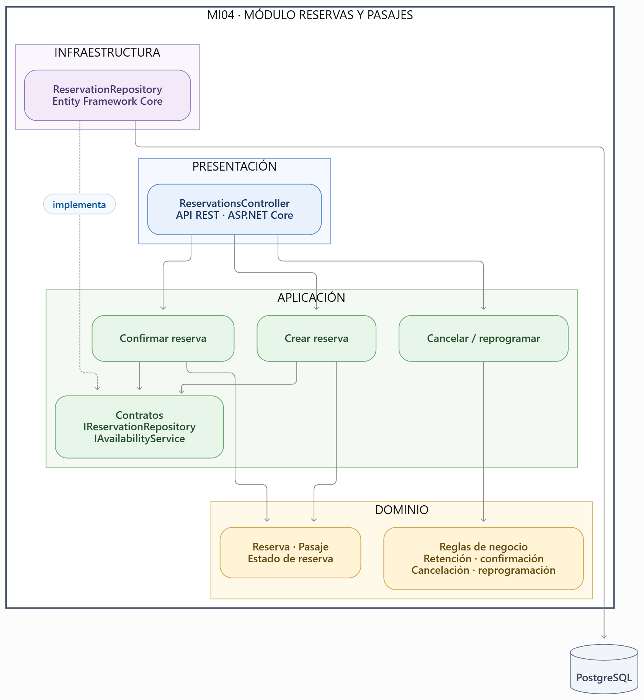
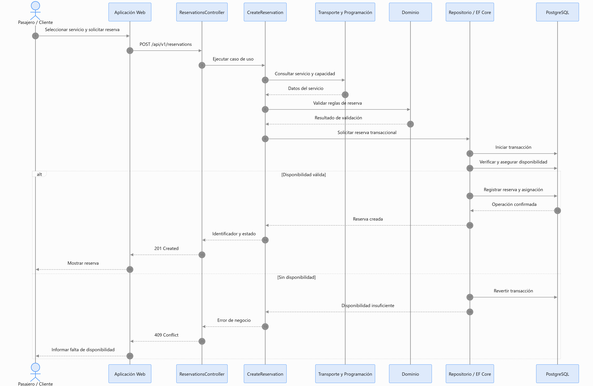

# Diseño Interno de Módulos

## 1. Propósito

Este documento define la organización interna del código de la Plataforma Integrada de Reservas y Gestión de Transporte Interprovincial.
El diseño se basa en un **monolito modular con arquitectura en capas y enfoque Clean Architecture**, implementado mediante ASP.NET Core y C#.
Su finalidad es establecer una estructura consistente para desarrollar los módulos, proteger las reglas del negocio y controlar las dependencias entre componentes.

## 2. Organización modular del backend

El backend se organiza en ocho módulos funcionales:

| Código | Módulo | Responsabilidad |
|---|---|---|
| MI01 | Identidad y Acceso | Autenticación, usuarios, roles y permisos. |
| MI02 | Empresas y Agencias | Registro y administración de empresas y agencias. |
| MI03 | Transporte y Programación | Rutas, vehículos, horarios, tarifas y servicios. |
| MI04 | Reservas y Pasajes | Disponibilidad, retenciones, reservas y emisión de pasajes. |
| MI05 | Ventas y Pagos | Registro de ventas, pagos y confirmaciones verificadas. |
| MI06 | Encomiendas | Solicitudes, recepción, despacho, seguimiento y entrega. |
| MI07 | Consultas y Reportes | Búsqueda de servicios e información operativa. |
| MI08 | Auditoría y Notificaciones | Trazabilidad y comunicación de eventos relevantes. |

Todos los módulos se ejecutan dentro de una única aplicación backend. Su separación es lógica y no implica desplegar microservicios independientes.

## 3. Estructura interna de referencia

Se utiliza el módulo **Reservas y Pasajes (MI04)** para establecer la estructura interna que podrán seguir los demás módulos según sus necesidades.

### 3.1. Organización de carpetas

```text
src/
└── Backend/
    ├── Modules/
    │   ├── IdentityAccess/
    │   ├── CompaniesAgencies/
    │   ├── TransportScheduling/
    │   ├── Reservations/
    │   │   ├── Domain/
    │   │   │   ├── Entities/
    │   │   │   │   └── Reservation.cs
    │   │   │   ├── Enums/
    │   │   │   │   └── ReservationStatus.cs
    │   │   │   └── Rules/
    │   │   │       └── ReservationPolicy.cs
    │   │   ├── Application/
    │   │   │   ├── UseCases/
    │   │   │   │   ├── CreateReservation.cs
    │   │   │   │   └── ConfirmReservation.cs
    │   │   │   ├── Contracts/
    │   │   │   │   ├── IReservationRepository.cs
    │   │   │   │   └── IAvailabilityService.cs
    │   │   │   └── DTOs/
    │   │   │       └── CreateReservationRequest.cs
    │   │   ├── Infrastructure/
    │   │   │   └── Persistence/
    │   │   │       └── ReservationRepository.cs
    │   │   ├── Presentation/
    │   │   │   └── ReservationsController.cs
    │   │   └── ReservationsModule.cs
    │   ├── SalesPayments/
    │   ├── Parcels/
    │   ├── QueriesReports/
    │   └── AuditNotifications/
    └── Shared/
        └── Infrastructure/
```

La estructura representa una propuesta de organización del código; no implica que los archivos ya estén implementados.

### 3.2. Responsabilidades de los elementos

| Elemento | Capa | Responsabilidad |
|---|---|---|
| Reservation.cs | Dominio | Representar la reserva y controlar sus transiciones de estado. |
| ReservationStatus.cs | Dominio | Definir los estados válidos de una reserva. |
| ReservationPolicy.cs | Dominio | Aplicar políticas de cancelación, confirmación y reprogramación. |
| CreateReservation.cs | Aplicación | Coordinar la creación de una reserva. |
| ConfirmReservation.cs | Aplicación | Coordinar su confirmación según disponibilidad y pago verificado, cuando corresponda. |
| IReservationRepository.cs | Aplicación | Definir las operaciones de persistencia requeridas. |
| IAvailabilityService.cs | Aplicación | Definir el contrato para consultar y asegurar disponibilidad. |
| ReservationRepository.cs | Infraestructura | Implementar la persistencia mediante Entity Framework Core. |
| ReservationsController.cs | Presentación | Recibir solicitudes HTTP e invocar casos de uso. |
| ReservationsModule.cs | Composición | Registrar las dependencias del módulo. |



*Figura 1. Organización interna del módulo Reservas y Pasajes según Clean Architecture.*

## 4. Reglas de dependencia

El código debe respetar la dirección de dependencias definida por Clean Architecture.

| Capa | Puede depender de | No debe depender de |
|---|---|---|
| Dominio | Sus propias entidades, reglas y objetos de valor. | Aplicación, infraestructura y presentación. |
| Aplicación | Dominio y contratos internos. | Controladores, Entity Framework Core y proveedores externos. |
| Infraestructura | Contratos de aplicación y modelos de dominio necesarios. | Controladores HTTP y lógica de presentación. |
| Presentación | Casos de uso y DTO de aplicación. | Repositorios concretos y acceso directo a PostgreSQL. |
| Composición | Implementaciones necesarias para configurar el módulo. | No aplica; es el punto de configuración de dependencias. |

La infraestructura implementa los contratos definidos hacia el núcleo. Las dependencias concretas se resuelven mediante inyección de dependencias de ASP.NET Core.

## 5. Modelo interno del módulo Reservas y Pasajes

### 5.1. Entidades principales

| Entidad | Información y reglas principales |
|---|---|
| Reserva | Identificador, pasajero, servicio, estado y vigencia de retención. |
| Pasaje | Reserva confirmada, información del viaje y asiento o cupo asignado. |
| Asiento o cupo | Capacidad disponible según la modalidad del servicio. |

El módulo utiliza información de Transporte y Programación para identificar el servicio y validar su capacidad, sin administrar directamente las rutas o vehículos.

### 5.2. Casos de uso

| Caso de uso | Función |
|---|---|
| ConsultarDisponibilidad | Obtener la disponibilidad vigente del servicio. |
| CrearReserva | Registrar una reserva o retención temporal válida. |
| ConfirmarReserva | Confirmar una reserva cuando se cumplen las condiciones aplicables. |
| CancelarReserva | Aplicar las políticas de cancelación. |
| ReprogramarReserva | Modificar el servicio reservado según disponibilidad y políticas. |
| EmitirPasaje | Generar el pasaje asociado a una reserva confirmada. |

### 5.3. Reglas de negocio

- **RIM01:** una reserva debe pertenecer a un servicio programado válido.
- **RIM02:** no se puede asignar un asiento ocupado por otra reserva vigente.
- **RIM03:** en servicios por cupos, las reservas vigentes no pueden superar la capacidad.
- **RIM04:** las retenciones temporales deben respetar su vencimiento.
- **RIM05:** la confirmación de pago debe estar verificada antes de registrar una reserva como pagada.
- **RIM06:** las cancelaciones y reprogramaciones deben respetar las políticas aplicables.
- **RIM07:** toda operación debe respetar el contexto autorizado de empresa y agencia.

## 6. Flujo interno: creación de una reserva

El flujo de referencia es el siguiente:

| Paso | Origen → Destino | Operación |
|---|---|---|
| 1 | Aplicación Web → API REST | Solicitar reserva de un servicio. |
| 2 | Controller → CreateReservation | Validar entrada y ejecutar el caso de uso. |
| 3 | Caso de uso → Transporte y Programación | Verificar servicio, modalidad y capacidad. |
| 4 | Caso de uso → Dominio | Evaluar reglas de reserva y retención. |
| 5 | Caso de uso → Persistencia | Ejecutar una operación transaccional con control de concurrencia. |
| 6 | Persistencia → PostgreSQL | Registrar reserva y asignación de asiento o cupo. |
| 7 | Caso de uso → Controller | Devolver el identificador y estado de la reserva. |
| 8 | Controller → Aplicación Web | Responder con el resultado de la operación. |

**Condición crítica:** la verificación y asignación de disponibilidad deben ejecutarse con mecanismos transaccionales que impidan la sobreventa, incluso cuando varios usuarios intenten reservar simultáneamente.


*Figura 2. Proceso de creación de una reserva con control transaccional de disponibilidad.*

## 7. Ejemplo de implementación en C#

Los siguientes fragmentos son ilustrativos y muestran la separación de responsabilidades. No constituyen una implementación completa del sistema.

### 7.1. Dominio: entidad Reserva

```csharp
public enum ReservationStatus
{
    Held,
    Confirmed,
    Cancelled,
    Expired
}

public sealed class Reservation
{
    public Guid Id { get; private set; }
    public Guid TripId { get; private set; }
    public Guid PassengerId { get; private set; }
    public ReservationStatus Status { get; private set; }

    private Reservation() { }

    public static Reservation Create(
        Guid tripId,
        Guid passengerId)
    {
        if (tripId == Guid.Empty ||
            passengerId == Guid.Empty)
            throw new ArgumentException(
                "Los identificadores son obligatorios.");

        return new Reservation
        {
            Id = Guid.NewGuid(),
            TripId = tripId,
            PassengerId = passengerId,
            Status = ReservationStatus.Held
        };
    }

    public void Confirm()
    {
        if (Status != ReservationStatus.Held)
            throw new InvalidOperationException(
                "La reserva no puede confirmarse.");

        Status = ReservationStatus.Confirmed;
    }
}
```

La entidad representa las reglas básicas de estado. La vigencia de la retención y la disponibilidad se verifican en operaciones específicas del módulo.

### 7.2. Aplicación: contrato de persistencia

```csharp
public interface IReservationRepository
{
    Task<Reservation?> GetByIdAsync(
        Guid id,
        CancellationToken cancellationToken);

    Task AddAsync(
        Reservation reservation,
        CancellationToken cancellationToken);
}
```

El contrato no depende de Entity Framework Core ni de PostgreSQL.

### 7.3. Aplicación: caso de uso

```csharp
public sealed class CreateReservation
{
    private readonly IAvailabilityService _availability;
    private readonly IReservationRepository _repository;

    public CreateReservation(
        IAvailabilityService availability,
        IReservationRepository repository)
    {
        _availability = availability;
        _repository = repository;
    }

    public async Task<Guid> ExecuteAsync(
        Guid tripId,
        Guid passengerId,
        CancellationToken cancellationToken)
    {
        await _availability.EnsureAvailableAsync(
            tripId,
            cancellationToken);

        var reservation = Reservation.Create(
            tripId,
            passengerId);

        await _repository.AddAsync(
            reservation,
            cancellationToken);

        return reservation.Id;
    }
}
```

Este ejemplo ilustra la coordinación del caso de uso. En la implementación real, la validación definitiva de disponibilidad y la asignación deben quedar protegidas por una misma operación transaccional, con control de concurrencia y confirmación de cambios.

### 7.4. Infraestructura: repositorio

```csharp
public sealed class ReservationRepository
    : IReservationRepository
{
    private readonly AppDbContext _context;

    public ReservationRepository(AppDbContext context)
    {
        _context = context;
    }

    public Task<Reservation?> GetByIdAsync(
        Guid id,
        CancellationToken cancellationToken)
    {
        return _context.Reservations
            .FirstOrDefaultAsync(
                x => x.Id == id,
                cancellationToken);
    }

    public async Task AddAsync(
        Reservation reservation,
        CancellationToken cancellationToken)
    {
        await _context.Reservations.AddAsync(
            reservation,
            cancellationToken);
    }
}
```

La confirmación de la transacción corresponde a la coordinación transaccional del caso de uso. No debe ejecutarse un `SaveChanges` independiente por cada operación cuando varias modificaciones deban ser atómicas.

### 7.5. Presentación: controlador REST

```csharp
[ApiController]
[Route("api/v1/reservations")]
public sealed class ReservationsController
    : ControllerBase
{
    private readonly CreateReservation _createReservation;

    public ReservationsController(
        CreateReservation createReservation)
    {
        _createReservation = createReservation;
    }

    [HttpPost]
    public async Task<IActionResult> Create(
        CreateReservationRequest request,
        CancellationToken cancellationToken)
    {
        // La identidad del pasajero y el contexto
        // autorizado deben obtenerse del servidor.

        var reservationId =
            await _createReservation.ExecuteAsync(
                request.TripId,
                GetAuthorizedPassengerId(),
                cancellationToken);

        return Created(
            $"/api/v1/reservations/{reservationId}",
            new { reservationId });
    }
}
```

`GetAuthorizedPassengerId()` representa un método pendiente de implementación que debe resolver la identidad autorizada del usuario autenticado. El controlador es un ejemplo estructural, no código listo para producción.

## 8. Comunicación entre módulos

Los módulos intercambian información mediante contratos internos y servicios de aplicación.

| Módulo origen | Módulo destino | Operación |
|---|---|---|
| Reservas y Pasajes | Transporte y Programación | Validar servicio y disponibilidad. |
| Reservas y Pasajes | Ventas y Pagos | Consultar el estado de pago verificado. |
| Ventas y Pagos | Reservas y Pasajes | Solicitar confirmación de una reserva pagada. |
| Encomiendas | Empresas y Agencias | Consultar habilitación y políticas del servicio. |
| Auditoría y Notificaciones | Módulos de negocio | Registrar eventos y coordinar comunicaciones. |
| Consultas y Reportes | Módulos correspondientes | Obtener información autorizada para consultas. |

La comunicación inicial es interna al monolito modular. No se requieren llamadas HTTP entre los módulos del mismo backend.

## 9. Criterios de validación del diseño

El diseño interno se considera consistente cuando:

1. Las entidades del dominio no importan dependencias de infraestructura.
2. Los controladores no contienen reglas de negocio.
3. Los casos de uso dependen de interfaces y no de repositorios concretos.
4. Cada módulo expone contratos definidos para su comunicación.
5. Las operaciones de reserva impiden la sobreventa bajo concurrencia.
6. Los pagos duplicados no producen confirmaciones duplicadas.
7. El acceso a los datos respeta el aislamiento por empresa y agencia.
8. Los módulos pueden probarse de manera aislada mediante sustitutos de sus dependencias.

## 10. Relación con los drivers arquitectónicos

| Driver | Aplicación en el diseño |
|---|---|
| DA01 — Consistencia | Transacciones y control de concurrencia en reservas y pagos. |
| DA02 — Seguridad multiempresa | Autorización y aislamiento por empresa y agencia. |
| DA03 — Rendimiento | Consultas especializadas y separación de responsabilidades. |
| DA04 — Disponibilidad y recuperación | Persistencia confiable y recuperación de operaciones. |
| DA05 — Escalabilidad | Módulos internos compatibles con réplicas del backend sin estado. |
| DA06 — Mantenibilidad | Contratos internos, separación de capas y bajo acoplamiento. |

## 11. Conclusión

El diseño interno establece una organización consistente para los ocho módulos de la plataforma y desarrolla el módulo de Reservas y Pasajes como referencia técnica.

La separación entre dominio, aplicación, infraestructura y presentación permite implementar las funcionalidades del sistema de manera organizada, proteger las reglas críticas del negocio y facilitar su mantenimiento y evolución.
