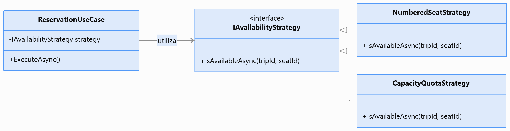

# Patrones de Diseño

## 1. Propósito

Este documento identifica los patrones de diseño propuestos para la Plataforma Integrada de Reservas y Gestión de Transporte Interprovincial.

Su aplicación busca mantener el código organizado, reducir el acoplamiento y facilitar las pruebas y el mantenimiento, respetando la arquitectura en capas, el monolito modular y Clean Architecture.

Los patrones se aplicarán según las necesidades de cada módulo, evitando incorporarlos cuando no aporten un beneficio concreto.

## 2. Patrones seleccionados

| Código | Patrón | Aplicación en el proyecto |
|---|---|---|
| PD01 | Repository | Abstraer las operaciones de persistencia de las entidades de negocio. |
| PD02 | Dependency Injection | Conectar casos de uso, contratos y adaptadores sin acoplamiento directo. |
| PD03 | Strategy | Aplicar políticas de cancelación/reprogramación según anticipación; reglas pendientes de validar. |
| PD04 | Adapter | Integrar pasarelas de pago y proveedores de notificaciones. |
| PD05 | Factory Method | Centralizar la creación válida de entidades de dominio cuando sea necesario. |

## 3. Aplicación de los patrones

### 3.1. PD01 — Repository

**Objetivo:** separar la lógica del negocio de los mecanismos de acceso a datos.

**Aplicación:** módulo Reservas y Pasajes.

El caso de uso utiliza `IReservationRepository` para consultar y registrar reservas. La implementación `ReservationRepository` utiliza Entity Framework Core para interactuar con PostgreSQL.

**Beneficio:** permite modificar o probar la persistencia sin introducir dependencias de base de datos en los casos de uso.

### 3.2. PD02 — Dependency Injection

**Objetivo:** proporcionar las dependencias de los componentes mediante contratos.

**Aplicación:** módulos del backend desarrollados con ASP.NET Core.

Los controladores reciben casos de uso y estos reciben interfaces de repositorios o servicios. Las implementaciones concretas se registran en la configuración de dependencias de ASP.NET Core.

**Beneficio:** reduce el acoplamiento y facilita las pruebas unitarias.

### 3.3. PD03 — Strategy

**Objetivo:** encapsular políticas de cancelación y reprogramación según la anticipación.

**Aplicación:** módulo Reservas y Pasajes mediante `ICancellationPolicy`. Las reglas comerciales, plazos y penalidades siguen pendientes de validación.

**Beneficio:** permite añadir políticas validadas sin concentrar condiciones en los casos de uso.

### 3.4. PD04 — Adapter

**Objetivo:** aislar las diferencias técnicas de los servicios externos.

**Aplicación:** módulos Ventas y Pagos, Auditoría y Notificaciones.

Los casos de uso se comunican mediante contratos como `IPaymentGateway` e `INotificationGateway`. Los adaptadores concretos traducen las solicitudes a los formatos requeridos por cada proveedor.

**Beneficio:** facilita cambiar proveedores sin modificar la lógica principal del negocio.

### 3.5. PD05 — Factory Method

**Objetivo:** centralizar la creación de entidades que requieren cumplir reglas iniciales.

**Aplicación:** módulo Reservas y Pasajes.

La entidad `Reservation` puede exponer un método de creación que valide los identificadores obligatorios y establezca el estado inicial de retención.

**Beneficio:** evita crear entidades con estados iniciales inválidos.

En C#, este comportamiento puede implementarse mediante un método de fábrica estático, sin requerir una jerarquía adicional de clases.

## 4. Ejemplo de aplicación: políticas de cancelación



*Figura 1. Aplicación conceptual de Strategy a políticas de cancelación/reprogramación; reglas pendientes de validar.*
El patrón Strategy representa políticas de cancelación/reprogramación; las reglas comerciales están pendientes de validación.

```csharp
public interface ICancellationPolicy
{
    bool CanCancel(Reservation reservation, DateTimeOffset requestedAt);
}
```

Implementación conceptual propuesta (sin reglas comerciales fijadas):

```csharp
public sealed class CancellationPolicyByNotice : ICancellationPolicy
{
    // Política pendiente de definir y validar con el negocio.
}
```

El contrato es conceptual: los plazos, penalidades y condiciones requieren validación del negocio antes de definir sus implementaciones.

## 5. Reglas de aplicación

- **RP01:** utilizar patrones cuando resuelvan una necesidad identificada.
- **RP02:** mantener las interfaces de persistencia y servicios externos independientes de implementaciones concretas.
- **RP03:** no incorporar reglas de negocio en controladores ni adaptadores.
- **RP04:** aplicar inyección de dependencias para conectar las implementaciones.
- **RP05:** proteger la asignación de asientos numerados mediante mecanismos transaccionales; el patrón Strategy no sustituye el bloqueo sobre TripSeat ni las restricciones de integridad.
- **RP06:** evitar patrones que generen clases o abstracciones innecesarias.

## 6. Relación con los drivers arquitectónicos

| Driver | Contribución |
|---|---|
| DA02 / DA03 — Concurrencia y Consistencia | Encapsulación de reglas de reserva por TripSeat y creación válida de entidades. |
| DA04 — Seguridad y Aislamiento multiempresa | Contratos que permiten aplicar el contexto de autorización en los casos de uso. |
| DA06 / DA11 — Rendimiento y Caché | Posibilidad de optimizar implementaciones de acceso a datos y repositorios sin alterar los casos de uso. |
| DA05 — Escalabilidad | Separación de responsabilidades y adaptadores sustituibles. |
| DA09 — Pagos con Adapter | Desacopla la lógica de ventas y pagos respecto de Culqi (`IPaymentGateway`). |
| DA10 — Notificaciones asíncronas | Desacopla el envío de WhatsApp (`INotificationGateway`) procesado vía RabbitMQ. |
| DA14 — Mantenibilidad | Bajo acoplamiento mediante interfaces, facilidad de pruebas unitarias y extensibilidad. |

Los patrones complementan los controles de seguridad, concurrencia y escalabilidad, pero no los sustituyen.

## 7. Conclusión

Los patrones Repository, Dependency Injection, Strategy, Adapter y Factory Method permiten organizar las responsabilidades técnicas y de negocio de la plataforma.

Su aplicación se concentrará en los puntos donde aporten flexibilidad y mantenibilidad, especialmente en la gestión de reservas, disponibilidad, pagos e integraciones externas.
