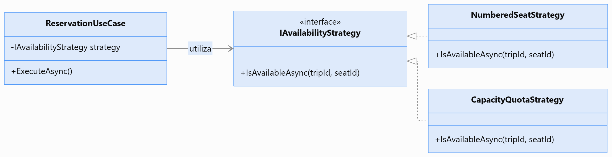

# Patrones de Diseño

## 1. Propósito

Este documento identifica los patrones de diseño propuestos para la Plataforma Integrada de Reservas y Gestión de Transporte Interprovincial.

Su aplicación busca mantener el código organizado, reducir el acoplamiento y facilitar las pruebas y el mantenimiento, respetando la arquitectura en capas, el monolito modular y Clean Architecture.

Los patrones se aplicarán según las necesidades de cada módulo, evitando incorporarlos cuando no aporten un beneficio concreto.

## 2. Patrones seleccionados

| Código | Patrón | Aplicación en el proyecto |
|---|---|---|
| PD01 | Repository | Abstraer las operaciones de persistencia de las entidades de negocio. |
| PD02 | Dependency Injection | Conectar casos de uso, contratos y adaptadores sin acoplamiento directo. |
| PD03 | Strategy | Seleccionar reglas de disponibilidad según la modalidad de asientos o cupos. |
| PD04 | Adapter | Integrar pasarelas de pago y proveedores de notificaciones. |
| PD05 | Factory Method | Centralizar la creación válida de entidades de dominio cuando sea necesario. |

## 3. Aplicación de los patrones

### 3.1. PD01 — Repository

**Objetivo:** separar la lógica del negocio de los mecanismos de acceso a datos.

**Aplicación:** módulo Reservas y Pasajes.

El caso de uso utiliza `IReservationRepository` para consultar y registrar reservas. La implementación `ReservationRepository` utiliza Entity Framework Core para interactuar con PostgreSQL.

**Beneficio:** permite modificar o probar la persistencia sin introducir dependencias de base de datos en los casos de uso.

### 3.2. PD02 — Dependency Injection

**Objetivo:** proporcionar las dependencias de los componentes mediante contratos.

**Aplicación:** módulos del backend desarrollados con ASP.NET Core.

Los controladores reciben casos de uso y estos reciben interfaces de repositorios o servicios. Las implementaciones concretas se registran en la configuración de dependencias de ASP.NET Core.

**Beneficio:** reduce el acoplamiento y facilita las pruebas unitarias.

### 3.3. PD03 — Strategy

**Objetivo:** encapsular reglas alternativas de una misma operación.

**Aplicación:** módulo Transporte y Programación, en coordinación con Reservas y Pasajes.

Se contemplan dos modalidades de disponibilidad:

- **Asientos numerados:** se verifica que el asiento seleccionado no esté asignado a otra reserva vigente.
- **Cupos:** se verifica que las reservas vigentes no superen la capacidad del servicio.

Cada modalidad puede implementar un contrato común de validación de disponibilidad.

**Beneficio:** permite incorporar reglas específicas sin concentrarlas en múltiples condiciones dentro de un único componente.

### 3.4. PD04 — Adapter

**Objetivo:** aislar las diferencias técnicas de los servicios externos.

**Aplicación:** módulos Ventas y Pagos, Auditoría y Notificaciones.

Los casos de uso se comunican mediante contratos como `IPaymentGateway` e `INotificationService`. Los adaptadores concretos traducen las solicitudes a los formatos requeridos por cada proveedor.

**Beneficio:** facilita cambiar proveedores sin modificar la lógica principal del negocio.

### 3.5. PD05 — Factory Method

**Objetivo:** centralizar la creación de entidades que requieren cumplir reglas iniciales.

**Aplicación:** módulo Reservas y Pasajes.

La entidad `Reservation` puede exponer un método de creación que valide los identificadores obligatorios y establezca el estado inicial de retención.

**Beneficio:** evita crear entidades con estados iniciales inválidos.

En C#, este comportamiento puede implementarse mediante un método de fábrica estático, sin requerir una jerarquía adicional de clases.

## 4. Ejemplo de aplicación: disponibilidad de reservas



*Figura 1. Aplicación del patrón Strategy para validar disponibilidad por asientos numerados o cupos.*
El patrón Strategy permite diferenciar las reglas de disponibilidad según la modalidad configurada para un servicio.

```csharp
public interface IAvailabilityStrategy
{
    Task<bool> IsAvailableAsync(
        Guid tripId,
        Guid? seatId,
        CancellationToken cancellationToken);
}
```

Implementaciones propuestas:

```csharp
public sealed class NumberedSeatStrategy
    : IAvailabilityStrategy
{
    // Verifica la disponibilidad del asiento seleccionado.
}

public sealed class CapacityQuotaStrategy
    : IAvailabilityStrategy
{
    // Verifica la capacidad restante del servicio.
}
```

Estas clases representan una estructura conceptual. La implementación definitiva deberá consultar la persistencia y garantizar que la asignación se confirme mediante una operación transaccional segura frente a solicitudes concurrentes.

## 5. Reglas de aplicación

- **RP01:** utilizar patrones cuando resuelvan una necesidad identificada.
- **RP02:** mantener las interfaces de persistencia y servicios externos independientes de implementaciones concretas.
- **RP03:** no incorporar reglas de negocio en controladores ni adaptadores.
- **RP04:** aplicar inyección de dependencias para conectar las implementaciones.
- **RP05:** proteger la asignación de asientos y cupos mediante mecanismos transaccionales; Strategy por sí solo no garantiza la concurrencia.
- **RP06:** evitar patrones que generen clases o abstracciones innecesarias.

## 6. Relación con los drivers arquitectónicos

| Driver | Contribución |
|---|---|
| DA01 — Consistencia | Encapsulación de reglas de reserva y creación válida de entidades. |
| DA02 — Seguridad multiempresa | Contratos que permiten aplicar el contexto de autorización en los casos de uso. |
| DA03 — Rendimiento | Posibilidad de optimizar implementaciones de acceso a datos sin alterar los casos de uso. |
| DA05 — Escalabilidad | Separación de responsabilidades y adaptadores sustituibles. |
| DA06 — Mantenibilidad | Bajo acoplamiento, facilidad de pruebas y extensibilidad. |

Los patrones complementan los controles de seguridad, concurrencia y escalabilidad, pero no los sustituyen.

## 7. Conclusión

Los patrones Repository, Dependency Injection, Strategy, Adapter y Factory Method permiten organizar las responsabilidades técnicas y de negocio de la plataforma.

Su aplicación se concentrará en los puntos donde aporten flexibilidad y mantenibilidad, especialmente en la gestión de reservas, disponibilidad, pagos e integraciones externas.
