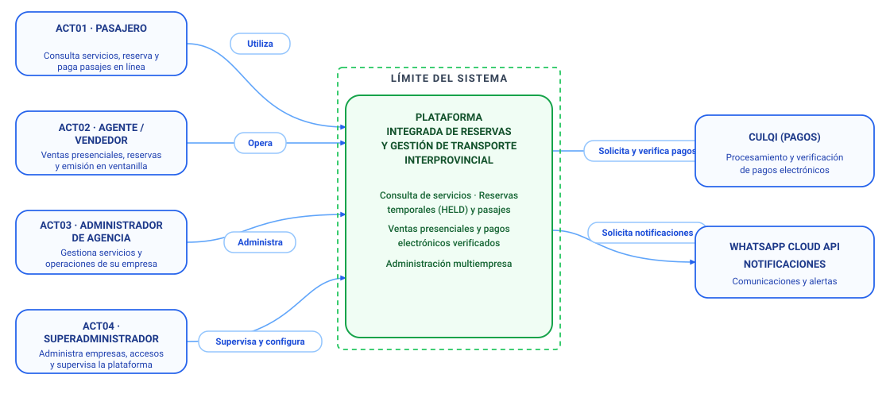

# Modelo C4 — Nivel 1: Diagrama de Contexto del Sistema

## 1. Propósito

El Diagrama de Contexto del Sistema (Nivel 1 del Modelo C4) establece una vista panorámica de la **Plataforma Integrada de Reservas y Gestión de Transporte Interprovincial**.

Su objetivo principal es definir de forma explícita el **límite del sistema de software**, ilustrar a los diferentes tipos de usuarios (actores humanos) que interactúan con él mediante verbos de operación claros, y detallar las interacciones con los sistemas externos necesarios para la operación comercial.

---

## 2. Diagrama de Contexto del Sistema

*Figura 1. Diagrama de Contexto del Sistema (C4 — Nivel 1).*

---

## 3. Actores del Sistema

| ID | Actor | Responsabilidades en el Diagrama | Verbo de Interacción |
|---|---|---|:---:|
| **ACT01** | **Pasajero** | Consulta rutas, horarios, tarifas, reserva pasajes y realiza pagos en línea. | **Utiliza** |
| **ACT02** | **Agente / Vendedor** | Atiende ventas presenciales, reservas y emite pasajes en ventanilla de su agencia. | **Opera** |
| **ACT03** | **Administrador de Agencia** | Gestiona rutas, horarios, servicios, flota y supervisa la operación de sus agencias autorizadas. | **Administra** |
| **ACT04** | **Superadministrador** | Administra empresas de transporte, agencias, usuarios y supervisa la plataforma globalmente. | **Supervisa y configura** |

---

## 4. Sistema Central y Límite del Sistema

* **Límite del Sistema:** Frontera lógica y de despliegue que delimita la responsabilidad directa del software desarrollado.
* **Sistema Central:** **Plataforma Integrada de Reservas y Gestión de Transporte Interprovincial**
  * **Consulta de servicios · Reservas y pasajes:** Búsqueda en tiempo real de itinerarios, retención temporal de asientos (estado HELD por 10 minutos) y emisión de pasajes garantizando cero sobreventa.
  * **Ventas y pagos:** Registro de ventas presenciales y cobros electrónicos verificados mediante pasarela de pagos.
  * **Administración multiempresa y multiagencia:** Aislamiento y control de datos operativos para múltiples empresas y sus respectivas agencias en una misma base de datos compartida.

---

## 5. Sistemas Externos

| Sistema Externo | Responsabilidad en el Diagrama | Interacción con la Plataforma |
|---|---|---|
| **Culqi (Pasarela de Pagos)** | Procesamiento y verificación de pagos electrónicos (EXT01). | La plataforma **solicita y verifica pagos** mediante transacciones seguras y adaptadores (`IPaymentGateway`). |
| **WhatsApp Business Cloud API** | Entrega de comunicaciones directas a pasajeros (EXT02). | La plataforma **solicita notificaciones** de confirmaciones, pasajes emitidos, recordatorios y alertas preventivas de alta demanda. |

---

## 6. Descripción de las Interacciones

1. **Pasajero → Plataforma (Utiliza):** El usuario final accede mediante navegador web o móvil para buscar rutas, seleccionar asientos o cupos, realizar reservas temporales y pagar en línea.
2. **Agente / Vendedor → Plataforma (Opera):** El personal de agencia interactúa con la interfaz web de ventanilla para consultar disponibilidad compartida, registrar reservas presenciales, procesar cobros y emitir pasajes.
3. **Administrador de Agencia → Plataforma (Administra):** Configura frecuencias de viajes, unidades de transporte (buses, combis, minivanes), tarifas, horarios y supervisa las ventas y ocupación de sus agencias asignadas.
4. **Superadministrador → Plataforma (Supervisa y configura):** Registra empresas de transporte, activa o desactiva agencias, asigna administradores, audita eventos y mantiene parámetros globales del sistema.
5. **Plataforma → Culqi (Solicita y verifica pagos):** Solicita el cobro electrónico y valida el resultado de la transacción antes de confirmar definitivamente la reserva.
6. **Plataforma → WhatsApp Business Cloud API (Solicita notificaciones):** Despacha confirmaciones de reserva, pasajes digitales emitidos, recordatorios y alertas preventivas de forma desacoplada y asíncrona.
