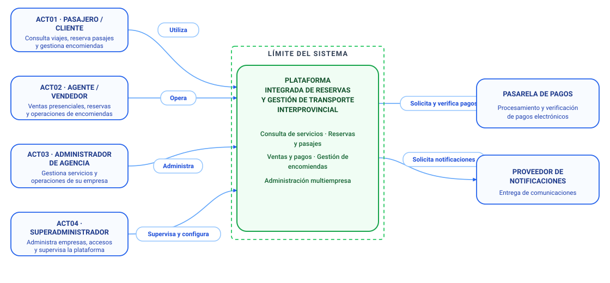

# Modelo C4 — Nivel 1: Diagrama de Contexto del Sistema

## 1. Propósito

El Diagrama de Contexto del Sistema (Nivel 1 del Modelo C4) establece una vista panorámica de la **Plataforma Integrada de Reservas y Gestión de Transporte Interprovincial**.

Su objetivo principal es definir de forma explícita el **límite del sistema de software**, ilustrar a los diferentes tipos de usuarios (actores humanos) que interactúan con él mediante verbos de operación claros, y detallar las interacciones con los sistemas externos necesarios para la operación comercial.

---

## 2. Diagrama de Contexto del Sistema

*Figura 1. Diagrama de Contexto del Sistema (C4 — Nivel 1).*

---

## 3. Actores del Sistema

| ID | Actor | Responsabilidades en el Diagrama | Verbo de Interacción |
|---|---|---|:---:|
| **ACT01** | **Pasajero / Cliente** | Consulta viajes, reserva pasajes y gestiona encomiendas. | **Utiliza** |
| **ACT02** | **Agente / Vendedor** | Ventas presenciales, reservas y operaciones de encomiendas en ventanilla. | **Opera** |
| **ACT03** | **Administrador de Agencia** | Gestiona servicios y operaciones de su empresa de transporte. | **Administra** |
| **ACT04** | **Superadministrador** | Administra empresas, accesos y supervisa la plataforma globalmente. | **Supervisa y configura** |

---

## 4. Sistema Central y Límite del Sistema

* **Límite del Sistema:** Frontera lógica y de despliegue que delimita la responsabilidad directa del software desarrollado.
* **Sistema Central:** **Plataforma Integrada de Reservas y Gestión de Transporte Interprovincial**
  * **Consulta de servicios · Reservas y pasajes:** Búsqueda en tiempo real de itinerarios, retención temporal de asientos y emisión de pasajes evitando sobreventas.
  * **Ventas y pagos · Gestión de encomiendas:** Registro de ventas físicas y electrónicas, control de guías, recepción, despacho y seguimiento de encomiendas.
  * **Administración multiempresa:** Aislamiento y control de datos operativos para múltiples empresas y agencias de transporte interprovincial.

---

## 5. Sistemas Externos

| Sistema Externo | Responsabilidad en el Diagrama | Interacción con la Plataforma |
|---|---|---|
| **Pasarela de Pagos** | Procesamiento y verificación de pagos electrónicos. | La plataforma **solicita y verifica pagos** mediante transacciones seguras y confirmaciones idempotentes. |
| **Proveedor de Notificaciones** | Entrega de comunicaciones a usuarios y clientes. | La plataforma **solicita notificaciones** de boletos digitales, confirmaciones y avisos de encomiendas. |

---

## 6. Descripción de las Interacciones

1. **Pasajero / Cliente → Plataforma (Utiliza):** El usuario final accede mediante navegador web o móvil para buscar rutas, reservar asientos disponibles, pagar y dar seguimiento a sus encomiendas.
2. **Agente / Vendedor → Plataforma (Opera):** El personal de agencia interactúa con la interfaz de ventanilla para registrar ventas directas de pasajes, gestionar reservas presenciales y recepcionar/entregar encomiendas.
3. **Administrador de Agencia → Plataforma (Administra):** Configura la flota de buses, asigna choferes, define tarifas y horarios, y supervisa la operación diaria de su empresa.
4. **Superadministrador → Plataforma (Supervisa y configura):** Da de alta empresas de transporte, administra cuentas de usuario, audita eventos y mantiene los parámetros globales del sistema.
5. **Plataforma → Pasarela de Pagos (Solicita y verifica pagos):** Solicita el cobro electrónico y valida las confirmaciones bancarias antes de emitir definitivamente los pasajes.
6. **Plataforma → Proveedor de Notificaciones (Solicita notificaciones):** Despacha mensajes por correo electrónico o SMS con comprobantes y estados de viaje de manera desacoplada.
