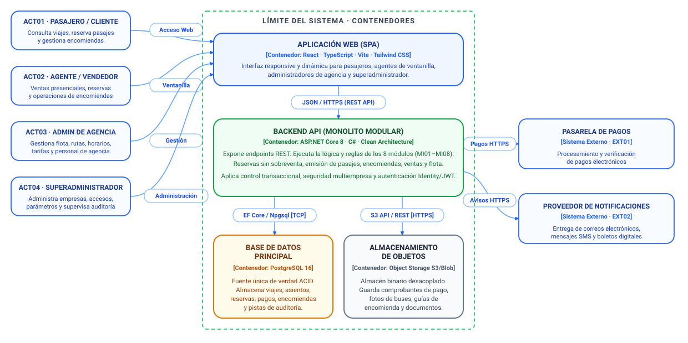

# Modelo C4 — Nivel 2: Diagrama de Contenedores

## 1. Propósito

El Diagrama de Contenedores (Nivel 2 del Modelo C4) descompone el sistema en sus unidades de software ejecutables y de almacenamiento de datos desplegables. Muestra las responsabilidades de alto nivel de cada contenedor, las decisiones tecnológicas clave adoptadas (según los ADRs del proyecto) y los protocolos de comunicación utilizados para su interacción.

En este nivel se hace explícito el enfoque de **Monolito Modular** para el backend (ADR01), desacoplado de la **Aplicación Web SPA** en el frontend (ADR02) y respaldado por una base de datos relacional robusta (ADR04).

---

## 2. Contenedores de la Solución

| Contenedor | Tipo | Tecnología | Responsabilidad Principal |
|---|---|---|---|
| **Aplicación Web (SPA)** | Frontend / Cliente Web | React 18+, TypeScript, Vite, Tailwind CSS, shadcn/ui | Proporciona la interfaz gráfica responsive y dinámica para pasajeros, agentes de ventanilla, administradores de agencia y superadministradores. |
| **Backend API (Monolito Modular)** | Servidor de Aplicaciones / API | ASP.NET Core 8+ (C#), REST API | Ejecuta la lógica del negocio, coordina casos de uso, aplica políticas de seguridad multiempresa y gestiona las transacciones de reservas y encomiendas. |
| **Base de Datos Principal** | Base de Datos Relacional | PostgreSQL 16+ | Fuente única de verdad. Garantiza consistencia transaccional (ACID), aislamiento multiempresa, control de concurrencia y persistencia de auditoría. |
| **Almacenamiento de Objetos** | Almacén de Archivos | Cloud Object Storage (compatible S3 / Azure Blob) | Almacena archivos estáticos y binarios: comprobantes de pago digitalizados, documentos de identidad, guías y fotografías de equipajes y unidades. |

---

## 3. Diagrama de Contenedores

*Figura 1. Diagrama de Contenedores de la Plataforma de Transporte Interprovincial (C4 — Nivel 2).*

---

## 4. Descripción Detallada de Contenedores

### 4.1. Aplicación Web (SPA)
* **Tecnología:** React con TypeScript, empaquetado con Vite. Estilizado con Tailwind CSS y componentes accesibles de shadcn/ui.
* **Ejecución:** Se descarga como recursos estáticos (HTML/JS/CSS) y se ejecuta en el navegador web del cliente (desktop, tablet o móvil).
* **Responsabilidades:**
  * Renderizado del catálogo de rutas, horarios, precios y estado de buses en tiempo real.
  * Selector interactivo de asientos (distribución gráfica de 1 o 2 pisos según bus) y selector numérico de cupos.
  * Pasarela visual para ingreso de datos de pasajeros y selección de método de pago.
  * Módulo de ventanilla optimizado con atajos de teclado para agentes de ventas.
  * Paneles administrativos para configuración de frecuencias, unidades y visualización de reportes.
  * Almacenamiento seguro del token de sesión (JWT en cookie HttpOnly).

### 4.2. Backend API (Monolito Modular)
* **Tecnología:** ASP.NET Core 8+, C#, arquitectura orientada a dominios (Clean Architecture).
* **Ejecución:** Proceso de servidor unificado alojado en contenedores Linux (Docker).
* **Responsabilidades:**
  * Exposición de endpoints RESTful seguros mediante HTTPS.
  * Autenticación y autorización basada en ASP.NET Core Identity y Claims (validando rol, empresa y agencia).
  * Coordinación de los 8 módulos de negocio (MI01 a MI08) en un único proceso en memoria.
  * Gestión de concurrencia y transacciones ACID en la reserva de asientos para evitar sobreventas.
  * Verificación criptográfica e idempotente de webhooks provenientes de la pasarela de pagos.
  * Despacho asíncrono en segundo plano (Background Services / Channels) para notificaciones y subida de archivos pesados.

### 4.3. Base de Datos Relacional Principal
* **Tecnología:** PostgreSQL 16+.
* **Responsabilidades:**
  * Almacenamiento persistente estructurado con integridad referencial estricta.
  * Soporte de transacciones serializables o con bloqueo pesimista (`SELECT ... FOR UPDATE`) durante la reserva simultánea de asientos.
  * Esquema particionado lógicamente por empresa para garantizar el aislamiento multiinquilino (multi-tenant).
  * Índices optimizados (B-Tree, GIN) para búsquedas ultrarrápidas de rutas y viajes disponibles por fecha y origen-destino.
  * Tablas inmutables para el registro cronológico de auditoría (logs de seguridad y transacciones).

### 4.4. Almacenamiento de Objetos
* **Tecnología:** MinIO local o almacenamiento en la nube (AWS S3 / Azure Blob Storage).
* **Responsabilidades:**
  * Repositorio desacoplado para almacenar archivos binarios grandes (evita degradar el tamaño de la base de datos PostgreSQL).
  * Generación de URLs prefirmadas de corta duración para la descarga segura de pasajes en PDF y vouchers de encomiendas.

---

## 5. Decisiones Arquitectónicas Relacionadas

* **ADR01 — Monolito Modular vs. Microservicios:** Se eligió un monolito modular porque consolida todos los módulos en un único backend desplegable, reduciendo drásticamente la sobrecarga de red, serialización y complejidad operativa en la fase inicial, mientras mantiene límites estrictos de código.
* **ADR02 — React + TypeScript:** Garantiza una interfaz de usuario reactiva, tipada fuertemente, compatible con dispositivos móviles y fácil de mantener.
* **ADR03 — ASP.NET Core + C#:** Brinda alto rendimiento de I/O concurrente, soporte nativo de inyección de dependencias, tipado robusto y herramientas sólidas para transacciones complejas.
* **ADR04 — PostgreSQL:** Provee soporte ACID maduro, indispensable para el requerimiento DA01 (evitar sobreventa y garantizar consistencia de reservas).
* **ADR09 — Almacenamiento de Objetos:** Mantiene a PostgreSQL enfocada en operaciones OLTP rápidas, delegando archivos pesados a almacenamiento de objetos escalable y económico.

---

## 6. Seguridad y Canales de Comunicación

1. **Cliente Web → Backend API:**
   * Protocolo: HTTPS / TLS 1.3 con cifrado extremo a extremo.
   * Autenticación: Tokens JWT transportados mediante cookies protegidas con flags `HttpOnly`, `Secure` y `SameSite=Strict`.
   * Protección contra ataques comunes: CORS configurado rígidamente, protección CSRF y rate limiting en endpoints de búsqueda y login.

2. **Backend API → PostgreSQL:**
   * Conexión por TCP mediante el driver oficial Npgsql con cifrado TLS activo.
   * Uso de Connection Pooling para optimizar reutilización de conexiones en picos de demanda.
   * Credenciales administradas mediante variables de entorno seguras (Secrets Manager).

3. **Backend API → Pasarela de Pagos:**
   * Comunicación saliente HTTPS con autenticación por API Keys / Secret Token.
   * Comunicación entrante (Webhooks) validada con firmas HMAC SHA-256 en las cabeceras HTTP y verificación de idempotencia contra la base de datos.
