# Modelo C4 — Nivel 3: Diagrama de Componentes

## 1. Propósito

El Diagrama de Componentes (Nivel 3 del Modelo C4) descompone el contenedor **Backend API (Monolito Modular)** en sus componentes estructurales clave. Muestra cómo se organizan internamente las responsabilidades según el enfoque de **Clean Architecture** (Arquitectura Limpia) y cómo colaboran los componentes del módulo nuclear transaccional **Reservas y Pasajes (MI04)** con los módulos adyacentes de **Transporte y Programación (MI03)** y **Ventas y Pagos (MI05)**.

Este diagrama ilustra con precisión cómo se aplican la regla de dependencias, la inyección de dependencias y el desacoplamiento respecto a la infraestructura y la base de datos.

---

## 2. Organización de Componentes por Capas

En concordancia con Clean Architecture, el backend divide sus componentes en cuatro capas concéntricas:

```
[ Presentación (Controllers) ] ──▶ [ Aplicación (Use Cases / DTOs) ] ──▶ [ Dominio (Entities / Policies) ]
                                              │
                                              ▼ (mediante Interfaces)
                                   [ Infraestructura (EF Core / Adapters) ]
```

1. **Capa de Presentación:** Recibe las peticiones HTTP desde la SPA, deserializa y valida DTOs de entrada, aplica filtros de autorización por Claims y traduce resultados a códigos HTTP (200, 201, 400, 404, 409).
2. **Capa de Aplicación:** Implementa los casos de uso específicos del negocio (orquestación), define contratos de interfaces (puertos) para repositorios y servicios externos, y maneja las transacciones lógicas.
3. **Capa de Dominio:** Núcleo puro del negocio sin dependencias tecnológicas externas. Contiene entidades, objetos de valor, enumeraciones de estado y reglas invariantes de políticas de reserva y capacidad.
4. **Capa de Infraestructura:** Implementa los contratos definidos por la capa de aplicación (adaptadores). Utiliza Entity Framework Core con Npgsql para persistencia en PostgreSQL y clientes HTTP para pasarelas de pago y notificaciones.

---

## 3. Diagrama de Componentes (Módulo Reservas y Pasajes)

```mermaid
C4Component
    title Diagrama de Componentes (Nivel 3) - Backend API (Módulo Reservas y Pasajes)

    Container(spa, "Aplicación Web (SPA)", "React / TypeScript", "Cliente web que interactúa con la API vía REST.")
    ContainerDb(db, "Base de Datos", "PostgreSQL", "Almacena viajes, asientos, transacciones y reservas.")
    System_Ext(gateway_ext, "Pasarela de Pago", "SaaS REST API", "Servicio externo para cobros electrónicos.")
    System_Ext(notif_ext, "Servicio Notificaciones", "SaaS REST API", "Servicio externo para envío de emails/SMS.")

    Container_Boundary(backend_api, "Backend API (ASP.NET Core - Monolito Modular)") {
        
        Component(ctrl_res, "ReservationsController", "Presentación / ASP.NET Controller", "Expone endpoints REST (/api/v1/reservations). Recibe DTOs, autentica el usuario y despacha a los casos de uso.")
        
        Component(uc_create, "CreateReservation (Caso de Uso)", "Aplicación / Use Case", "Coordina la creación de una reserva temporal: valida viaje, invoca cálculo de disponibilidad y solicita persistencia transaccional.")
        Component(uc_confirm, "ConfirmReservation (Caso de Uso)", "Aplicación / Use Case", "Coordina la confirmación definitiva de la reserva tras verificar el pago exitoso.")
        Component(uc_cancel, "CancelReservation (Caso de Uso)", "Aplicación / Use Case", "Coordina la liberación de asientos y cancelaciones según políticas de vigencia.")

        Component(serv_avail, "AvailabilityService", "Aplicación / Servicio de Coordinación", "Determina la disponibilidad consultando al módulo de Transporte según modalidad (asientos numerados o cupos).")

        Component(contract_repo, "IReservationRepository", "Aplicación / Interfaz (Puerto)", "Define los métodos requeridos para persistir, bloquear y recuperar reservas.")
        Component(contract_pay, "IPaymentGatewayService", "Aplicación / Interfaz (Puerto)", "Define el contrato para consultar el estado verificado de una transacción de pago.")
        Component(contract_notif, "INotificationService", "Aplicación / Interfaz (Puerto)", "Define el contrato para despachar notificaciones asíncronas de pasajes.")

        Component(domain_res, "Entidad Reservation & Rules", "Dominio / Entidad y Políticas", "Encapsula el ciclo de vida de la reserva, estados (Held, Confirmed, Cancelled, Expired) y validaciones de retención.")

        Component(impl_repo, "ReservationRepository", "Infraestructura / EF Core", "Implementa IReservationRepository. Realiza consultas optimizadas y control de concurrencia en PostgreSQL.")
        Component(impl_pay, "PaymentGatewayAdapter", "Infraestructura / HttpClient", "Implementa IPaymentGatewayService. Se comunica con la pasarela externa y valida firmas de webhooks.")
        Component(impl_notif, "NotificationAdapter", "Infraestructura / BackgroundService", "Implementa INotificationService. Encola y envía mensajes y correos con boletos adjuntos.")
    }

    Rel(spa, ctrl_res, "Solicitudes de reserva / confirmación", "HTTPS / JSON")
    Rel(ctrl_res, uc_create, "Invoca ejecución de creación", "C# In-Process")
    Rel(ctrl_res, uc_confirm, "Invoca confirmación con pago", "C# In-Process")
    Rel(ctrl_res, uc_cancel, "Invoca cancelación", "C# In-Process")

    Rel(uc_create, serv_avail, "Verifica disponibilidad y capacidad", "C# In-Process")
    Rel(uc_create, domain_res, "Crea instancia de Reservation", "C# In-Process")
    Rel(uc_create, contract_repo, "Persiste reserva temporal", "C# In-Process")

    Rel(uc_confirm, contract_pay, "Verifica pago confirmado e idempotente", "C# In-Process")
    Rel(uc_confirm, domain_res, "Ejecuta método Confirm()", "C# In-Process")
    Rel(uc_confirm, contract_repo, "Actualiza estado de reserva", "C# In-Process")
    Rel(uc_confirm, contract_notif, "Encola notificación de boleto", "C# In-Process")

    Rel(impl_repo, contract_repo, "Implementa contrato", "C# Interface")
    Rel(impl_repo, db, "Operaciones SQL / Bloqueos ACID", "Npgsql / EF Core")

    Rel(impl_pay, contract_pay, "Implementa contrato", "C# Interface")
    Rel(impl_pay, gateway_ext, "Consulta estado de transacción", "HTTPS / REST")

    Rel(impl_notif, contract_notif, "Implementa contrato", "C# Interface")
    Rel(impl_notif, notif_ext, "Despacha mensajes y correos", "HTTPS / REST")
```



---

## 4. Descripción de los Componentes Principales

| Componente | Capa | Rol y Responsabilidad |
|---|---|---|
| **ReservationsController** | Presentación | Punto de entrada HTTP REST. Valida los modelos recibidos (`CreateReservationRequest`), verifica tokens de autorización y delega la ejecución al caso de uso correspondiente. |
| **CreateReservation** | Aplicación | Orquestador de la reserva inicial. Solicita al servicio de disponibilidad verificar que el asiento o cupo esté libre, genera la reserva en estado retenido temporal (`Held`) y guarda el registro con bloqueo de concurrencia. |
| **ConfirmReservation** | Aplicación | Valida que el pago correspondiente haya sido liquidado exitosamente mediante el adaptador de pagos, transiciona la reserva a `Confirmed`, genera el número de pasaje y dispara la emisión del comprobante. |
| **AvailabilityService** | Aplicación | Encapsula la lógica de verificación de asientos. Implementa el patrón Strategy para alternar entre validación de asientos individuales numerados o control de cupos globales según la modalidad del bus. |
| **Entidad Reservation & Rules** | Dominio | Objeto de negocio nuclear. Contiene las reglas invariantes: no se puede confirmar una reserva que ya venció o fue cancelada; solo puede transicionar de `Held` a `Confirmed` si no ha expirado su vigencia de retención. |
| **IReservationRepository** | Aplicación | Interfaz que define las operaciones de lectura y persistencia de reservas sin ligarse a ningún motor de base de datos ni ORM. |
| **ReservationRepository** | Infraestructura | Implementación concreta de la persistencia utilizando Entity Framework Core 8 y Npgsql. Aplica mecanismos de bloqueo (`SELECT ... FOR UPDATE`) o verificación de versiones para evitar carreras críticas (race conditions). |
| **PaymentGatewayAdapter** | Infraestructura | Cliente HTTP que interactúa con la API REST de la pasarela de pagos. Valida firmas de seguridad criptográfica y maneja reintentos con backoff exponencial. |
| **NotificationAdapter** | Infraestructura | Adaptador desacoplado que utiliza colas en memoria (`System.Threading.Channels`) para enviar correos y comprobantes en segundo plano sin ralentizar la respuesta HTTP al usuario. |

---

## 5. Flujo de Colaboración: Creación y Confirmación de Reserva

El siguiente flujo detalla la secuencia de interacciones entre los componentes ante una solicitud de reserva web:

1. **Recepción:** El usuario envía `POST /api/v1/reservations` con el ID del viaje, pasajero y asiento seleccionado.
2. **Validación:** `ReservationsController` valida los datos de entrada y pasa los parámetros a `CreateReservation`.
3. **Comprobación:** `CreateReservation` invoca a `AvailabilityService`, que verifica si el asiento está libre en el viaje indicado.
4. **Creación en Dominio:** Se crea la entidad de dominio `Reservation` en estado inicial `Held` con una ventana de retención (ej. 10 minutos).
5. **Persistencia Transaccional:** Se invoca a `IReservationRepository.AddAsync()`. La implementación `ReservationRepository` abre una transacción en PostgreSQL y persiste la retención, garantizando que ninguna otra transacción paralela tome el mismo asiento.
6. **Retorno de Orden:** El controlador devuelve un código `201 Created` con el ID de reserva y los datos necesarios para redirigir a la pasarela de pagos.
7. **Confirmación Asíncrona:** Cuando el usuario completa el pago, la pasarela envía un webhook al backend. El caso de uso `ConfirmReservation` verifica la autenticidad con `PaymentGatewayAdapter`, cambia el estado a `Confirmed` y solicita a `NotificationAdapter` el envío del boleto en PDF al pasajero.

---

## 6. Reglas de Acoplamiento y Dependencias

* **Regla de Dependencia de Clean Architecture:** Las flechas de dependencia de código fuente solo apuntan hacia adentro (hacia el Dominio). La capa de Dominio no conoce a Entity Framework, ni a ASP.NET Core, ni a la pasarela externa.
* **Inversión de Control (IoC):** Todos los componentes de aplicación interactúan con la infraestructura únicamente a través de interfaces (`IReservationRepository`, `IPaymentGatewayService`).
* **Aislamiento entre Módulos:** El módulo de Reservas se comunica con Transporte o Ventas mediante interfaces de aplicación compartidas en el mismo proceso, sin acceder directamente a las tablas de base de datos de otros módulos.
