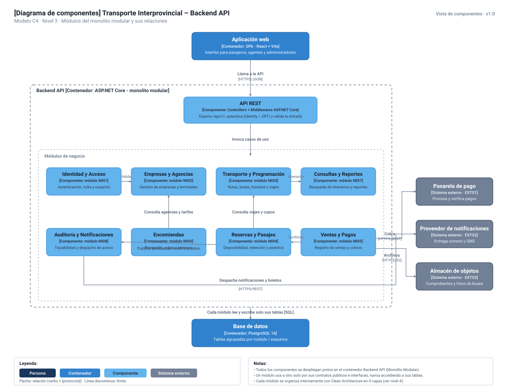

# Modelo C4 — Nivel 3: Diagrama de Componentes

## 1. Propósito

El Diagrama de Componentes (Nivel 3 del Modelo C4) descompone el contenedor **Backend API (Monolito Modular)** en sus componentes y módulos estructurales. Muestra la organización interna de los **ocho módulos de negocio (MI01–MI08)**, la capa de entrada **API REST**, las relaciones e interfaces entre módulos en memoria, y la comunicación con los sistemas externos y la base de datos relacional.

El objetivo es evidenciar el principio de **alta cohesión y bajo acoplamiento**: cada módulo gestiona su propia lógica de dominio y sus tablas en PostgreSQL, comunicándose con otros módulos únicamente a través de contratos e interfaces públicas, nunca accediendo a datos ajenos.

---

## 2. Diagrama de Componentes

*Figura 1. Diagrama de Componentes: Módulos del monolito modular y sus relaciones (C4 — Nivel 3).*

---

## 3. Componentes y Módulos de Negocio

| ID | Componente / Módulo | Tipo | Responsabilidad Principal |
|---|---|---|---|
| — | **API REST** | Controlador / Entrada | Expone endpoints HTTPS (`/api/v1`), aplica middlewares de autenticación (JWT/Identity), valida formatos de entrada y despacha a los casos de uso. |
| **MI01** | **Identidad y Acceso** | Módulo de Negocio | Autenticación, gestión de usuarios, roles, permisos y emisión de tokens. |
| **MI02** | **Empresas y Agencias** | Módulo de Negocio | Registro y administración de empresas de transporte, agencias, terminales y ámbito operativo. |
| **MI03** | **Transporte y Programación** | Módulo de Negocio | Gestión de rutas, destinos, unidades vehiculares, choferes, horarios, tarifas y viajes programados. |
| **MI07** | **Consultas y Reportes** | Módulo de Negocio | Búsqueda pública de itinerarios, disponibilidad general y reportes consolidados para administración. |
| **MI08** | **Auditoría y Notificaciones** | Módulo de Negocio | Registro cronológico inmutable de eventos críticos y despacho asíncrono de alertas/comunicaciones. |
| **MI06** | **Encomiendas** | Módulo de Negocio | Registro de solicitudes, pesaje, tarifas, despacho, seguimiento y entrega de encomiendas. |
| **MI04** | **Reservas y Pasajes** | Módulo de Negocio | Gestión de disponibilidad en tiempo real, retenciones temporales, asientos y emisión de pasajes evitando sobreventa. |
| **MI05** | **Ventas y Pagos** | Módulo de Negocio | Registro transaccional de ventas, coordinación con pasarela de pagos y confirmación de cobros verificados. |

---

## 4. Relaciones e Interacciones entre Módulos

Los módulos conviven en el mismo proceso de backend, pero respetan fronteras estrictas de código:

1. **API REST → Módulos de Negocio:** La capa de presentación recibe las peticiones HTTP e invoca los casos de uso correspondientes mediante inyección de dependencias de ASP.NET Core.
2. **Identidad y Acceso → Empresas y Agencias:** Valida la pertenencia de usuarios y permisos específicos por empresa y agencia (`Valida ámbito`).
3. **Reservas y Pasajes → Transporte y Programación:** Consulta la existencia de viajes programados, distribución de asientos y capacidad máxima (`Consulta viajes y cupos`).
4. **Ventas y Pagos → Reservas y Pasajes:** Tras confirmar la recepción y verificación de fondos, solicita cambiar el estado de la reserva a confirmada (`Confirma reserva`).
5. **Encomiendas → Empresas y Agencias:** Verifica las agencias habilitadas para recepción y despacho, así como las tarifas comerciales vigentes (`Consulta agencias y tarifas`).
6. **Módulos Transaccionales → Auditoría y Notificaciones:** Ante eventos críticos (creación de reserva, pago liquidado, despacho de encomienda), se publican eventos internos para auditoría y despacho de boletos digitales.

---

## 5. Integración con Contenedores y Sistemas Externos

* **Aplicación Web (SPA):** Cliente React que envía solicitudes REST autenticadas al componente API REST mediante HTTPS.
* **Base de Datos (PostgreSQL 16):** Cada módulo gestiona sus propias tablas relacionales mediante Entity Framework Core. Ningún módulo consulta directamente tablas pertenecientes a otro módulo.
* **Pasarela de Pago (EXT01):** El módulo de Ventas y Pagos solicita el cobro electrónico y procesa webhooks idempotentes con firma criptográfica.
* **Proveedor de Notificaciones (EXT02):** El módulo de Auditoría y Notificaciones encola solicitudes de envío de correos electrónicos y mensajes SMS/WhatsApp con los comprobantes y pasajes en formato digital.
* **Almacén de Objetos (EXT03):** Permite subir y almacenar archivos binarios (comprobantes digitalizados, guías de encomiendas y fotografías de buses).

---

## 6. Reglas de Diseño Arquitectónico

1. **Despliegue Unificado:** Todos los componentes se compilan y despliegan juntos dentro del contenedor Backend API (Monolito Modular).
2. **Aislamiento de Persistencia:** Un módulo accede a los datos de otro únicamente a través de su interfaz o servicio de aplicación público, nunca mediante consultas SQL cruzadas entre esquemas privados.
3. **Organización Interna:** Cada módulo implementa internamente el patrón Clean Architecture organizado en 4 capas (Presentación, Aplicación, Dominio e Infraestructura), tal como se detalla en el Nivel 4 (Diagrama de Código).
