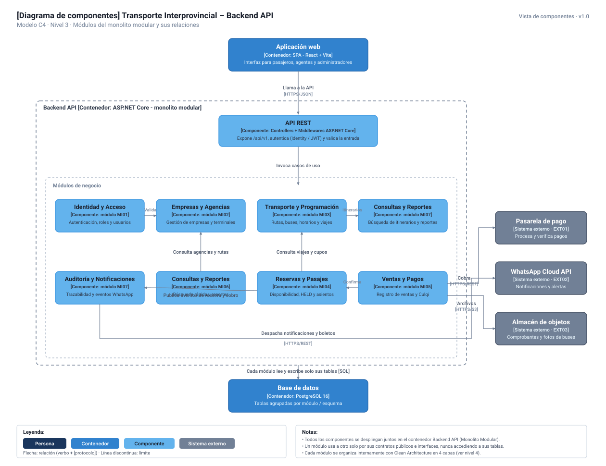

# Modelo C4 — Nivel 3: Diagrama de Componentes

## 1. Propósito

El Diagrama de Componentes (Nivel 3 del Modelo C4) descompone el contenedor **Backend API (Monolito Modular)** en sus componentes y módulos estructurales. Muestra la organización interna de los **siete módulos de negocio (MI01–MI07)**, la capa de entrada **API REST**, las relaciones e interfaces entre módulos en memoria, y la comunicación con los sistemas externos, la caché y la base de datos relacional.

El objetivo es evidenciar el principio de **alta cohesión y bajo acoplamiento**: cada módulo gestiona su propia lógica de dominio y sus tablas en PostgreSQL, comunicándose con otros módulos únicamente a través de contratos e interfaces públicas, nunca accediendo a datos ajenos.

---

## 2. Diagrama de Componentes

*Figura 1. Diagrama de Componentes: Módulos del monolito modular y sus relaciones (C4 — Nivel 3).*

---

## 3. Componentes y Módulos de Negocio

| ID | Componente / Módulo | Tipo | Responsabilidad Principal |
|---|---|---|---|
| — | **API REST** | Controlador / Entrada | Expone endpoints HTTPS (`/api/v1`), aplica middlewares de autenticación (JWT/Identity), valida formatos de entrada y despacha a los casos de uso. |
| **MI01** | **Identidad y Acceso** | Módulo de Negocio | Autenticación, gestión de usuarios, roles, permisos y emisión de tokens con claims de empresa y agencia. |
| **MI02** | **Empresas y Agencias** | Módulo de Negocio | Registro y administración de empresas de transporte, agencias, sucursales y asignaciones. |
| **MI03** | **Transporte y Programación** | Módulo de Negocio | Gestión de rutas, destinos, unidades vehiculares, choferes, horarios, tarifas y servicios programados. |
| **MI04** | **Reservas y Pasajes** | Módulo de Negocio | Gestión de disponibilidad en tiempo real, retenciones temporales (HELD por 10 min), control de concurrencia y emisión de pasajes. |
| **MI05** | **Ventas y Pagos** | Módulo de Negocio | Registro transaccional de ventas presenciales, integración con Culqi mediante adaptador y confirmación de cobros verificados. |
| **MI06** | **Consultas y Reportes** | Módulo de Negocio | Búsqueda pública de itinerarios con soporte de caché en Redis y reportes consolidados para administradores. |
| **MI07** | **Auditoría y Notificaciones** | Módulo de Negocio | Registro cronológico inmutable de eventos críticos y publicación en RabbitMQ para notificaciones vía WhatsApp. |

---

## 4. Relaciones e Interacciones entre Módulos

Los módulos conviven en el mismo proceso de backend, pero respetan fronteras estrictas de código:

1. **API REST → Módulos de Negocio:** La capa de presentación recibe las peticiones HTTP e invoca los casos de uso correspondientes mediante inyección de dependencias de ASP.NET Core.
2. **Identidad y Acceso → Empresas y Agencias:** Valida la pertenencia de usuarios y permisos específicos por empresa y agencia (`Valida ámbito organizacional`).
3. **Reservas y Pasajes → Transporte y Programación:** Consulta la existencia de viajes programados, distribución de asientos y capacidad máxima (`Consulta viajes y cupos`).
4. **Ventas y Pagos → Reservas y Pasajes:** Tras confirmar la recepción y verificación de fondos ante Culqi, solicita cambiar el estado de la reserva a confirmada (`Confirma reserva`).
5. **Módulos Transaccionales → Auditoría y Notificaciones:** Ante eventos críticos (creación de reserva, pago liquidado), se publican eventos internos para auditoría y despacho asíncrono de notificaciones.
6. **Consultas y Reportes → Transporte / Reservas:** Consulta itinerarios y disponibilidad para la visualización pública y reportes de ocupación.

---

## 5. Integración con Contenedores y Sistemas Externos

* **Aplicación Web (SPA):** Cliente React que envía solicitudes REST autenticadas al componente API REST mediante HTTPS.
* **Base de Datos (PostgreSQL 16):** Cada módulo gestiona sus propias tablas relacionales mediante Entity Framework Core con aislamiento lógico por empresa y agencia.
* **Caché (Redis):** El módulo de Consultas y Reportes consume y actualiza la caché de catálogos y rutas frecuentes para reducir latencia.
* **Cola de Mensajería (RabbitMQ):** El módulo de Auditoría y Notificaciones publica eventos para que los consumidores envíen mensajes de WhatsApp sin bloquear la transacción principal.
* **Pasarela de Pago (Culqi - EXT01):** El módulo de Ventas y Pagos solicita el cobro electrónico y procesa confirmaciones mediante `IPaymentGateway` / `CulqiPaymentAdapter`.
* **Proveedor de Notificaciones (WhatsApp Business Cloud API - EXT02):** Procesa el envío directo de boletos digitales, recordatorios y alertas preventivas.

---

## 6. Reglas de Diseño Arquitectónico

1. **Despliegue Unificado:** Todos los componentes se compilan y despliegan juntos dentro del contenedor Backend API (Monolito Modular).
2. **Aislamiento de Persistencia:** Un módulo accede a los datos de otro únicamente a través de su interfaz o servicio de aplicación público, nunca mediante consultas SQL cruzadas entre esquemas privados.
3. **Organización Interna:** Cada módulo implementa internamente el patrón Clean Architecture organizado en 4 capas (Presentación, Aplicación, Dominio e Infraestructura), tal como se detalla en el Nivel 4 (Diagrama de Código).
