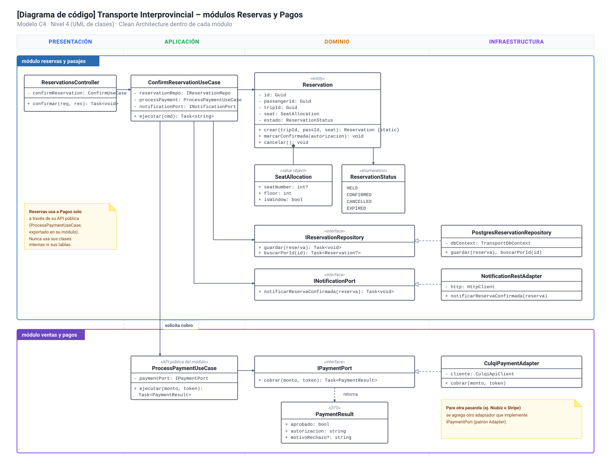
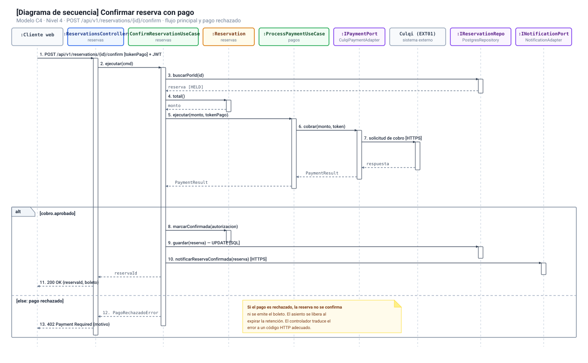

# Modelo C4 — Nivel 4: Diagrama de Código

## 1. Propósito

Esta vista describe clases, interfaces y métodos conceptuales de Reservas y Pasajes (MI04) y Ventas y Pagos (MI05). Los ejemplos son documentales; no afirman que el código esté implementado.

El control de concurrencia se realiza sobre `TripSeat` (DA02); **cero sobreventa** es un objetivo de diseño garantizado por ADR-07 y verificado mediante EQ-02.

## 2. Diagramas



La imagen referenciada contiene nombres e IDs previos y queda marcada como **pendiente de regenerar**; la lista está en el README.



La imagen referenciada contiene conceptos previos y queda marcada como **pendiente de regenerar**; la lista está en el README.

## 3. Contratos y componentes

### MI04 — Reservas y Pasajes

- `ConfirmReservationUseCase` coordina la confirmación; `CreateReservationUseCase`, `CancelReservationUseCase`, `RescheduleReservationUseCase` e `IssueTicketUseCase` cubren sus operaciones respectivas.
- `IReservationRepository` e `ISeatAvailabilityService` son interfaces de Aplicación. `ReservationRepository` (EF Core) es la implementación de persistencia en Infraestructura.
- `Reservation` expone `Create`, `Confirm`, `Cancel`, `Expire` y `Reschedule`. Una reserva puede agrupar varios `TripSeat`, cada uno asociado a un pasajero.
- Estados de reserva: `HELD`, `CONFIRMED`, `CANCELLED`, `EXPIRED`, `RESCHEDULED`.

### MI05 — Ventas y Pagos

- `ProcessPaymentUseCase` usa `IPaymentGateway` (interfaz en Aplicación); `CulqiPaymentAdapter` la implementa en Infraestructura.
- Culqi Checkout entrega el token; el backend crea el cargo y verifica la respuesta. Webhooks HMAC reconcilian idempotentemente por `charge_id`.
- Estados de pago: `PENDING`, `APPROVED`, `REJECTED`, `ERROR`, `REFUNDED`.
- `INotificationGateway` es el contrato de Aplicación; `WhatsAppNotificationAdapter` es su implementación en Infraestructura. Outbox y RabbitMQ despachan notificaciones asíncronas.
- Estados de pasaje: `ISSUED`, `USED`, `VOIDED`.

Toda integración externa y persistencia se accede mediante interfaz en Aplicación e implementación en Infraestructura.

## 4. Patrones de diseño

| Código | Patrón | Clase / interfaz | Aplicación |
|---|---|---|---|
| PD01 | Repository | `IReservationRepository` / `ReservationRepository` | Persistencia EF Core desacoplada. |
| PD02 | Dependency Injection | Contenedor IoC | Conecta contratos y adaptadores. |
| PD03 | Strategy | `ICancellationPolicy` | Políticas por anticipación, pendientes de validación comercial. |
| PD04 | Adapter | `IPaymentGateway` / `CulqiPaymentAdapter`; `INotificationGateway` / `WhatsAppNotificationAdapter` | Aísla proveedores externos. |
| PD05 | Factory Method | `Reservation.Create(...)` | Crea reservas válidas. |

## 5. Ejemplo de dominio

```csharp
public enum ReservationStatus
{
    HELD, CONFIRMED, CANCELLED, EXPIRED, RESCHEDULED
}

public sealed class Reservation
{
    public ReservationStatus Status { get; private set; }
    public IReadOnlyCollection<TripSeat> Seats => _seats;

    public static Reservation Create(IEnumerable<TripSeat> seats)
    {
        // Valida que haya asientos numerados y crea la retención digital.
        throw new NotImplementedException();
    }

    public void Confirm() { /* transición de dominio */ }
    public void Cancel() { /* transición de dominio */ }
    public void Expire() { /* libera los TripSeat retenidos */ }
    public void Reschedule() { /* política comercial por validar */ }
}
```

El fragmento ilustra el vocabulario canónico, no es código ejecutable.

## 6. Concurrencia e idempotencia

La asignación bloquea las filas de `TripSeat` con `SELECT ... FOR UPDATE`; un índice único parcial sobre `trip_seat_id` impide reservas activas duplicadas para estados `HELD` y `CONFIRMED`. Un `BackgroundService` expira retenciones cada 10 segundos usando `FOR UPDATE SKIP LOCKED`.

Las ventas digitales retienen asientos por 10 minutos. El agente registra pago presencial (efectivo, Yape/Plin o POS) y confirma directamente. Si una aprobación Culqi llega tras expirar la retención, solo se confirma si todos los asientos siguen libres; de lo contrario el pago queda `REFUNDED`.

La notificación se escribe mediante Outbox en la transacción y se publica asíncronamente; no se realiza una llamada síncrona al proveedor dentro del caso de uso transaccional.
