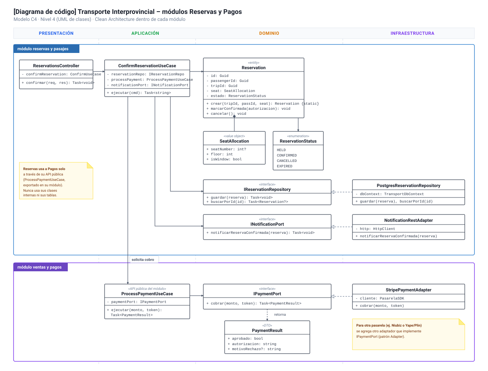
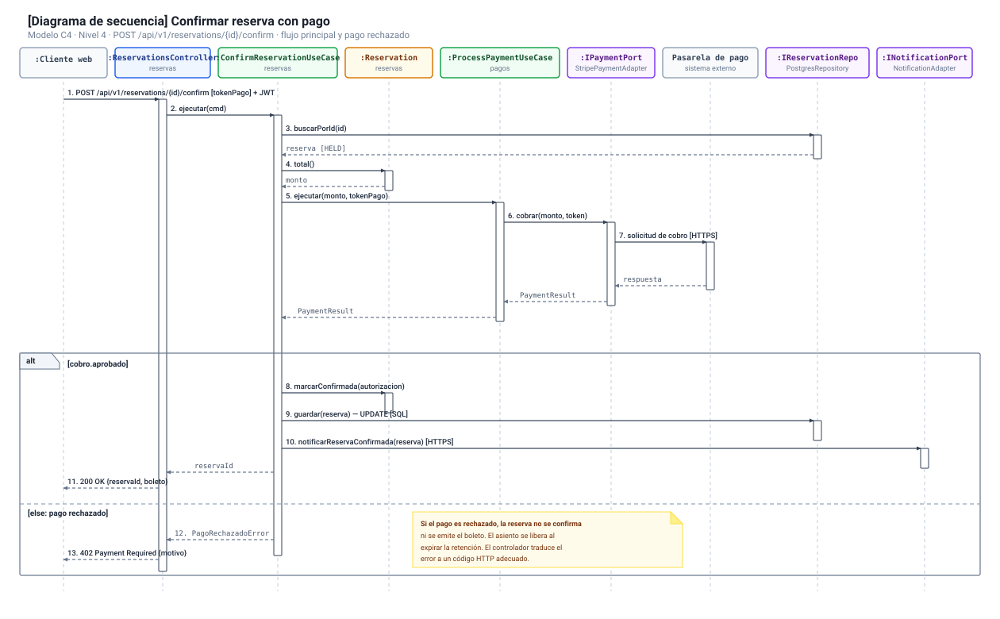

# Modelo C4 — Nivel 4: Diagrama de Código

## 1. Propósito

El Diagrama de Código (Nivel 4 del Modelo C4) ofrece el mayor nivel de detalle técnico, mostrando cómo se implementan los componentes de software en términos de clases, interfaces, métodos y relaciones en código fuente.

En este documento se profundiza en el subsistema transaccional más crítico de la plataforma: la interacción entre el módulo **Reservas y Pasajes (MI04)** y el módulo **Ventas y Pagos (MI05)**. Se detalla la implementación en C# (.NET 8) siguiendo los principios de **Clean Architecture** (organizada en capas de Presentación, Aplicación, Dominio e Infraestructura), el uso de **patrones de diseño** (Repository, Adapter, Factory, Strategy), el **diagrama de secuencia** del flujo de confirmación y cobro, y los mecanismos de **control de concurrencia** requeridos para evitar la sobreventa de asientos (DA01).

---

## 2. Diagrama de Clases

El siguiente diagrama modela la estructura de clases, interfaces y tipos principales organizados por capas de Clean Architecture dentro de cada módulo:



*Figura 1. Diagrama de Clases de los módulos Reservas y Pasajes y Ventas y Pagos según Clean Architecture (C4 — Nivel 4).*

---

## 3. Diagrama de Secuencia: Confirmar Reserva con Pago

El siguiente diagrama de secuencia detalla la colaboración cronológica entre controladores, casos de uso, entidades de dominio, repositorios y la pasarela de pagos ante la solicitud `POST /api/v1/reservations/{id}/confirm`, contemplando tanto el flujo principal exitoso como el escenario alternativo de pago rechazado:



*Figura 2. Diagrama de Secuencia del flujo de confirmación de reserva y procesamiento de pago (C4 — Nivel 4).*

---

## 4. Descripción de Componentes y Clases

### 4.1. Módulo Reservas y Pasajes (MI04)

#### `ReservationsController` (Presentación)
* Recibe solicitudes HTTP REST (`POST /api/v1/reservations/{id}/confirm`), extrae tokens JWT y DTOs de entrada.
* Invoca a `ConfirmReservationUseCase` y traduce los resultados a códigos de estado HTTP (200 OK, 400 Bad Request, 402 Payment Required, 404 Not Found).

#### `ConfirmReservationUseCase` (Aplicación)
* Orquesta la confirmación de la reserva:
  1. Recupera la reserva desde `IReservationRepository`.
  2. Verifica que la reserva se encuentre en estado `Held` y dentro del tiempo de vigencia.
  3. Solicita el cobro invocando a la API pública del módulo de pagos (`ProcessPaymentUseCase`).
  4. Si el pago es aprobado, ejecuta `reserva.marcarConfirmada(autorizacion)`.
  5. Persiste el estado actualizado en PostgreSQL mediante el repositorio.
  6. Despacha la notificación del boleto mediante `INotificationPort`.

#### `Reservation` (Dominio — Entidad Raíz de Agregado)
* Encapsula el ciclo de vida y las reglas invariantes de negocio:
  * No permite confirmar reservas que ya hayan vencido o hayan sido canceladas.
  * Protege sus atributos permitiendo mutaciones de estado solo a través de métodos de negocio (`marcarConfirmada`, `cancelar`).

#### `SeatAllocation` (Dominio — Objeto de Valor)
* Representa la asignación de un asiento (`seatNumber`, `floor`, `isWindow`), siendo inmutable por diseño.

#### `ReservationStatus` (Dominio — Enumeración)
* Define los cuatro estados válidos: `HELD` (retención temporal), `CONFIRMED` (pagada y emitida), `CANCELLED` (cancelada) y `EXPIRED` (retención vencida sin pago).

#### `IReservationRepository` (Dominio / Aplicación — Puerto)
* Define los métodos de persistencia desacoplados de la tecnología de base de datos (`guardar`, `buscarPorId`).

#### `PostgresReservationRepository` (Infraestructura — Adaptador)
* Implementa `IReservationRepository` utilizando Entity Framework Core 8 y Npgsql. Aplica bloqueos pesimistas (`SELECT ... FOR UPDATE`) para evitar carreras críticas (race conditions).

---

### 4.2. Módulo Ventas y Pagos (MI05)

#### `ProcessPaymentUseCase` (Aplicación — API Pública del Módulo)
* Expone la funcionalidad de cobro como API pública del módulo hacia otros módulos del backend.
* Invoca `IPaymentPort.cobrar(monto, token)` y retorna un DTO desacoplado `PaymentResult`.

#### `IPaymentPort` (Dominio / Aplicación — Puerto)
* Define el contrato para procesar cobros electrónicos, aislando la lógica de negocio de los detalles de proveedores específicos.

#### `StripePaymentAdapter` (Infraestructura — Adaptador)
* Implementa `IPaymentPort` adaptando las llamadas hacia el SDK o API REST del proveedor de pagos externo (Stripe, Culqi o Niubiz).

---

## 5. Patrones de Diseño Implementados

| Código | Patrón | Clase / Interfaz Implicada | Justificación y Aplicación |
|---|---|---|---|
| **PD01** | **Repository** | `IReservationRepository` y `PostgresReservationRepository` | Desacopla la lógica de negocio de las consultas de Entity Framework Core y PostgreSQL. Permite crear pruebas unitarias mediante mocks. |
| **PD02** | **Dependency Injection** | ASP.NET Core IoC Container (`IServiceCollection`) | Conecta controladores, casos de uso, puertos y adaptadores sin dependencias rígidas ni acoplamiento directo. |
| **PD03** | **Strategy** | `IAvailabilityStrategy`, `NumberedSeatStrategy`, `QuotaSeatStrategy` | Permite alternar la regla de validación de disponibilidad dinámicamente según la modalidad del bus (asientos fijos o cupo abierto). |
| **PD04** | **Adapter** | `StripePaymentAdapter` : `IPaymentPort` | Adapta la API externa de la pasarela de pagos a un contrato interno de la aplicación, aislando el dominio de cambios del proveedor. |
| **PD05** | **Factory Method** | `Reservation.crear(...)` | Garantiza que ninguna entidad `Reservation` sea instanciada en un estado inválido o incompleto. |

---

## 6. Fragmentos de Código de Referencia (.NET 8 / C#)

### 6.1. Entidad de Dominio: `Reservation.cs`

```csharp
namespace TransportPlatform.Modules.Reservations.Domain;

public sealed class Reservation
{
    public Guid Id { get; private set; }
    public Guid TripId { get; private set; }
    public Guid PassengerId { get; private set; }
    public int? SeatNumber { get; private set; }
    public ReservationStatus Status { get; private set; }
    public DateTime HeldUntil { get; private set; }
    public DateTime CreatedAt { get; private set; }

    private Reservation() { }

    public static Reservation Crear(
        Guid tripId,
        Guid passengerId,
        int? seatNumber,
        int holdDurationMinutes = 10)
    {
        if (tripId == Guid.Empty)
            throw new ArgumentException("El viaje es obligatorio.", nameof(tripId));

        if (passengerId == Guid.Empty)
            throw new ArgumentException("El pasajero es obligatorio.", nameof(passengerId));

        return new Reservation
        {
            Id = Guid.NewGuid(),
            TripId = tripId,
            PassengerId = passengerId,
            SeatNumber = seatNumber,
            Status = ReservationStatus.Held,
            HeldUntil = DateTime.UtcNow.AddMinutes(holdDurationMinutes),
            CreatedAt = DateTime.UtcNow
        };
    }

    public void MarcarConfirmada(string codigoAutorizacion)
    {
        if (Status != ReservationStatus.Held)
            throw new InvalidOperationException("Solo se pueden confirmar reservas retenidas.");

        if (EstaVencida())
            throw new InvalidOperationException("La retención temporal ha vencido.");

        Status = ReservationStatus.Confirmed;
    }

    public void Cancelar()
    {
        if (Status == ReservationStatus.Cancelled || Status == ReservationStatus.Expired)
            throw new InvalidOperationException("La reserva ya se encuentra cancelada o vencida.");

        Status = ReservationStatus.Cancelled;
    }

    public bool EstaVencida() =>
        Status == ReservationStatus.Held && DateTime.UtcNow > HeldUntil;
}
```

---

### 6.2. Caso de Uso: `ConfirmReservationUseCase.cs`

```csharp
namespace TransportPlatform.Modules.Reservations.Application.UseCases;

using TransportPlatform.Modules.Reservations.Application.Contracts;
using TransportPlatform.Modules.Reservations.Domain;
using TransportPlatform.Modules.SalesPayments.Application.UseCases;

public sealed class ConfirmReservationUseCase
{
    private readonly IReservationRepository _repository;
    private readonly ProcessPaymentUseCase _paymentService;
    private readonly INotificationPort _notificationService;

    public ConfirmReservationUseCase(
        IReservationRepository repository,
        ProcessPaymentUseCase paymentService,
        INotificationPort notificationService)
    {
        _repository = repository;
        _paymentService = paymentService;
        _notificationService = notificationService;
    }

    public async Task<string> EjecutarAsync(
        Guid reservationId,
        decimal monto,
        string tokenPago,
        CancellationToken ct = default)
    {
        // 1. Obtener la reserva
        var reservation = await _repository.BuscarPorIdAsync(reservationId, ct)
            ?? throw new KeyNotFoundException("Reserva no encontrada.");

        // 2. Verificar que no haya expirado
        if (reservation.EstaVencida())
            throw new InvalidOperationException("La retención de la reserva ha expirado.");

        // 3. Procesar cobro mediante API pública del módulo de pagos
        var resultadoCobro = await _paymentService.EjecutarAsync(monto, tokenPago, ct);
        if (!resultadoCobro.Aprobado)
            throw new InvalidOperationException($"Pago rechazado: {resultadoCobro.MotivoRechazo}");

        // 4. Confirmar reserva en dominio
        reservation.MarcarConfirmada(resultadoCobro.Autorizacion);

        // 5. Persistir estado confirmado
        await _repository.GuardarAsync(reservation, ct);

        // 6. Notificar emisión de boleto (desacoplado)
        await _notificationService.NotificarReservaConfirmadaAsync(reservation, ct);

        return reservation.Id.ToString();
    }
}
```

---

## 7. Control de Concurrencia y Transacciones en PostgreSQL

Para satisfacer el requerimiento arquitectónico crítico **DA01 (Consistencia de Reservas sin sobreventa)**, el repositorio implementa dos mecanismos complementarios:

1. **Bloqueo Pesimista a Nivel de Fila:** Se bloquea el registro del viaje o asiento durante la transacción con `FOR UPDATE`, asegurando que solicitudes simultáneas provenientes de dos pasajeros distintos para el mismo asiento sean serializadas por el motor de base de datos.
2. **Restricción de Exclusión / Índice Único Parcial:** En PostgreSQL se define un índice único condicional:
   ```sql
   CREATE UNIQUE INDEX idx_unique_active_seat ON reservations (trip_id, seat_number)
   WHERE status IN ('Held', 'Confirmed');
   ```
   Esta restricción a nivel de base de datos actúa como salvaguarda definitiva en caso de cualquier concurrencia imprevista en la aplicación, garantizando que el motor físico rechace cualquier intento duplicado mediante un error de violación de restricción única (`unique_violation`).
