# Modelo C4 — Nivel 4: Diagrama de Código

## 1. Propósito

El Diagrama de Código (Nivel 4 del Modelo C4) ofrece el mayor nivel de detalle técnico, mostrando cómo se implementan los componentes de software en términos de clases, interfaces, métodos y relaciones en código fuente.

En este documento se profundiza en el subsistema transaccional más crítico de la plataforma: el módulo **Reservas y Pasajes (MI04)**. Se detalla la implementación en C# (.NET 8) siguiendo los principios de **Clean Architecture**, el uso de **patrones de diseño** (Repository, Strategy, Adapter, Factory) y los mecanismos de **control de concurrencia** requeridos para evitar la sobreventa de asientos (DA01).

---

## 2. Diagrama de Clases

El siguiente diagrama modela la estructura de clases, interfaces y tipos principales que componen el flujo de creación y confirmación de reservas:

```mermaid
classDiagram
    direction TB

    class ReservationStatus {
        <<enumeration>>
        Held
        Confirmed
        Cancelled
        Expired
    }

    class Reservation {
        -Guid id
        -Guid tripId
        -Guid passengerId
        -int? seatNumber
        -ReservationStatus status
        -DateTime heldUntil
        -DateTime createdAt
        +Guid Id
        +Guid TripId
        +Guid PassengerId
        +int? SeatNumber
        +ReservationStatus Status
        +DateTime HeldUntil
        +Create(tripId: Guid, passengerId: Guid, seatNumber: int?, holdMinutes: int) Reservation
        +Confirm() void
        +Cancel() void
        +IsExpired() bool
    }

    class IReservationRepository {
        <<interface>>
        +GetByIdAsync(id: Guid, ct: CancellationToken) Task~Reservation~
        +AddAsync(reservation: Reservation, ct: CancellationToken) Task
        +UpdateAsync(reservation: Reservation, ct: CancellationToken) Task
        +IsSeatAvailableAsync(tripId: Guid, seatNumber: int, ct: CancellationToken) Task~bool~
        +GetActiveHoldsCountAsync(tripId: Guid, ct: CancellationToken) Task~int~
    }

    class IAvailabilityStrategy {
        <<interface>>
        +CheckAndHoldAsync(tripId: Guid, seatNumber: int?, ct: CancellationToken) Task~bool~
    }

    class NumberedSeatStrategy {
        -IReservationRepository repository
        +NumberedSeatStrategy(repository: IReservationRepository)
        +CheckAndHoldAsync(tripId: Guid, seatNumber: int?, ct: CancellationToken) Task~bool~
    }

    class QuotaSeatStrategy {
        -IReservationRepository repository
        -int totalTripQuota
        +QuotaSeatStrategy(repository: IReservationRepository, totalTripQuota: int)
        +CheckAndHoldAsync(tripId: Guid, seatNumber: int?, ct: CancellationToken) Task~bool~
    }

    class IAvailabilityService {
        <<interface>>
        +EnsureAvailabilityAsync(tripId: Guid, seatNumber: int?, ct: CancellationToken) Task~bool~
    }

    class AvailabilityService {
        -IEnumerable~IAvailabilityStrategy~ strategies
        +AvailabilityService(strategies: IEnumerable~IAvailabilityStrategy~)
        +EnsureAvailabilityAsync(tripId: Guid, seatNumber: int?, ct: CancellationToken) Task~bool~
    }

    class CreateReservation {
        -IAvailabilityService availabilityService
        -IReservationRepository repository
        +CreateReservation(availabilityService: IAvailabilityService, repository: IReservationRepository)
        +ExecuteAsync(tripId: Guid, passengerId: Guid, seatNumber: int?, ct: CancellationToken) Task~Guid~
    }

    class ConfirmReservation {
        -IReservationRepository repository
        -IPaymentGatewayService paymentGateway
        +ConfirmReservation(repository: IReservationRepository, paymentGateway: IPaymentGatewayService)
        +ExecuteAsync(reservationId: Guid, paymentTransactionId: string, ct: CancellationToken) Task~bool~
    }

    class IPaymentGatewayService {
        <<interface>>
        +VerifyPaymentAsync(transactionId: string, ct: CancellationToken) Task~bool~
    }

    class ReservationRepository {
        -TransportDbContext dbContext
        +ReservationRepository(dbContext: TransportDbContext)
        +GetByIdAsync(id: Guid, ct: CancellationToken) Task~Reservation~
        +AddAsync(reservation: Reservation, ct: CancellationToken) Task
        +UpdateAsync(reservation: Reservation, ct: CancellationToken) Task
        +IsSeatAvailableAsync(tripId: Guid, seatNumber: int, ct: CancellationToken) Task~bool~
        +GetActiveHoldsCountAsync(tripId: Guid, ct: CancellationToken) Task~int~
    }

    class ReservationsController {
        -CreateReservation createUseCase
        -ConfirmReservation confirmUseCase
        +ReservationsController(createUseCase: CreateReservation, confirmUseCase: ConfirmReservation)
        +Create(request: CreateReservationRequest, ct: CancellationToken) Task~IActionResult~
        +Confirm(id: Guid, request: ConfirmPaymentRequest, ct: CancellationToken) Task~IActionResult~
    }

    class CreateReservationRequest {
        +Guid TripId
        +Guid PassengerId
        +int? SeatNumber
    }

    %% Relaciones
    Reservation --> ReservationStatus
    CreateReservation ..> Reservation : crea instancia
    CreateReservation --> IAvailabilityService
    CreateReservation --> IReservationRepository
    ConfirmReservation --> IReservationRepository
    ConfirmReservation --> IPaymentGatewayService

    AvailabilityService ..|> IAvailabilityService
    AvailabilityService --> IAvailabilityStrategy
    NumberedSeatStrategy ..|> IAvailabilityStrategy
    QuotaSeatStrategy ..|> IAvailabilityStrategy
    NumberedSeatStrategy --> IReservationRepository
    QuotaSeatStrategy --> IReservationRepository

    ReservationRepository ..|> IReservationRepository
    ReservationsController --> CreateReservation
    ReservationsController --> ConfirmReservation
    ReservationsController ..> CreateReservationRequest
```



---

## 3. Descripción de Componentes y Clases

### 3.1. Capa de Dominio

#### `Reservation` (Entidad Raíz de Agregado)
* Representa el estado y ciclo de vida de una reserva de transporte.
* Implementa encapsulamiento mediante constructores privados y métodos de factoría estáticos (`Factory Method`).
* Controla las transiciones de estado válidas impidiendo alteraciones indebidas:
  * Solo puede confirmarse si se encuentra en estado `Held` y dentro de su ventana de retención (`heldUntil > DateTime.UtcNow`).
  * Solo puede cancelarse si está en estado `Held` o `Confirmed`.

#### `ReservationStatus` (Enumeración)
* Define los cuatro estados oficiales del ciclo de vida:
  * `Held`: Asiento temporalmente bloqueado a la espera de pago (ej. 10 minutos).
  * `Confirmed`: Pago verificado y pasaje emitido.
  * `Cancelled`: Reserva cancelada por solicitud del usuario o agente.
  * `Expired`: Retención temporal caducada automáticamente por falta de pago.

---

### 3.2. Capa de Aplicación

#### `CreateReservation` (Caso de Uso)
* Orquesta la creación de una reserva temporal:
  1. Recibe identificadores y valida entradas.
  2. Invoca `IAvailabilityService` para confirmar que el asiento o cupo esté disponible.
  3. Crea la entidad de dominio `Reservation` con una retención de 10 minutos.
  4. Persiste la reserva mediante `IReservationRepository`.
  5. Retorna el identificador generado (`Guid`).

#### `ConfirmReservation` (Caso de Uso)
* Orquesta la confirmación tras el cobro exitoso:
  1. Recupera la reserva desde `IReservationRepository`.
  2. Verifica con `IPaymentGatewayService` que la transacción externa esté realmente liquidada y sea legítima (evitando confirmaciones falsas).
  3. Ejecuta `reservation.Confirm()`.
  4. Persiste el nuevo estado de manera transaccional.

#### `IAvailabilityStrategy` (Patrón Strategy)
* Interfaz que abstrae la regla de verificación de capacidad según la modalidad del servicio:
  * `NumberedSeatStrategy`: Verifica mediante consulta con bloqueo que el número de asiento específico no tenga una reserva activa (`Held` o `Confirmed`).
  * `QuotaSeatStrategy`: Verifica que la suma total de asientos ocupados más retenciones activas no supere la capacidad total del bus asignado al viaje.

---

### 3.3. Capa de Infraestructura

#### `ReservationRepository` (Implementación con Entity Framework Core)
* Implementa `IReservationRepository` utilizando `TransportDbContext`.
* Para prevenir condiciones de carrera (Race Conditions), implementa transacciones con aislamiento y bloqueos a nivel de fila de PostgreSQL:
  ```csharp
  // Ejemplo conceptual de consulta con bloqueo pesimista en EF Core:
  await _dbContext.Database.ExecuteSqlRawAsync(
      "SELECT id FROM trips WHERE id = {0} FOR UPDATE", tripId);
  ```

---

## 4. Patrones de Diseño Implementados

| Código | Patrón | Clase / Interfaz Implicada | Justificación y Aplicación |
|---|---|---|---|
| **PD01** | **Repository** | `IReservationRepository` y `ReservationRepository` | Desacopla la lógica de negocio de las consultas de Entity Framework Core y PostgreSQL. Permite crear pruebas unitarias mediante mocks. |
| **PD02** | **Dependency Injection** | ASP.NET Core IoC Container (`IServiceCollection`) | Inyecta automáticamente casos de uso y repositorios en controladores y servicios mediante interfaces. |
| **PD03** | **Strategy** | `IAvailabilityStrategy`, `NumberedSeatStrategy`, `QuotaSeatStrategy` | Permite alternar la regla de validación de disponibilidad dinámicamente según la modalidad del bus (asientos fijos o cupo abierto). |
| **PD04** | **Adapter** | `PaymentGatewayAdapter` : `IPaymentGatewayService` | Adapta la API externa de la pasarela de pagos a un contrato interno de la aplicación, aislando el dominio de cambios del proveedor. |
| **PD05** | **Factory Method** | `Reservation.Create(...)` | Garantiza que ninguna entidad `Reservation` sea instanciada en un estado inválido o incompleto. |

---

## 5. Fragmentos de Código de Referencia (.NET 8 / C#)

### 5.1. Entidad de Dominio: `Reservation.cs`

```csharp
namespace TransportPlatform.Modules.Reservations.Domain;

public sealed class Reservation
{
    public Guid Id { get; private set; }
    public Guid TripId { get; private set; }
    public Guid PassengerId { get; private set; }
    public int? SeatNumber { get; private set; }
    public ReservationStatus Status { get; private set; }
    public DateTime HeldUntil { get; private set; }
    public DateTime CreatedAt { get; private set; }

    private Reservation() { }

    public static Reservation Create(
        Guid tripId,
        Guid passengerId,
        int? seatNumber,
        int holdDurationMinutes = 10)
    {
        if (tripId == Guid.Empty)
            throw new ArgumentException("El viaje es obligatorio.", nameof(tripId));

        if (passengerId == Guid.Empty)
            throw new ArgumentException("El pasajero es obligatorio.", nameof(passengerId));

        return new Reservation
        {
            Id = Guid.NewGuid(),
            TripId = tripId,
            PassengerId = passengerId,
            SeatNumber = seatNumber,
            Status = ReservationStatus.Held,
            HeldUntil = DateTime.UtcNow.AddMinutes(holdDurationMinutes),
            CreatedAt = DateTime.UtcNow
        };
    }

    public void Confirm()
    {
        if (Status != ReservationStatus.Held)
            throw new InvalidOperationException("Solo se pueden confirmar reservas retenidas.");

        if (IsExpired())
            throw new InvalidOperationException("La retención temporal ha vencido.");

        Status = ReservationStatus.Confirmed;
    }

    public void Cancel()
    {
        if (Status == ReservationStatus.Cancelled || Status == ReservationStatus.Expired)
            throw new InvalidOperationException("La reserva ya se encuentra cancelada o vencida.");

        Status = ReservationStatus.Cancelled;
    }

    public bool IsExpired() =>
        Status == ReservationStatus.Held && DateTime.UtcNow > HeldUntil;
}
```

---

### 5.2. Caso de Uso: `CreateReservation.cs`

```csharp
namespace TransportPlatform.Modules.Reservations.Application.UseCases;

using TransportPlatform.Modules.Reservations.Application.Contracts;
using TransportPlatform.Modules.Reservations.Domain;

public sealed class CreateReservation
{
    private readonly IAvailabilityService _availabilityService;
    private readonly IReservationRepository _repository;

    public CreateReservation(
        IAvailabilityService availabilityService,
        IReservationRepository repository)
    {
        _availabilityService = availabilityService;
        _repository = repository;
    }

    public async Task<Guid> ExecuteAsync(
        Guid tripId,
        Guid passengerId,
        int? seatNumber,
        CancellationToken cancellationToken = default)
    {
        // 1. Verificar disponibilidad según modalidad (Strategy)
        bool isAvailable = await _availabilityService.EnsureAvailabilityAsync(
            tripId, seatNumber, cancellationToken);

        if (!isAvailable)
        {
            throw new InvalidOperationException(
                "El asiento o cupo solicitado no se encuentra disponible.");
        }

        // 2. Crear entidad en dominio
        var reservation = Reservation.Create(tripId, passengerId, seatNumber);

        // 3. Persistir de forma transaccional con control de concurrencia
        await _repository.AddAsync(reservation, cancellationToken);

        return reservation.Id;
    }
}
```

---

### 5.3. Controlador REST: `ReservationsController.cs`

```csharp
namespace TransportPlatform.Modules.Reservations.Presentation;

using Microsoft.AspNetCore.Mvc;
using Microsoft.AspNetCore.Authorization;
using TransportPlatform.Modules.Reservations.Application.UseCases;
using TransportPlatform.Modules.Reservations.Application.DTOs;

[ApiController]
[Route("api/v1/reservations")]
[Authorize]
public sealed class ReservationsController : ControllerBase
{
    private readonly CreateReservation _createReservation;
    private readonly ConfirmReservation _confirmReservation;

    public ReservationsController(
        CreateReservation createReservation,
        ConfirmReservation confirmReservation)
    {
        _createReservation = createReservation;
        _confirmReservation = confirmReservation;
    }

    [HttpPost]
    public async Task<IActionResult> Create(
        [FromBody] CreateReservationRequest request,
        CancellationToken ct)
    {
        try
        {
            var reservationId = await _createReservation.ExecuteAsync(
                request.TripId,
                request.PassengerId,
                request.SeatNumber,
                ct);

            return CreatedAtAction(
                nameof(Create),
                new { id = reservationId },
                new { id = reservationId, status = "Held" });
        }
        catch (InvalidOperationException ex)
        {
            return Conflict(new { error = ex.Message });
        }
    }
}
```

---

## 6. Control de Concurrencia y Transacciones en PostgreSQL

Para satisfacer el requerimiento arquitectónico crítico **DA01 (Consistencia de Reservas sin sobreventa)**, el método `AddAsync` en el repositorio ejecuta una transacción explícita en PostgreSQL:

1. **Bloqueo Pesimista a Nivel de Fila:** Se bloquea el registro del viaje o asiento durante la transacción con `FOR UPDATE`, asegurando que solicitudes simultáneas provenientes de dos pasajeros distintos para el mismo asiento sean serializadas por el motor de base de datos.
2. **Restricción Exclusión / Índice Único Parcial:** En PostgreSQL se define un índice único condicional:
   ```sql
   CREATE UNIQUE INDEX idx_unique_active_seat ON reservations (trip_id, seat_number)
   WHERE status IN ('Held', 'Confirmed');
   ```
   Esta restricción a nivel de base de datos actúa como salvaguarda definitiva en caso de cualquier eventualidad en la aplicación, garantizando que el motor de base de datos rechace a nivel físico cualquier intento duplicado con un error de violación de clave única.
